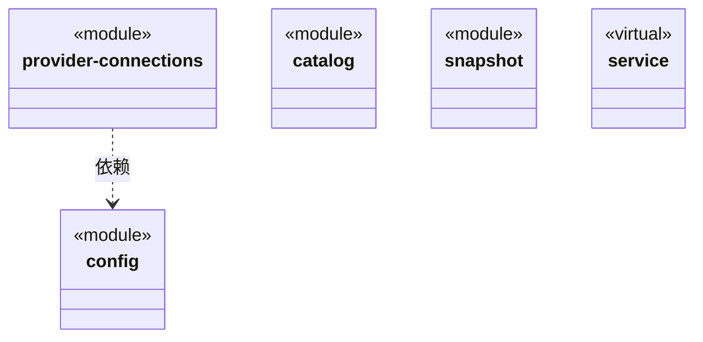

# src/logic/models 架构

## 设计意图

定义模型目录、供应商连接和公开配置协议。便携入口负责选择与快照表达，service 封装配置持久化及凭据处理；请求预算由独立预算模块管理。

## 主要组成

| 组成 | 定位 |
| --- | --- |
| [catalog](catalog.ts) | 解析供应商模型目录的能力资料，供新增模型和显式同步容量使用。 |
| [config](config.ts) | 定义自定义供应商的生成与向量模型目录，保持旧生成配置字节与字段缺省。 |
| [provider-connections](provider-connections.ts) | 供应商到协议需求的纯接口选择规则，供界面筛选、岗位采纳和实际启动共同使用。 |
| [snapshot](snapshot.ts) | 生成模型公开运行快照的纯校验，供引擎角色绑定与岗位历史共同使用。 |

<!-- architecture:generated:start -->

## 架构关系

标注为 `virtual` 的节点是直接子模块的虚拟类封装；内部设计沿下方入口阅读。

## 子模块

| 虚拟封装 | 整体职责 |
| --- | --- |
| [service](service/ARCHITECTURE.md) | LlmProfiles 配置持久化、生成/向量操作公开快照、受控锁内原子选型与延迟解密；index.ts 仅向宿主提供服务，平台加密由端口注入。 |

[上层设计](../ARCHITECTURE.md)

<!-- architecture:generated:end -->
