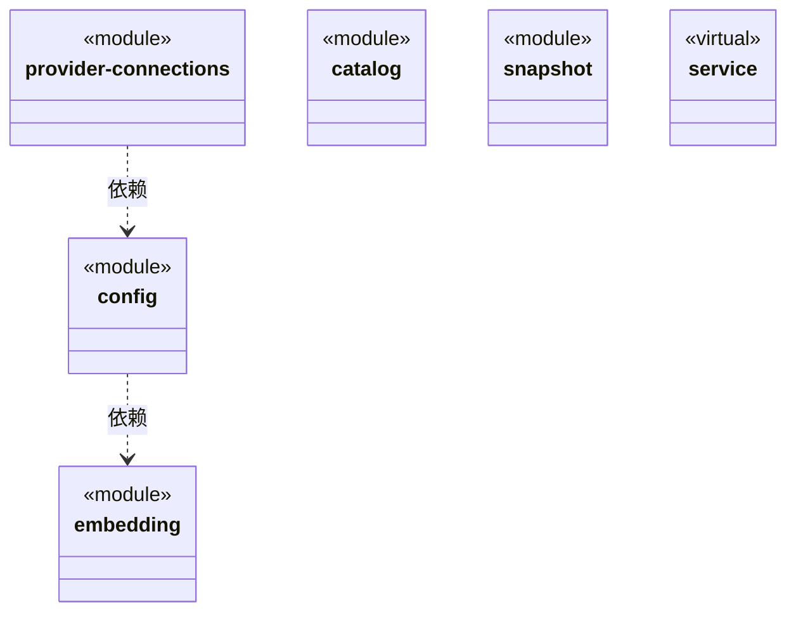

# src/logic/models 架构

## 设计意图

管理供应商连接、生成与向量模型目录及公开快照，使模型能力独立于具体 Agent 引擎。

本层纯规则解析端点、能力和协议选择，`service` 保存配置并在锁内捕获执行快照。生成与向量参数分别表达，公开快照不携带凭据；请求预占和结算归 budget，运行包选择归 engines。

## 主要组成

| 组成 | 定位 |
| --- | --- |
| [catalog](catalog.ts) | 解析供应商模型目录的能力资料，供新增模型和显式同步容量使用。 |
| [config](config.ts) | 定义自定义供应商的生成与向量模型目录，保持旧生成配置字节与字段缺省。 |
| [provider-connections](provider-connections.ts) | 供应商到协议需求的纯接口选择规则，供界面筛选、岗位采纳和实际启动共同使用。 |
| [snapshot](snapshot.ts) | 生成模型公开运行快照的纯校验，供引擎角色绑定与岗位历史共同使用。 |
| [embedding](embedding.ts) | 向量模型的独立配置与公开快照，不套用生成输出预算字段。 |

## 现状与目标边界

当前配置、端点、协议选择和快照规则直接在父层，service 独立管理配置状态。目标是按公开模型协议和无状态选择规则聚合，保留纯入口与宿主服务入口分离；尚未创建新的子目录。迁移需保持生成与向量参数差异、历史字段缺省和模型服务唯一配置锁，不能为引擎消费者复制配置状态。

<!-- architecture:generated:start -->

## 架构关系

标注为 `virtual` 的节点是直接子模块的虚拟类封装；内部设计沿下方入口阅读。

## 子模块

| 虚拟封装 | 整体职责 |
| --- | --- |
| [service](service/ARCHITECTURE.md) | 持久管理模型供应商配置，并在一致配置版本下解析运行连接与凭据。 |

[上层设计](../ARCHITECTURE.md)

<!-- architecture:generated:end -->
