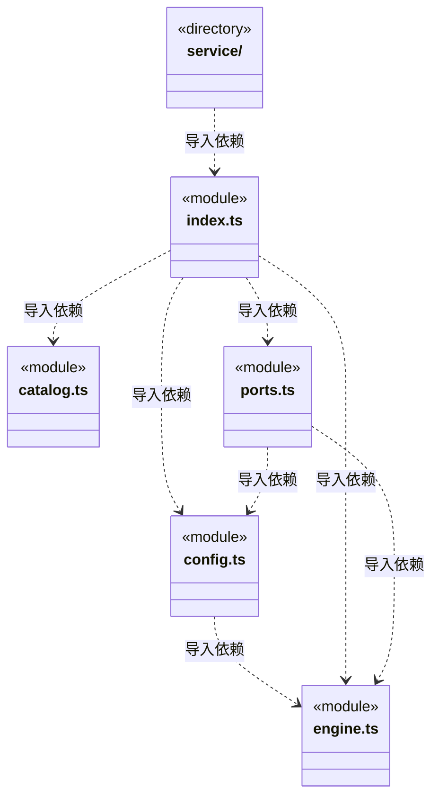
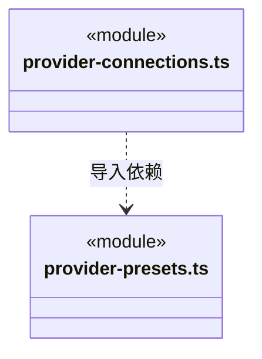
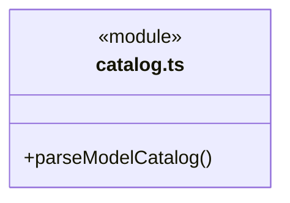
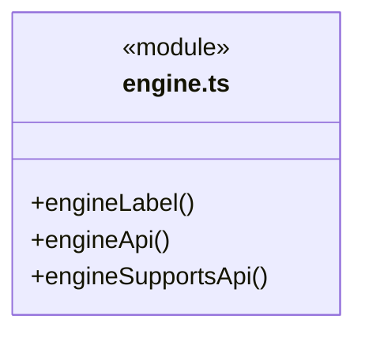
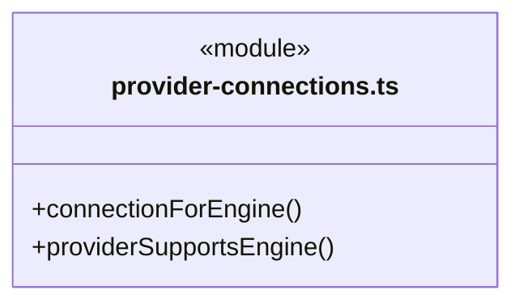
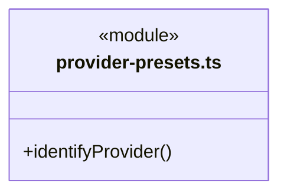

# src/logic/models 架构

## 目录定位

模型目录、公开配置 Schema、供应商预设与引擎接口选择；index.ts 是纯公共入口，不加载 Node 或服务。配置服务位于 service，旧预算端口和主 Agent 设置不属于本片。

本文描述当前实现。通过分析目录边界后维护的 [源码架构脚本](../../../scripts/source-architecture.mjs) 同步清单和声明；代码变更时仍须核对职责、关键成员与关系。

## 代码清单

| 文件 | 当前职责 |
| --- | --- |
| [catalog.ts](catalog.ts) | 解析供应商模型目录的能力资料，供新增模型和显式同步容量使用。 |
| [config.ts](config.ts) | 定义自定义供应商及其模型目录的持久化与界面契约。 |
| [engine.ts](engine.ts) | 用户模型目录和 Agent 运行选型共用的引擎标识与纯选择规则。 |
| [index.ts](index.ts) | 模型目录、供应商连接和引擎选型的便携公共入口。 |
| [ports.ts](ports.ts) | 模型运行快照与凭据加解密端口。 |
| [provider-connections.ts](provider-connections.ts) | 供应商到引擎的纯接口选择规则，供界面筛选、岗位采纳和实际启动共同使用。 |
| [provider-presets.ts](provider-presets.ts) | 模型设置与接口解析共用的官方供应商地址预设，属于模型配置的纯数据策略。 |

## 架构类图

各图中的同名节点表示同一目录边界；跨组及完整直接依赖如下（无边不代表继承）：

- `config.ts` → `engine.ts`：导入。
- `index.ts` → `catalog.ts`：导入。
- `index.ts` → `config.ts`：导入。
- `index.ts` → `engine.ts`：导入。
- `index.ts` → `provider-connections.ts`：导入。
- `index.ts` → `provider-presets.ts`：导入。
- `index.ts` → `ports.ts`：导入。
- `ports.ts` → `config.ts`：导入。
- `ports.ts` → `engine.ts`：导入。
- `provider-connections.ts` → `config.ts`：导入。
- `provider-connections.ts` → `engine.ts`：导入。
- `provider-connections.ts` → `provider-presets.ts`：导入。
- `provider-presets.ts` → `config.ts`：导入。
- `service` → `index.ts`：导入。

### catalog.ts 公开入口

### engine.ts 公开入口

### provider-connections.ts 公开入口

### provider-presets.ts 公开入口

## 子目录导航

- [service/](service/ARCHITECTURE.md)：LlmProfiles 配置持久化、公开快照、受控锁内选型与延迟解密；index.ts 仅向宿主提供服务，平台加密由端口注入。

[返回上层](../ARCHITECTURE.md)。

每次修改本目录代码，同步维护文件头、关键契约说明及本图。未实现的治理、证据验收和自动编排能力不列入当前类图。

## 设计契约 v1 与落地范围

以下内容区分已接通能力与后续设计；以各节的实现状态为准，不将目标图当作现状图。维护源：[CONTRACT.md](CONTRACT.md)；生成类图时同步附加，勿直接修改本附录。

# 模型目录与选型

`index.ts` 是不加载 Node、Electron 或服务的纯公共入口。目录解析、配置 Schema、引擎标识、供应商预设和接口选择归本模块；配置持久化、联网与凭据解析归 [service](service/CONTRACT.md)。请求预算归 logic/budget/rules/request-budget.ts，主 Agent 设置仍归旧 main/models，未随目录整体迁入。

## 不变量

- 三引擎独立于供应商。旧 definition.engine 只用于读取兼容，不决定实际执行引擎。
- connectionForEngine 优先使用兼容的主接口，其次显式接口，最后精确匹配官方 HTTPS 预设。显式型号限制不可通过预设绕过；autoDetect=false 禁止自动补充。不转换型号、协议或失败后重试。
- 目录解析保留供应商真实容量；未知能力不填造默认容量。公开配置不包含密文或明文凭据；ResolvedLlm 是仅供可信执行侧使用的类型，桥接出口不重导出它。
- 运行快照只冻结选中的 api/baseUrl，不携带候选接口；历史字段缺省及 Pi 快照字节保持原语义。

## 迁移期消费与退出

旧 backend 的规则、引擎、调度与宿主只能通过 index.ts 使用模型规则。只有 backend/main 与 Bridge server 可通过 service/index.ts 使用服务，禁止跨边界直达实现。

`bridge/contracts/models.ts` 暂时保留既有纯规则的具名重导出，前端仍通过该契约使用相同选型规则；没有开放其他 Bridge 文件直接导入 Logic，也没有把业务规则归入 Core。这是保留现有同步草稿预览的迁移兼容边界，不代表 Bridge DTO 解耦已经完成。后续桥接迁移必须一起替换预览与公开数据消费者，才能删除该精确许可。

修改供应商地址从 provider-presets.ts 入手，修改接口优先级从 provider-connections.ts 入手，修改能力解析从 catalog.ts 入手。规则与服务分开测试，前后端共同选型及历史快照用契约测试保留。
