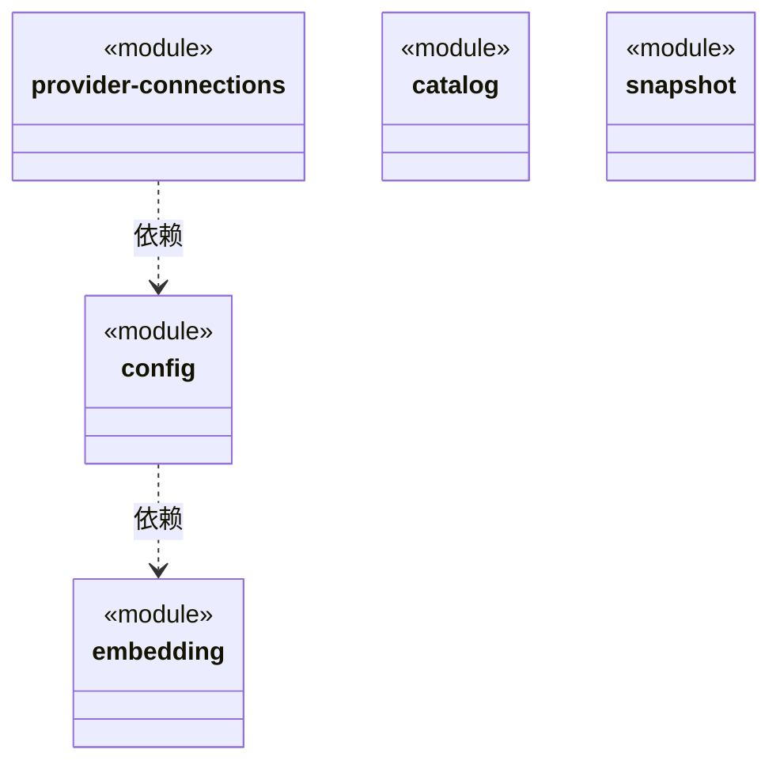

# 大模型

## 设计意图

维护模型配置结构、供应商连接选择、模型目录解析及生成与嵌入快照。凭据存取和设置持久化由 Logic 装配。

## 主要组成

| 组成 | 定位 |
| --- | --- |
| [catalog](catalog.ts) | 解析供应商模型目录的能力资料，供新增模型和显式同步容量使用。 |
| [config](config.ts) | 定义自定义供应商的生成与向量模型目录，保持旧生成配置字节与字段缺省。 |
| [provider-connections](provider-connections.ts) | 供应商到协议需求的纯接口选择规则，供界面筛选、岗位采纳和实际启动共同使用。 |
| [snapshot](snapshot.ts) | 生成模型公开运行快照的纯校验，供引擎角色绑定与岗位历史共同使用。 |
| [embedding](embedding.ts) | 向量模型的独立配置与公开快照，不套用生成输出预算字段。 |

<!-- architecture:generated:start -->

## 架构关系

[上层设计](../ARCHITECTURE.md)

<!-- architecture:generated:end -->
