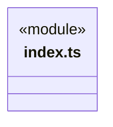
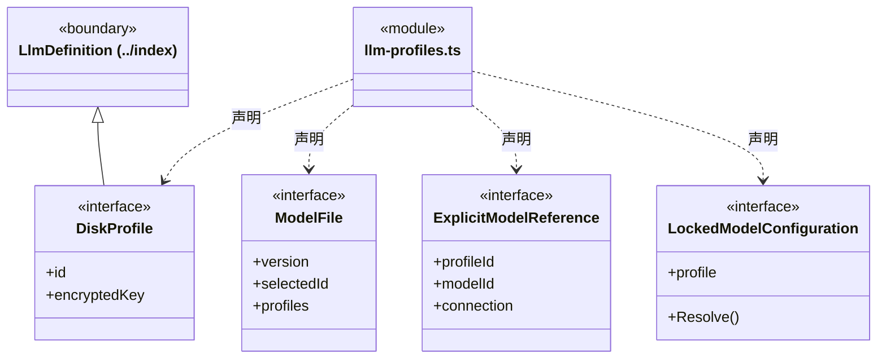
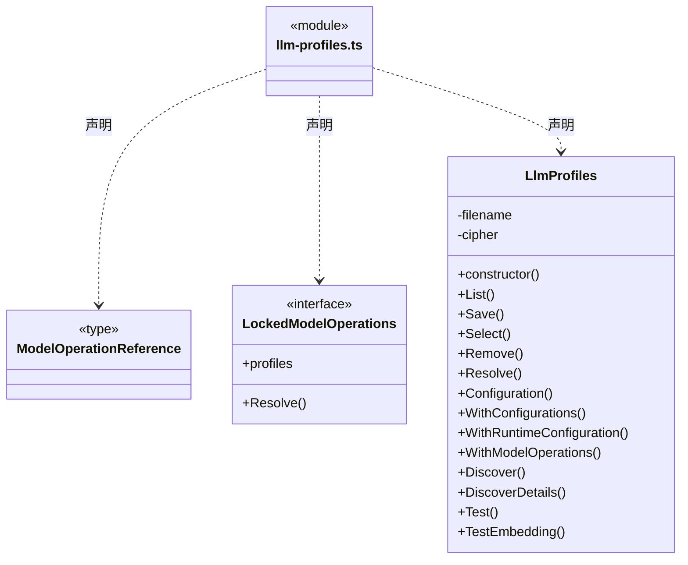
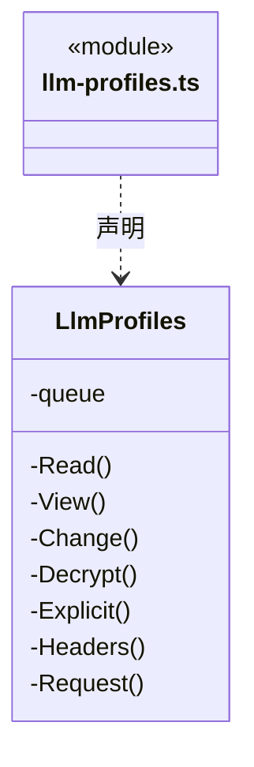
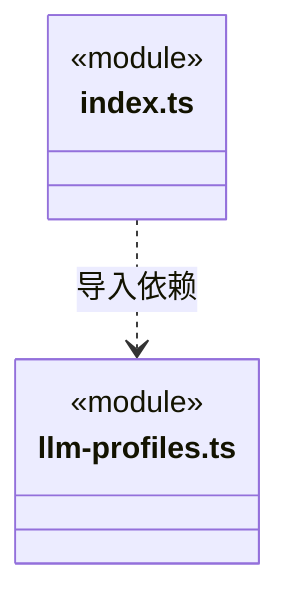

# src/logic/models/service 架构

本目录只维护这一份说明。设计与契约直接编辑本文；文件清单、类图和导航由 [架构脚本](../../../../scripts/source-architecture.mjs) 更新，生成区域之外的人工说明会保留。

## 封装意图

LlmProfiles 配置持久化、生成/向量操作公开快照、受控锁内原子选型与延迟解密；index.ts 仅向宿主提供服务，平台加密由端口注入。

## 类与模块的设计意图

下表依据源码声明及文件头说明定位封装。字段表示该实例持有的状态或协作引用，不表示它拥有被引用服务的生命周期；实际资源责任和调用限制见下文契约及源码注释。

| 类／模块 | 实现形式与实例字段 | 封装依据 |
| --- | --- | --- |
| [index.ts](index.ts) | 函数／契约模块 | 文件持久化、联网探测与凭据解析不能被纯模型规则入口加载；此入口只允许服务端消费者。 |
| [LlmProfiles](llm-profiles.ts) | 实例类；持有 `queue`、`filename`、`cipher` | 运行与岗位登记共用实际模型选型；岗位领取在同一配置队列中固定公开参数并延迟解密，与设置修改形成明确先后，凭据不进入登记或任务日志。 |

## 接口设计契约

### 模型配置服务

公开入口为 index.ts，唯一实现 LlmProfiles 拥有本机供应商配置、encryptedKey 和实例 SerialQueue。纯模型规则通过上层 index.ts 组合；文件替换使用 Core Node files，错误使用 Core Fault。平台加密实现由宿主注入 SecretCipher，不反向引用旧 Main。

save/select/remove 串行写入配置；withConfigurations 与 withRuntimeConfiguration 在同一队列固定配置，回调内不得再次进入队列。后者仅在回调有效期内允许解析已捕获凭据，退出后 resolve 拒绝。预算和占用检查仍由调用方负责，锁释放后才启动引擎。

configuration/resolve/test 接受可选 ModelConnectionRequirement，缺省使用供应商主接口，不识别引擎 ID；不兼容返回 LLM_CONNECTION_API。EngineModelProfiles 在外层生成需求、组合引擎快照并保留执行侧 LLM_ENGINE_API 诊断。configuration 与公开目录不解密、不联网；resolve 及受控锁内 resolve 才解析凭据。公开列表仅返回 hasKey。运行快照不携带备用地址或预设来源，设置变化不热替换已捕获快照。

主接口变更或新增自定义凭据目标必须重新提供 Key，改名/型号范围/删除兼容接口保持原规则。探测固定选中的接口，失败不切换协议、不重发或清空目录。错误仅返回安全端点和状态，不返回上游正文、密钥或查询参数。

现有文件格式、默认选择、原子写入与失败语义保持；迁移不重写用户文件。测试使用独立临时目录和加密替身，不加载完整 Application。下一次修改配置并发、保存或探测从 llm-profiles.ts 入手。

WithModelOperations 在同一次配置读取和原 SerialQueue 中捕获生成/向量角色。角色分别显式声明供应商、型号和操作类型；公开 profiles 不含凭据，Resolve(index) 只解密对应角色一次，回调结束后即使有缓存也拒绝。准备失败或停止不自动重试，不启动网络。此入口为 V2 Agent 绑定提供原子准备机制；引擎服务与界面已消费多角色配置，本方法只捕获配置和受限凭据解析能力，不发送向量请求。

供应商设置的 testEmbedding 在配置短锁内冻结明确向量操作，网络在锁外；只发送小样本，校验返回的维度和有限数值，不保存通过状态、不写知识或索引。通用生成连接测试按接口需求选择，不依赖引擎 ID。

## 开闭边界

本目录的职责及允许协作由[封装意图](#封装意图)限定，输入输出、状态与失败语义以[接口设计契约](#接口设计契约)为准。扩展从已有公开入口及实际装配位置进入；没有明确可替换契约的部分按真实影响修改和验证，不预建未使用的基类或插件入口。

<!-- architecture:generated:start -->

## 文件清单

| 文件 | 形式 | 当前职责 |
| --- | --- | --- |
| [ARCHITECTURE.md](ARCHITECTURE.md) | 说明文档 | 本目录的文件清单、真实声明、依赖与子封装导航。 |
| [index.ts](index.ts) | 源码模块 | 模型配置服务的宿主公共入口，供应用装配及主 Agent 设置使用。 |
| [llm-profiles.ts](llm-profiles.ts) | 源码模块 | 本机供应商配置持久化、生成模型选择、跨模型操作原子捕获和连接检测。 |

## 架构类图

成员标记：`+` 公开、`-` 私有、`#` 受保护、`$` 静态；构造函数单独列出。文档和资源仅在文件清单中导航，不作为代码节点。

### index.ts

直接依赖：[llm-profiles.ts](llm-profiles.ts)。

### llm-profiles.ts

成员 1/2（同名节点为同一声明，跨图合并阅读）。

成员 2/2（同名节点为同一声明，跨图合并阅读）。

继承／实现来源：`LlmDefinition` → [../index.ts](../index.ts)。
直接依赖：[../../../core/errors.ts](../../../core/errors.ts)、[../../../core/platform/node/files/index.ts](../../../core/platform/node/files/index.ts)、[../../../core/utility/index.ts](../../../core/utility/index.ts)、[../index.ts](../index.ts)。

### 本目录调用边界

## 子目录导航

无子目录。

[返回上层](../ARCHITECTURE.md)。

每次修改本目录代码，同步维护文件头、关键契约说明及本图。未实现的治理、证据验收和自动编排能力不列入当前类图。

<!-- architecture:generated:end -->
