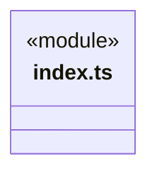
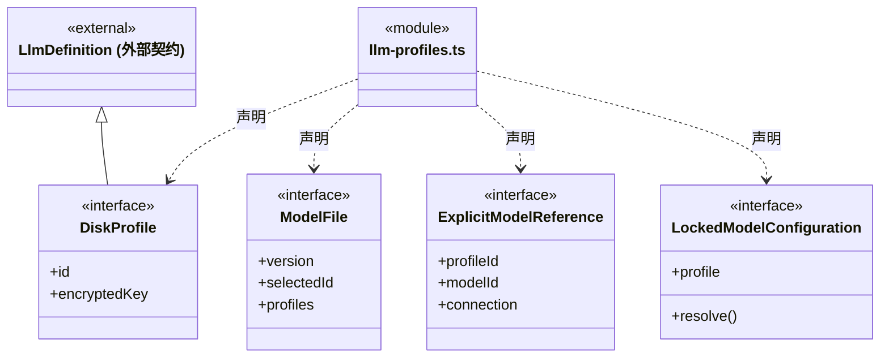
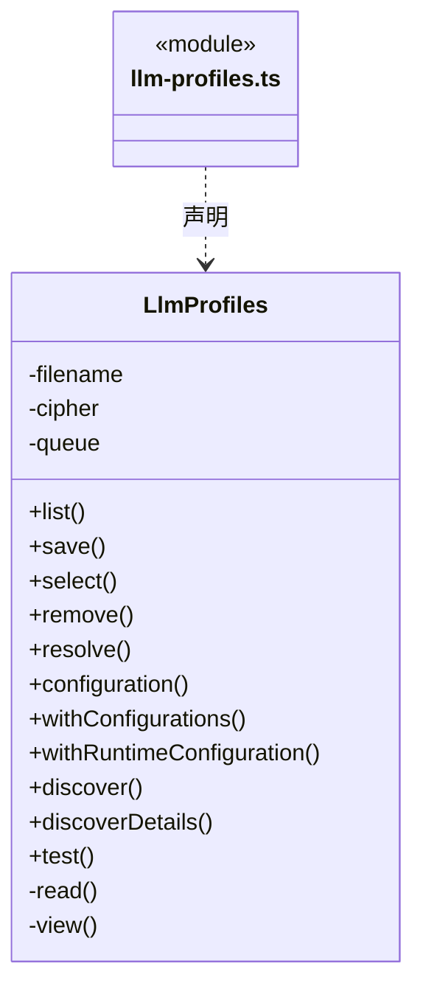
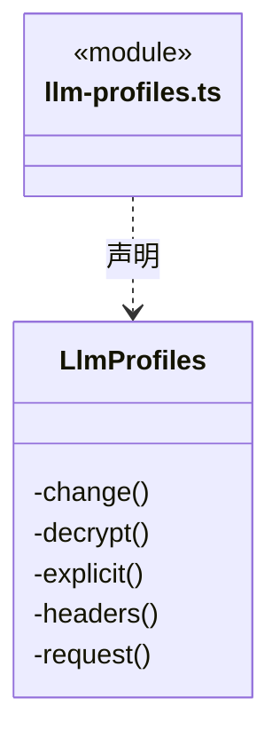
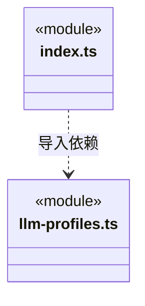

# src/logic/models/service 架构

## 目录定位

LlmProfiles 配置持久化、公开快照、受控锁内选型与延迟解密；index.ts 仅向宿主提供服务，平台加密由端口注入。

本文描述当前实现。通过分析目录边界后维护的 [源码架构脚本](../../../../scripts/source-architecture.mjs) 同步清单和声明；代码变更时仍须核对职责、关键成员与关系。

## 代码清单

| 文件 | 当前职责 |
| --- | --- |
| [index.ts](index.ts) | 模型配置服务的宿主公共入口，供应用装配及主 Agent 设置使用。 |
| [llm-profiles.ts](llm-profiles.ts) | 本机供应商配置持久化、默认模型选择和连接检测。 |

## 架构类图

### index.ts

直接依赖：[llm-profiles.ts](llm-profiles.ts)。

### llm-profiles.ts

成员 1/2（同名节点为同一声明，跨图合并阅读）。

成员 2/2（同名节点为同一声明，跨图合并阅读）。

直接依赖：[../../../core/utility/index.ts](../../../core/utility/index.ts)、[../index.ts](../index.ts)、[../../../core/platform/node/files/index.ts](../../../core/platform/node/files/index.ts)、[../../../core/errors.ts](../../../core/errors.ts)。

### 本目录调用边界

## 子目录导航

无子目录。

[返回上层](../ARCHITECTURE.md)。

每次修改本目录代码，同步维护文件头、关键契约说明及本图。未实现的治理、证据验收和自动编排能力不列入当前类图。

## 设计契约 v1 与落地范围

以下内容区分已接通能力与后续设计；以各节的实现状态为准，不将目标图当作现状图。维护源：[CONTRACT.md](CONTRACT.md)；生成类图时同步附加，勿直接修改本附录。

# 模型配置服务

公开入口为 index.ts，唯一实现 LlmProfiles 拥有本机供应商配置、encryptedKey 和实例 SerialQueue。纯模型规则通过上层 index.ts 组合；文件替换使用 Core Node files，错误使用 Core Fault。平台加密实现由宿主注入 SecretCipher，不反向引用旧 Main。

save/select/remove 串行写入配置；withConfigurations 与 withRuntimeConfiguration 在同一队列固定配置，回调内不得再次进入队列。后者仅在回调有效期内允许解析已捕获凭据，退出后 resolve 拒绝。预算和占用检查仍由调用方负责，锁释放后才启动引擎。

configuration/resolve/test 接受可选 ModelConnectionRequirement，缺省使用供应商主接口，不识别引擎 ID；不兼容返回 LLM_CONNECTION_API。EngineModelProfiles 在外层生成需求、组合引擎快照并保留执行侧 LLM_ENGINE_API 诊断。configuration 与公开目录不解密、不联网；resolve 及受控锁内 resolve 才解析凭据。公开列表仅返回 hasKey。运行快照不携带备用地址或预设来源，设置变化不热替换已捕获快照。

主接口变更或新增自定义凭据目标必须重新提供 Key，改名/型号范围/删除兼容接口保持原规则。探测固定选中的接口，失败不切换协议、不重发或清空目录。错误仅返回安全端点和状态，不返回上游正文、密钥或查询参数。

现有文件格式、默认选择、原子写入与失败语义保持；迁移不重写用户文件。测试使用独立临时目录和加密替身，不加载完整 Application。下一次修改配置并发、保存或探测从 llm-profiles.ts 入手。
