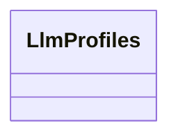

# src/logic/models/service 架构

## 设计意图

LlmProfiles 配置持久化、生成/向量操作公开快照、受控锁内原子选型与延迟解密；index.ts 仅向宿主提供服务，平台加密由端口注入。

## 主要组成

| 组成 | 定位 |
| --- | --- |
| [LlmProfiles](llm-profiles.ts) | 本机供应商配置持久化、生成模型选择、跨模型操作原子捕获和连接检测。 |

<!-- architecture:generated:start -->

## 架构关系

[上层设计](../ARCHITECTURE.md)

<!-- architecture:generated:end -->
