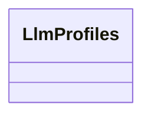

# src/logic/models/service 架构

## 设计意图

持久管理模型供应商配置，并在一致配置版本下解析运行连接与凭据。

`LlmProfiles` 拥有本机配置和短锁，原子捕获生成／向量操作快照，按需要延迟解密并执行连接检测。加密能力通过 Core 端口注入；引擎服务复用这一份状态，不另存模型配置或掌握其锁。

## 主要组成

| 组成 | 定位 |
| --- | --- |
| [LlmProfiles](llm-profiles.ts) | 本机供应商配置持久化、生成模型选择、跨模型操作原子捕获和连接检测。 |

<!-- architecture:generated:start -->

## 架构关系

[上层设计](../ARCHITECTURE.md)

<!-- architecture:generated:end -->
