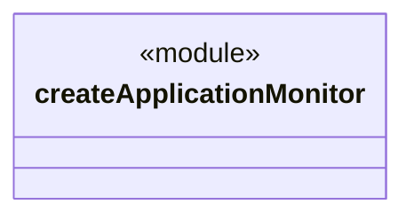

# 运行监控

## 设计意图

负责运行监控。

## 主要组成

| 组成 | 定位 |
| --- | --- |
| [createApplicationMonitor](index.ts) | 将应用运行时与主进程指标接入 Framework 的运行监控。 |

<!-- architecture:generated:start -->

## 架构关系

[上层设计](../ARCHITECTURE.md)

<!-- architecture:generated:end -->
