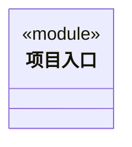

# 项目

## 设计意图

左侧项目列表的每个条目使用本地项目标识。项目提供组织岗位和业务工作区树，每个主对话使用该项目下独立的 Office。用户输入由该 Office 的主 Agent 接收。

## 主要组成

| 组成 | 定位 |
| --- | --- |
| [项目入口](index.ts) | 按项目和主会话取得 Office，装配业务树和组织岗位。 |

<!-- architecture:generated:start -->

## 架构关系

[上层设计](../ARCHITECTURE.md)

<!-- architecture:generated:end -->
