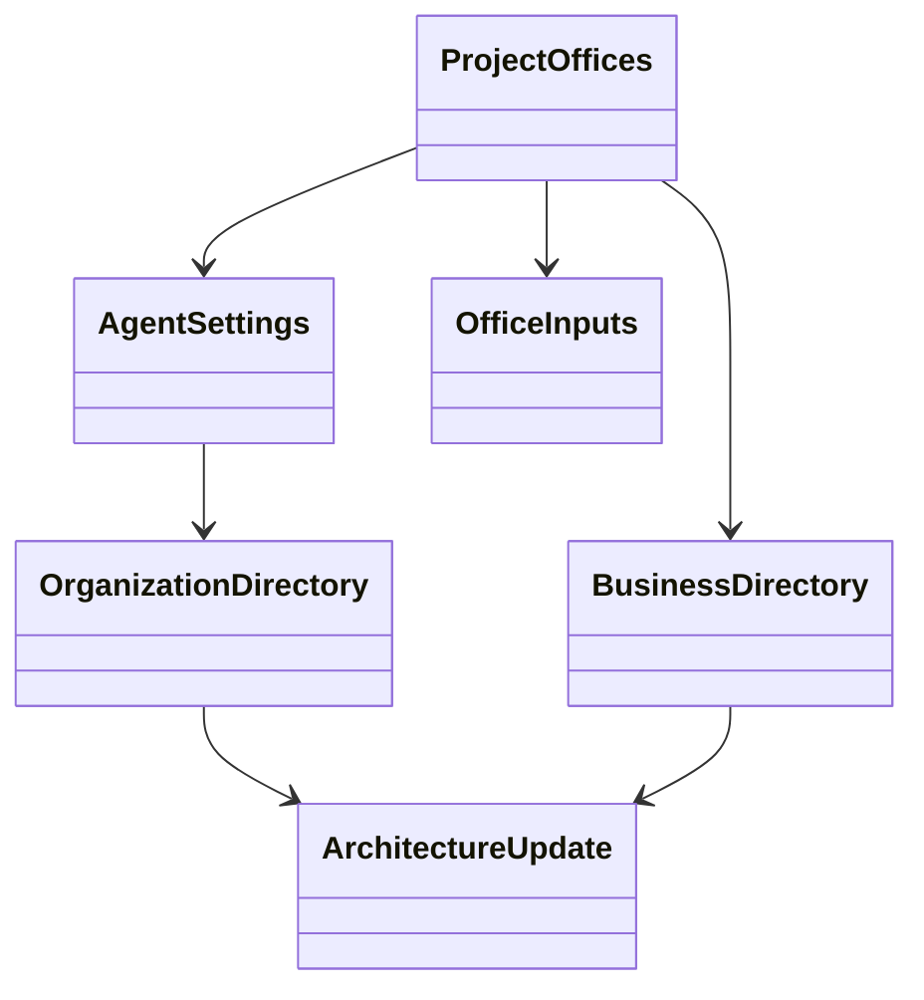
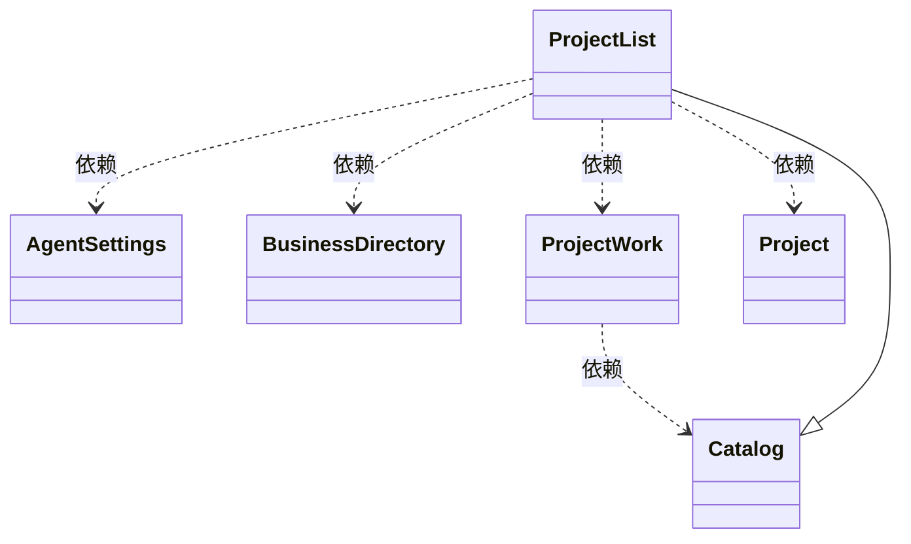
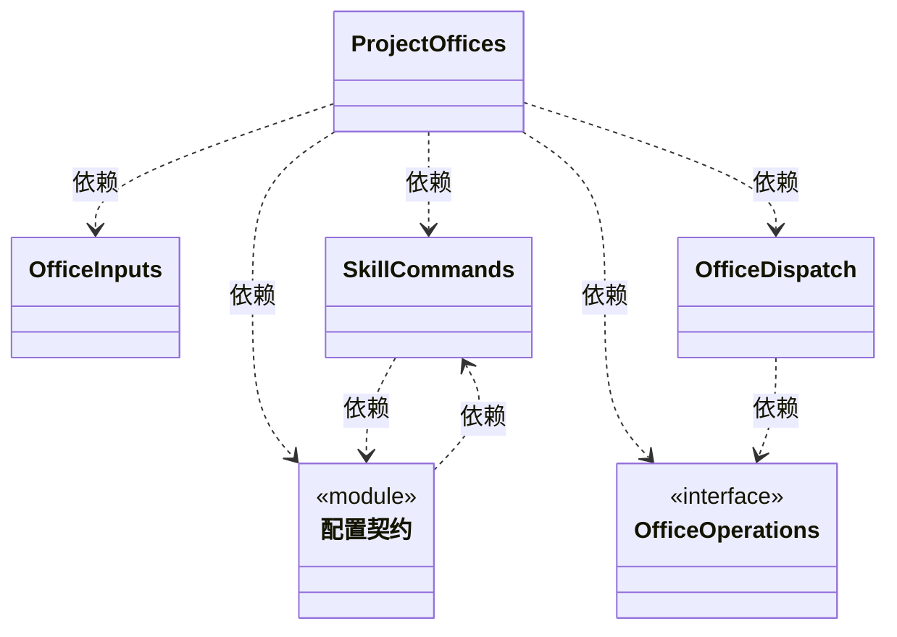
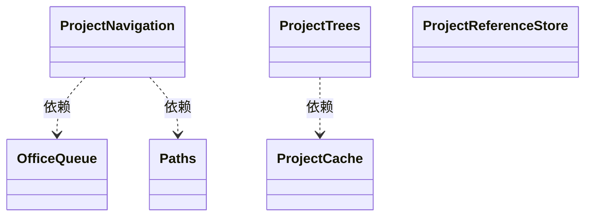
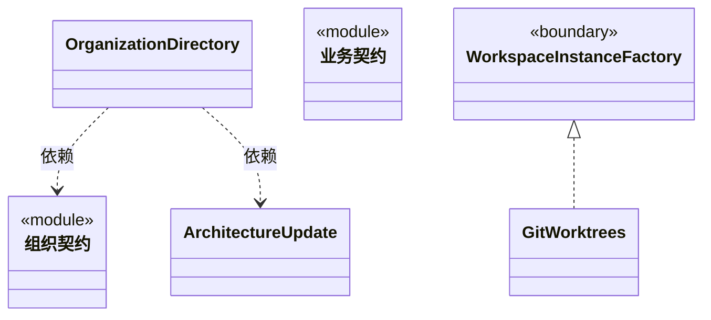
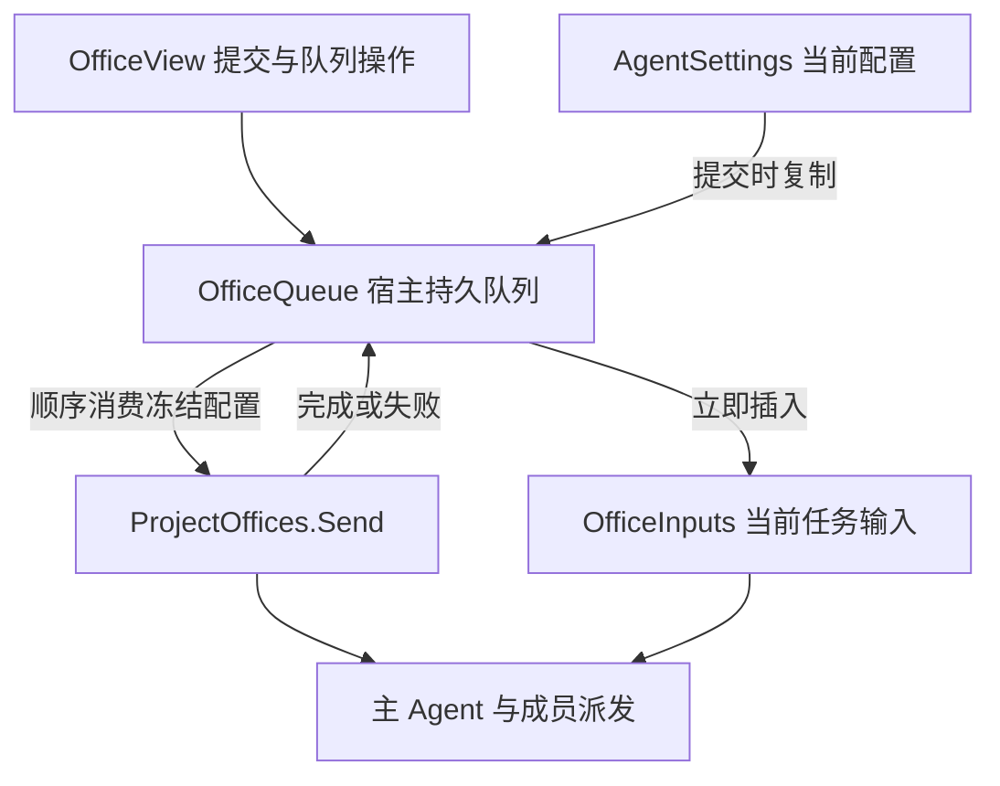

# 项目列表和各项目的 Office 会话

## 设计意图

负责项目列表和各项目的 Office 会话。

发送消息时，ProjectOffices 将界面权限写入当前 Office，并沿主 Agent 引擎工厂将 `ReadPermission` 传给 OfficeChat。读取器绑定办公室而非消息快照，供宿主在启动及工具调用时核对权限。

OfficeDispatch 将本轮工具派发连接到 Office 的任务队列。只接收已配置、可用岗位，子任务沿岗位自己的模型和同一 Office 权限执行；禁止祖先循环派发，并限制本轮深度和总量。成员使用 Office Git 工作树，结果报告实际目录和未合并状态，不把子运行结束视为业务验收。主轮停止、子运行失败时取消并排空相关运行，关闭工位使用权；工作树文件保留，不自动合并或删除。

岗位描述中的可选 `model` 显式包含 `engine`、`profileId` 和 `modelId`，装配时验证完整性；缺少配置的岗位仍标记为不可用，不暗中套用主 Agent 的模型或账号。实际引擎安装状态和模型可用性由成员启动时继续核验。

Skills 和连接器配置只声明可用范围，不代表执行请求。SkillCommands 在纯配置边界生成 `/skill:名称` 命令并解析消息开头的显式调用；普通消息只附带技能目录，不附带全部技能正文。仅选中技能正文随本次请求展开，未知命令拒绝执行。OfficeQueue 入队和编辑时校验可用清单，运行与立即插入均使用该条指令冻结的配置，后续设置变化不会替换已排队技能。成员派发的显式命令按成员自己的可用清单解析，连接器工具仍受 Office 权限检查。

## 主要组成

OrganizationDirectory 是本机项目组织结构的写入入口：初始从项目角色树读取，首次编辑后以用户数据项目目录下的 `organization.json` 为权威快照，不删除或改写项目知识目录。节点身份独立于名称/父团队，新建身份由宿主生成；改名、移动保留成员能力配置。版本比较与进程内写入门禁保护整树原子提交，拒绝循环、过深层级、无效父节点、同级重名和非空团队删除；损坏文件失败关闭，不回退为空组织。删除保留历史和孤立的能力配置文件，但已删除 ID 不再可查或派发，重新创建使用新 ID。

结构编辑不受活跃、排队或挂起 Office 任务限制。保存前准备完整岗位目录，原子落盘后同步替换项目共享组织，再通知项目内所有活动主 Agent；已启动实例仍持冻结角色。启动读取通过版本与配置代次检查避免覆盖较新目录。结构与能力配置的并发写仍需短暂互斥和版本检查，该门禁不依赖任务状态。空团队是合法的待组建节点，组织读写不承担文件目录迁移。

ProjectList.Business 提供当前运行树初始索引；BusinessDirectory 首次从该索引初始化，编辑后以本机 `business.json` 的版本化定义为准，立即更新共享 Project.UpdateTree。新增身份不依赖目录路径，移动和删除只改变定义，已打开工作树和活动成员继续保留。保存拒绝循环、同层级重名与非空节点删除，但不拒绝活跃 Office。

AgentSettings 保存本机项目下的能力设置，主配置以会话 ID 隔离，成员配置以岗位 ID 隔离；文件位于用户数据项目目录的 `agent-settings/`，不会修改项目知识文件。版本号与进程内保存互斥防止编辑覆盖，损坏文件报错而不重置。首次读取成员时采用项目 `agent.json` 的 model/skills/connectorIds；保存后以本机配置为准。保存后立即更新后续派发使用的组织目录，正在运行的角色仍持有冻结快照。

主与成员都由 ProjectOffices 的同一个运行装配函数读取角色模型、技能和连接器，并传递真实 Agent 实例及 Office 身份。两处页面只决定配置目标。设置不接受权限字段，不把主 Agent 的能力选择继承给成员。

| 组成 | 定位 |
| --- | --- |
| [ProjectCache](project-cache.ts) | 定位项目本机记录和兼容缓存。 |
| [ProjectTrees](project-trees.ts) | 校验并持久化组织和业务快照。 |
| [ProjectReferenceStore](project-references.ts) | 带版本校验地修改共享资源引用。 |
| [ProjectWork](project-work.ts) | 维护项目设置和定时任务。 |
| [Project](project.ts) | 持有项目资源和该项目独立的运行时。 |
| [ProjectList](project.ts) | 按登记身份加载项目，聚合 Office 监控事件。 |
| [GitWorktrees](git-worktrees.ts) | Opens a separate Git worktree for each Office and repository. |
| [Catalog](index.ts) | 读取项目列表，按本地目录身份登记工作区。 |
| [Paths](paths.ts) | 解析项目目录身份与用户数据位置。 |
| [ProjectOffices](offices.ts) | 将登记项目的持久会话绑定到运行时 Office。 |
| [AgentSettings](agent-settings.ts) | 管理岗位/会话配置读取、版本化保存与组织装配。 |
| [OrganizationDirectory](organization-directory.ts) | 组织结构持久化、版本冲突检查、CRUD 与框架树转换。 |
| [组织契约](organization-contract.ts) | 节点身份、归属和修改命令的纯边界校验。 |
| [SkillCommands](agent-configuration.ts) | 共享可用命令目录、显式调用校验与选中正文展开。 |
| [配置契约](agent-configuration.ts) | 验证引擎/LLM、独立技能和连接器选择，拒绝重复 ID 与未知字段。 |
| [OfficeDispatch](office-dispatch.ts) | 将工具派发绑定到真实岗位、工位和任务队列，管理本轮子运行取消与清理。 |
| [OfficeOperations](office-operations.ts) | Office 查询、派发和逐次审批的无宿主依赖契约。 |

| 组成 | 定位 |
| --- | --- |
| [BusinessDirectory](business-directory.ts) | 实时业务定义、持久化与共享树更新。 |
| [业务契约](business-contract.ts) | 版本化业务资料和层级校验。 |
| [ArchitectureUpdate](architecture-update.ts) | 组织／业务变更及祖先差异计算。 |
| [OfficeInputs](office-inputs.ts) | 当前任务的追加输入及交付状态。 |
| [OfficeQueue](office-queue.ts) | 宿主持久接收和串行消费指令，管理重排、立即插入及设置快照。 |
| [ProjectNavigation](navigation.ts) | 管理项目与对话的名称、置顶、排序及可恢复移除，不加载项目运行时来读取侧栏。 |

## 当前任务中的架构更新

ArchitectureUpdate 生成带版本的节点差异、删除墓碑、根子节点以及新旧全部祖先的最新子节点列表。OrganizationDirectory 与 BusinessDirectory 提交后调用 ProjectOffices 的项目内通知入口，活动主 Agent 各持自己的 OfficeInputs；其他项目隔离。空闲 Office 不自动启动引擎，下一轮直接获得最新完整组织和业务快照。成员能力配置保存也更新可派发目录并通知主 Agent，已运行实例保留冻结配置。

用户 Insert 与架构通知使用同一队列；成员不消费主输入。主 Agent 根据通知重新评估后续派发，不强改运行中成员的模型、权限、Skill 或既有副作用。派发在异步打开工作区后再次核验岗位和业务节点，防止使用刚失效的目录。

OfficeInputs 在原生 steer、工具前拦截、工具结果或当前任务续跑这些模型可见边界交付。原生接收与模型已经执行分开；未知交付显示告警且不自动重发。尚未交付的输入在本次生成结束后继续同一个主任务，收尾前同步关闭队列避免尾部遗漏。成功轮次把通知和接收状态保存进工作记录；队列本身为进程内状态，停止、失败或退出不承诺继续执行追加请求，架构定义独立持久化，下一轮完整快照不依赖内存通知恢复。

<!-- architecture:generated:start -->

## 架构关系

### 关系组 1：ProjectList

### 关系组 2：ProjectOffices

### 关系组 3：OfficeQueue

### 关系组 4：组织契约

### 跨图协作

按引用方归并目标，保留全部跨图关系；分图只用于阅读，不表示新增模块或依赖边界。

| 引用方 | 关系 | 目标 |
| --- | --- | --- |
| [ProjectCache](project-cache.ts)（图 3） | 依赖 | [GitWorktrees](git-worktrees.ts)（图 4） |
| [ProjectTrees](project-trees.ts)（图 3） | 依赖 | [组织契约](organization-contract.ts)（图 4）、[业务契约](business-contract.ts)（图 4）、[配置契约](agent-configuration.ts)（图 2） |
| [Project](project.ts)（图 1） | 依赖 | [ProjectCache](project-cache.ts)（图 3）、[ProjectTrees](project-trees.ts)（图 3）、[ProjectReferenceStore](project-references.ts)（图 3） |
| [ProjectList](project.ts)（图 1） | 依赖 | [ProjectTrees](project-trees.ts)（图 3）、[ProjectReferenceStore](project-references.ts)（图 3）、[OrganizationDirectory](organization-directory.ts)（图 4） |
| [Catalog](index.ts)（图 1） | 依赖 | [ProjectCache](project-cache.ts)（图 3）、[Paths](paths.ts)（图 3） |
| [ProjectOffices](offices.ts)（图 2） | 依赖 | [AgentSettings](agent-settings.ts)（图 1）、[ProjectWork](project-work.ts)（图 1）、[BusinessDirectory](business-directory.ts)（图 1）、[ProjectList](project.ts)（图 1） |
| [AgentSettings](agent-settings.ts)（图 1） | 依赖 | [OrganizationDirectory](organization-directory.ts)（图 4）、[配置契约](agent-configuration.ts)（图 2）、[ArchitectureUpdate](architecture-update.ts)（图 4）、[组织契约](organization-contract.ts)（图 4） |
| [组织契约](organization-contract.ts)（图 4） | 依赖 | [配置契约](agent-configuration.ts)（图 2） |
| [BusinessDirectory](business-directory.ts)（图 1） | 依赖 | [业务契约](business-contract.ts)（图 4）、[ArchitectureUpdate](architecture-update.ts)（图 4） |
| [OfficeQueue](office-queue.ts)（图 3） | 依赖 | [ProjectList](project.ts)（图 1）、[ProjectOffices](offices.ts)（图 2）、[Catalog](index.ts)（图 1）、[AgentSettings](agent-settings.ts)（图 1）、[配置契约](agent-configuration.ts)（图 2）、[SkillCommands](agent-configuration.ts)（图 2） |
| [ProjectNavigation](navigation.ts)（图 3） | 依赖 | [ProjectList](project.ts)（图 1）、[Catalog](index.ts)（图 1） |

外部继承／实现边界：[WorkspaceInstanceFactory](../../framework/business/workspace-instance.ts)。

[上层设计](../ARCHITECTURE.md)

<!-- architecture:generated:end -->

### Office 指令排队

OfficeQueue 按项目与会话独立持久化指令；宿主负责串行接收、FIFO 消费、版本化重排和插入，页面卸载不停止。每次提交保存引擎、模型、Skills、连接器与权限快照；之后的设置修改仅影响后续提交。立即插入沿用当前任务环境，通过 OfficeInputs 传递，不另开重复任务。手动暂停与停止需要显式继续；单条失败不会阻塞后续指令。重开未暂停的会话恢复 FIFO；中断的在途项标为 uncertain 并暂停，继续只消费 queued 项。空闲时可优先执行选中项。接收 ID 保留最近 1000 条去重回执。

### 项目与对话导航

ProjectNavigation 在用户目录 navigation.json 保存导航元数据，使用版本比较和宿主串行写入避免菜单互相覆盖。Read 读取 OfficeHistory 的首尾轮次与 OfficeQueue.Status，不创建会话或加载项目运行时。工程路径和稳定身份不随重命名变化。项目移除只隐藏目录入口，任务继续；对话移除先停止任务并暂停队列，历史不擦除，恢复不自动重跑。损坏元数据报错且不覆盖原文件。
