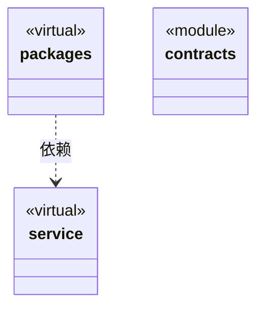

# src/logic/resources 架构

## 设计意图

资源定义、分类、仓库快照与公开状态的纯业务契约；仓库存储和共享由 service 负责。

## 主要组成

| 组成 | 定位 |
| --- | --- |
| [contracts](contracts.ts) | 资源种类、仓库快照、登录占位及仓库状态的共享类型。 |

<!-- architecture:generated:start -->

## 架构关系

标注为 `virtual` 的节点是直接子模块的虚拟类封装；内部设计沿下方入口阅读。

## 子模块

| 虚拟封装 | 整体职责 |
| --- | --- |
| [packages](packages/ARCHITECTURE.md) | 静态知识包的发布与预览导入；同时核仓库和知识版本，正式导入复用原知识事务。 |
| [service](service/ARCHITECTURE.md) | 本地/HTTP 资源仓库、版本与身份校验、共享代际与取消；宿主仅提供目录边界，不持有应用或 Bridge。 |

[上层设计](../ARCHITECTURE.md)

<!-- architecture:generated:end -->
