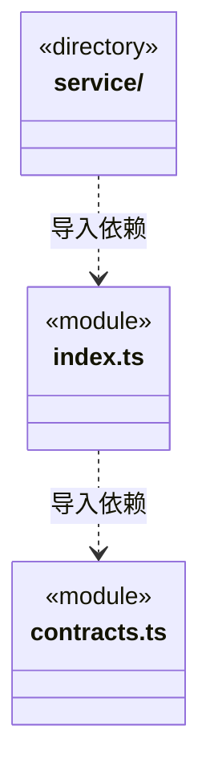

# src/logic/resources 架构

## 目录定位

资源定义、分类、仓库快照与公开状态的纯业务契约；仓库存储和共享由 service 负责。

本文描述当前实现。通过分析目录边界后维护的 [源码架构脚本](../../../scripts/source-architecture.mjs) 同步清单和声明；代码变更时仍须核对职责、关键成员与关系。

## 代码清单

| 文件 | 当前职责 |
| --- | --- |
| [contracts.ts](contracts.ts) | 资源种类、仓库快照、登录占位及仓库状态的共享类型。 |
| [index.ts](index.ts) | 资源定义、仓库快照和公开状态的纯业务入口。 |

## 架构类图

各图中的同名节点表示同一目录边界；跨组及完整直接依赖如下（无边不代表继承）：

- `index.ts` → `contracts.ts`：导入。
- `service` → `index.ts`：导入。

## 子目录导航

- [service/](service/ARCHITECTURE.md)：本地/HTTP 资源仓库、版本与身份校验、共享代际与取消；宿主仅提供目录边界，不持有应用或 Bridge。

[返回上层](../ARCHITECTURE.md)。

每次修改本目录代码，同步维护文件头、关键契约说明及本图。未实现的治理、证据验收和自动编排能力不列入当前类图。

## 设计契约 v1 与落地范围

以下内容区分已接通能力与后续设计；以各节的实现状态为准，不将目标图当作现状图。维护源：[CONTRACT.md](CONTRACT.md)；生成类图时同步附加，勿直接修改本附录。

# 资源仓库纯契约

index.ts 公开资源分类、定义、完整快照和无凭据状态；不加载服务或平台。Bridge resources 仅具名转接这些既有契约，包导入/发布仍由其原业务负责。服务不反向引用 Bridge 类型。定义可浏览不代表授权安装或执行。
