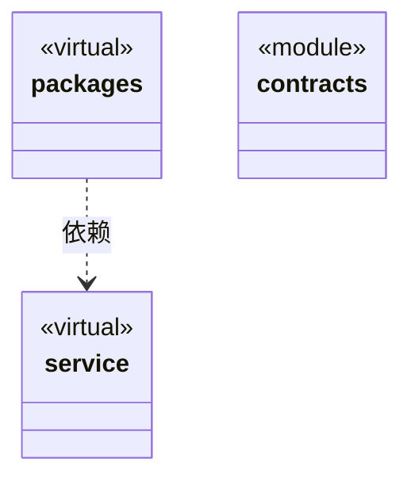

# src/logic/resources 架构

## 设计意图

统一资源种类、仓库身份与静态包交换，隔离仓库管理和工作区知识应用。

本层纯契约描述可公开资源状态，`service` 管理本地/HTTP 仓库及共享生命周期，`packages` 将工作区能力发布或预览导入。连接授权归 connectors，包存在不意味着已获读取或正式导入许可。

## 主要组成

| 组成 | 定位 |
| --- | --- |
| [contracts](contracts.ts) | 资源种类、仓库快照、登录占位及仓库状态的共享类型。 |

## 现状与目标边界

当前 [contracts.ts](contracts.ts) 与 [index.ts](index.ts) 留在父层，service 和 packages 分别处理仓库与工作区交换。目标是明确纯资源协议子封装，父层仅组合并保留必要转接；迁移前后纯协议不能加载 HTTP、仓库存储或工作区实例，资源包导入仍走 knowledge 原事务。

<!-- architecture:generated:start -->

## 架构关系

标注为 `virtual` 的节点是直接子模块的虚拟类封装；内部设计沿下方入口阅读。

## 子模块

| 虚拟封装 | 整体职责 |
| --- | --- |
| [packages](packages/ARCHITECTURE.md) | 把静态团队能力和业务架构在工作区与资源仓库之间转换，保留预览与正式应用的区别。 |
| [service](service/ARCHITECTURE.md) | 管理本地与 HTTP 资源仓库的版本化读写和共享生命周期，不依赖具体应用或 Bridge。 |

[上层设计](../ARCHITECTURE.md)

<!-- architecture:generated:end -->
