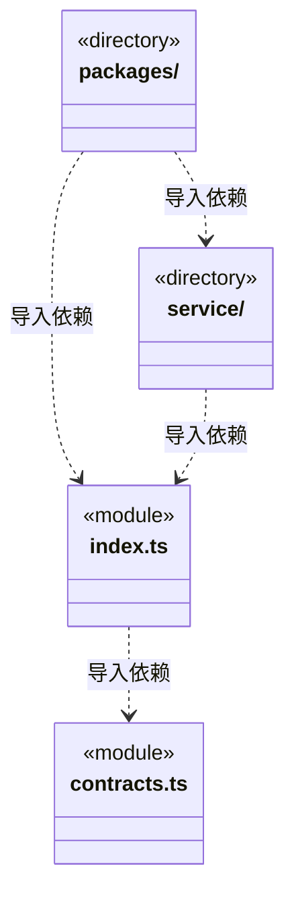

# src/logic/resources 架构

本目录只维护这一份说明。设计与契约直接编辑本文；文件清单、类图和导航由 [架构脚本](../../../scripts/source-architecture.mjs) 更新，生成区域之外的人工说明会保留。

## 封装意图

资源定义、分类、仓库快照与公开状态的纯业务契约；仓库存储和共享由 service 负责。

## 类与模块的设计意图

下表依据源码声明及文件头说明定位封装。字段表示该实例持有的状态或协作引用，不表示它拥有被引用服务的生命周期；实际资源责任和调用限制见下文契约及源码注释。

| 类／模块 | 实现形式与实例字段 | 封装依据 |
| --- | --- | --- |
| [contracts.ts](contracts.ts) | 函数／契约模块 | 统一三类资源的定义与仓库状态；共享类型不包含凭据或执行授权。 |
| [index.ts](index.ts) | 函数／契约模块 | 静态定义与仓库服务独立，界面契约不加载文件、网络或共享凭据。 |

## 接口设计契约

### 资源仓库纯契约

index.ts 公开资源分类、定义、完整快照和无凭据状态；不加载服务或平台。Bridge resources 仅具名转接这些既有契约，包导入/发布仍由其原业务负责。服务不反向引用 Bridge 类型。定义可浏览不代表授权安装或执行。

## 开闭边界

本目录的职责及允许协作由[封装意图](#封装意图)限定，输入输出、状态与失败语义以[接口设计契约](#接口设计契约)为准。扩展从已有公开入口及实际装配位置进入；没有明确可替换契约的部分按真实影响修改和验证，不预建未使用的基类或插件入口。

<!-- architecture:generated:start -->

## 文件清单

| 文件 | 形式 | 当前职责 |
| --- | --- | --- |
| [ARCHITECTURE.md](ARCHITECTURE.md) | 说明文档 | 本目录的文件清单、真实声明、依赖与子封装导航。 |
| [contracts.ts](contracts.ts) | 源码模块 | 资源种类、仓库快照、登录占位及仓库状态的共享类型。 |
| [index.ts](index.ts) | 源码模块 | 资源定义、仓库快照和公开状态的纯业务入口。 |

## 架构类图

成员标记：`+` 公开、`-` 私有、`#` 受保护、`$` 静态；构造函数单独列出。文档和资源仅在文件清单中导航，不作为代码节点。

各图中的同名节点表示同一目录边界；跨组及完整直接依赖如下（无边不代表继承）：

- `index.ts` → `contracts.ts`：导入。
- `packages` → `index.ts`：导入。
- `packages` → `service`：导入。
- `service` → `index.ts`：导入。

## 子目录导航

- [packages/](packages/ARCHITECTURE.md)：静态知识包的发布与预览导入；同时核仓库和知识版本，正式导入复用原知识事务。
- [service/](service/ARCHITECTURE.md)：本地/HTTP 资源仓库、版本与身份校验、共享代际与取消；宿主仅提供目录边界，不持有应用或 Bridge。

[返回上层](../ARCHITECTURE.md)。

每次修改本目录代码，同步维护文件头、关键契约说明及本图。未实现的治理、证据验收和自动编排能力不列入当前类图。

<!-- architecture:generated:end -->
