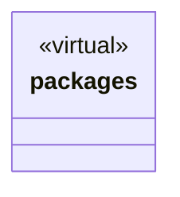

# 工作区资源交换

## 设计意图

在工作区知识和资产库之间发布、预览及导入静态资源包。仓库读写由 Resource 层提供。

## 主要组成

本层由 packages 子模块实现。

<!-- architecture:generated:start -->

## 架构关系

标注为 `virtual` 的节点是直接子模块的虚拟类封装；内部设计沿下方入口阅读。

## 子模块

| 虚拟封装 | 整体职责 |
| --- | --- |
| [packages](packages/ARCHITECTURE.md) | 把静态团队能力和业务架构在工作区与资源仓库之间转换，保留预览与正式应用的区别。 |

[上层设计](../ARCHITECTURE.md)

<!-- architecture:generated:end -->
