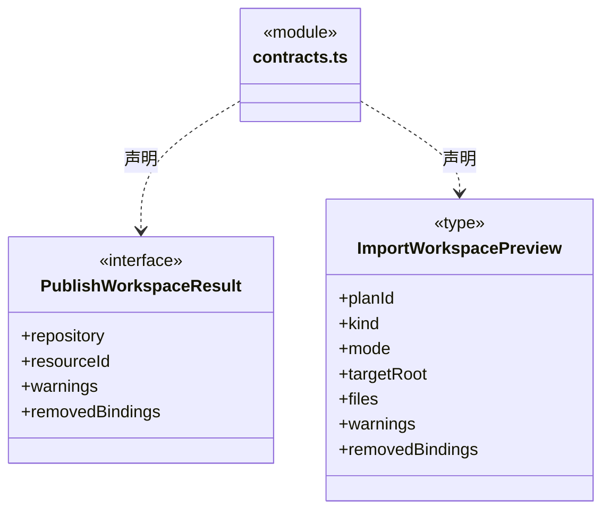
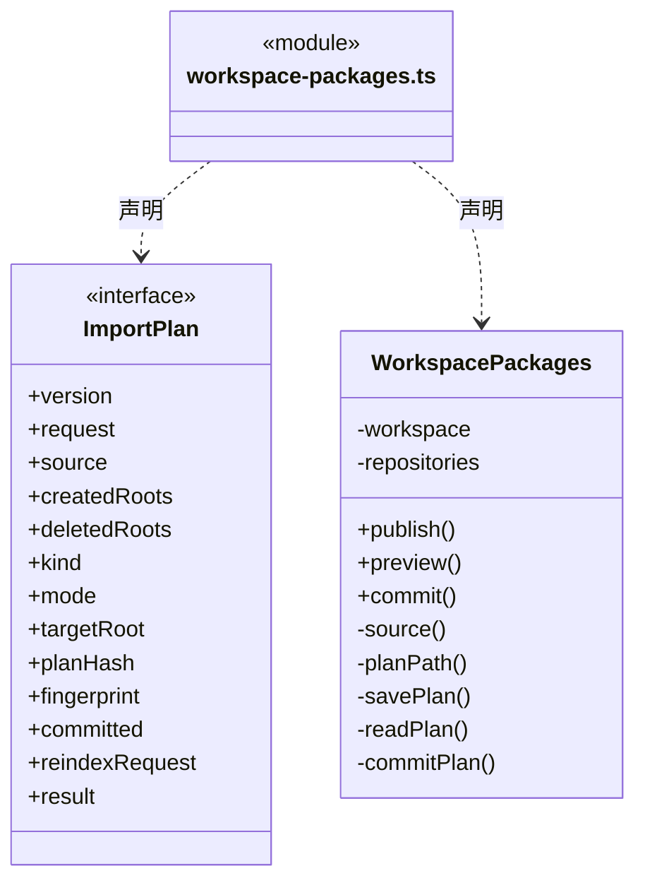
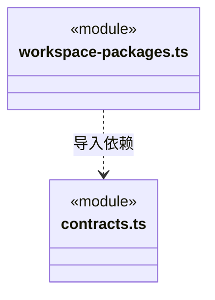

# src/logic/resources/packages 架构

## 目录定位

静态知识包的发布与预览导入；同时核仓库和知识版本，正式导入复用原知识事务。

本文描述当前实现。通过分析目录边界后维护的 [源码架构脚本](../../../../scripts/source-architecture.mjs) 同步清单和声明；代码变更时仍须核对职责、关键成员与关系。

## 代码清单

| 文件 | 当前职责 |
| --- | --- |
| [contracts.ts](contracts.ts) | 静态知识包发布和导入预览结果。 |
| [workspace-packages.ts](workspace-packages.ts) | 把当前工作区的静态团队/业务架构发布到统一资源仓库，并提供持久化导入预览与显式提交。 |

## 架构类图

### contracts.ts

直接依赖：[../index.ts](../index.ts)、[../../knowledge/rules/types.ts](../../knowledge/rules/types.ts)。

### workspace-packages.ts

直接依赖：[../../../core/platform/node/files/index.ts](../../../core/platform/node/files/index.ts)、[../../../core/platform/node/serialization.ts](../../../core/platform/node/serialization.ts)、[../../../core/errors.ts](../../../core/errors.ts)、[../../knowledge/rules/portable-package.ts](../../knowledge/rules/portable-package.ts)、[../../knowledge/rules/ports.ts](../../knowledge/rules/ports.ts)、[../../knowledge/rules/types.ts](../../knowledge/rules/types.ts)、[../../knowledge/rules/planned-commit.ts](../../knowledge/rules/planned-commit.ts)、[contracts.ts](contracts.ts)、[../service/index.ts](../service/index.ts)。

### 本目录调用边界

## 子目录导航

无子目录。

[返回上层](../ARCHITECTURE.md)。

每次修改本目录代码，同步维护文件头、关键契约说明及本图。未实现的治理、证据验收和自动编排能力不列入当前类图。

## 设计契约 v1 与落地范围

以下内容区分已接通能力与后续设计；以各节的实现状态为准，不将目标图当作现状图。维护源：[CONTRACT.md](CONTRACT.md)；生成类图时同步附加，勿直接修改本附录。

# 静态知识包发布与导入

`WorkspacePackages` 只处理静态架构定义。`publish` 从工作区校验快照构建完整包，在用户明确发布操作后保存到当前仓库；源工作区、仓库身份或版本改变则拒绝。相同类型、名称、摘要和完整正文已存在时返回原资源，避免丢失回执后重复发布；不会按名称覆盖其他定义。

`preview` 同时固定工作区实例/版本与源仓库版本/资源哈希，调用原知识校验并将计划保存到工作区的应用缓存 `resource-imports`。预览只显示增删改清单、完整校验和清除绑定提示，不写正式知识。旧普通文本资源、单模块与单 Workflow 资源可继续浏览，不能作为整包应用。

`commit` 必须显式提供同工作区实例的 `planId`。首次写入前复核两端版本、源内容、目标目录冲突及未知资源；正式写入复用 `KnowledgeWorkspace.commit` 的事务、索引和请求幂等日志。跨 IPC 创建的多个门面共用按工作区排队的提交队列。同一计划成功后返回持久化回执；如果正式知识已写入但缓存回执失败，重试只能查询原请求的已提交回执，不能以新版本重放包内容。

整体替换后仅清理已经空的目录，不递归删除任何文件。旧小组物理目录清理后再次通过独立知识事务刷新派生索引；主提交回执和索引请求分别持久化。若并发治理导致索引版本冲突，主包不再执行，显式重试只重新准备索引。未知事务失败保留现场并沿用原恢复要求，不自动重放副作用。实例重启后旧计划不能复用，用户须基于当前知识重新预览。

主知识提交成功后的目录、索引或回执失败以 `RESOURCE_IMPORT_APPLIED` 明确报告“静态定义已应用，后续整理未完成”，附同一个计划 ID；不把部分完成描述成尚未写入或完全成功。完整 Team 替换保留旧 people.json，不再校验历史人员的小组引用；当前静态定义与导入映射仍须完整验证。

共享内容不绑定主会话：一个工作区的静态 Team/业务架构与多个主会话分别拥有的成员调度任务图相互独立。导入不启动 Agent、不派任务、不连接工具、不恢复会话、不继承来源项目的人员或维护授权。

## 整包导入来源意图

`WorkspacePackages` 新预览保存 v2 完整不可变计划，源资源指纹、目标域和 add/replace 语义由真实包规划生成；原样 wire 指纹不经 Schema 键序重排。提交仅把计划引用交给固定知识加载器，不能用可变 committed/result 缓存证明来源结算或知识成功。

缓存回执必须与原知识 journal（含需要时的索引 journal）一致。重开后已提交旧计划仅查询并返回原真实回执，不续办旧实例清理、索引或替换；没有原成功日志的旧实例计划拒绝。全包净差异为空继续拒绝，实际整体 replace 中未变字节的对象仍按明确替换域轮换代次。

资源读写由 [仓库服务](../service/CONTRACT.md) 提供，工作区授权连接归 [连接服务](../../connectors/service/CONTRACT.md)。本模块只处理静态定义包，不拥有反馈或网页工具。
