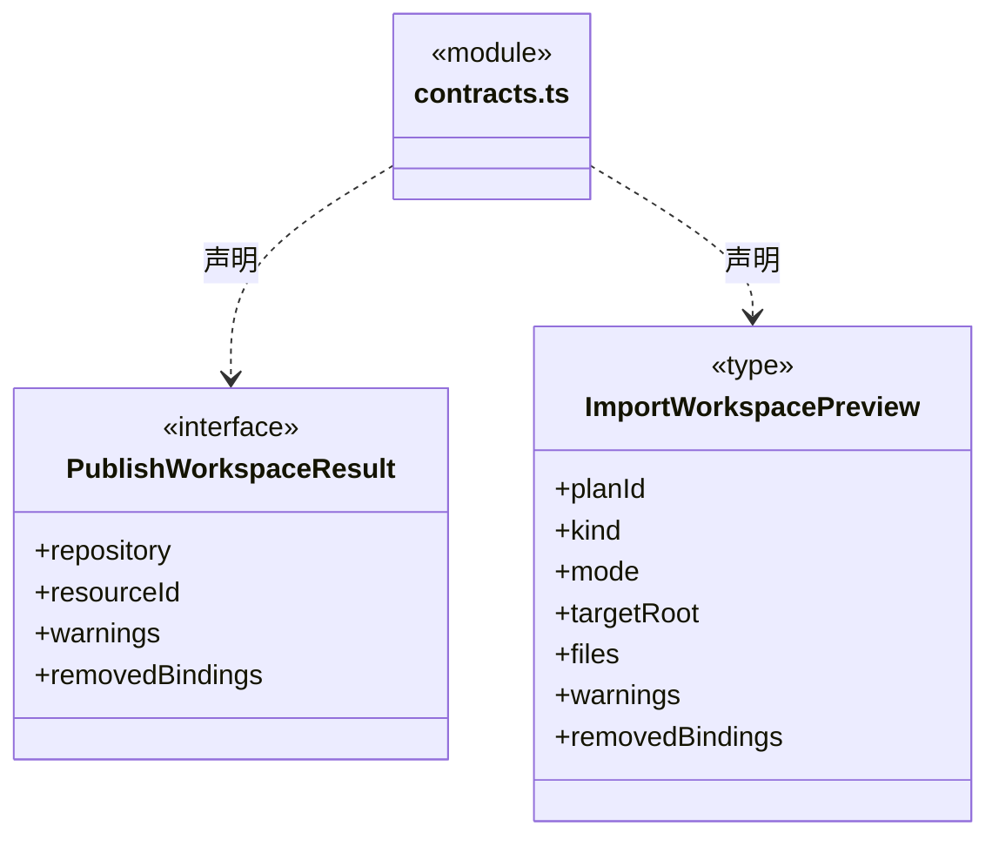
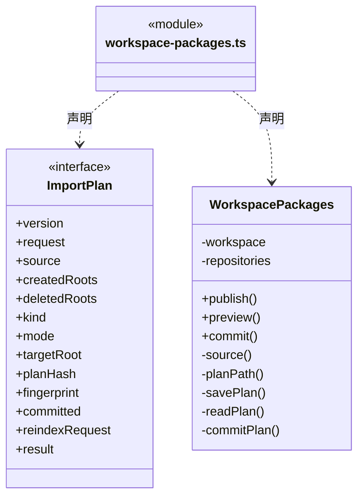
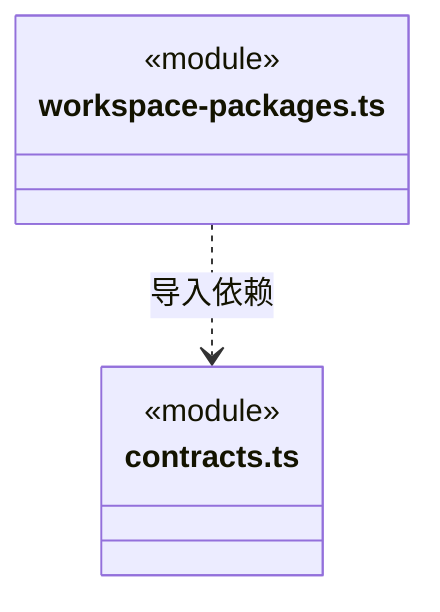

# src/logic/resources/packages 架构

## 目录定位

静态知识包的发布与预览导入；同时核仓库和知识版本，正式导入复用原知识事务。

本文描述当前实现。通过分析目录边界后维护的 [源码架构脚本](../../../../scripts/source-architecture.mjs) 同步清单和声明；代码变更时仍须核对职责、关键成员与关系。

## 代码清单

| 文件 | 当前职责 |
| --- | --- |
| [contracts.ts](contracts.ts) | 静态知识包发布和导入预览结果。 |
| [workspace-packages.ts](workspace-packages.ts) | 把当前工作区的静态团队/业务架构发布到统一资源仓库，并提供持久化导入预览与显式提交。 |

## 架构类图

### contracts.ts

直接依赖：[../index.ts](../index.ts)、[../../knowledge/rules/types.ts](../../knowledge/rules/types.ts)。

### workspace-packages.ts

直接依赖：[../../../core/platform/node/files/index.ts](../../../core/platform/node/files/index.ts)、[../../../core/platform/node/serialization.ts](../../../core/platform/node/serialization.ts)、[../../../core/errors.ts](../../../core/errors.ts)、[../../knowledge/rules/portable-package.ts](../../knowledge/rules/portable-package.ts)、[../../knowledge/rules/ports.ts](../../knowledge/rules/ports.ts)、[../../knowledge/rules/types.ts](../../knowledge/rules/types.ts)、[../../knowledge/rules/planned-commit.ts](../../knowledge/rules/planned-commit.ts)、[contracts.ts](contracts.ts)、[../service/index.ts](../service/index.ts)。

### 本目录调用边界

## 子目录导航

无子目录。

[返回上层](../ARCHITECTURE.md)。

每次修改本目录代码，同步维护文件头、关键契约说明及本图。未实现的治理、证据验收和自动编排能力不列入当前类图。
