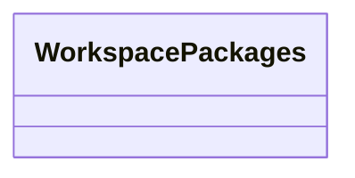

# src/logic/resources/packages 架构

## 设计意图

把静态团队能力和业务架构在工作区与资源仓库之间转换，保留预览与正式应用的区别。

`WorkspacePackages` 同时核实仓库和知识版本，发布静态包或保存导入预览，明确提交时复用原知识事务。包不携带活动运行、授权或本机服务实例；预览成功不表示工作区已经改变。

## 主要组成

| 组成 | 定位 |
| --- | --- |
| [WorkspacePackages](workspace-packages.ts) | 把当前工作区的静态团队/业务架构发布到统一资源仓库，并提供持久化导入预览与显式提交。 |

<!-- architecture:generated:start -->

## 架构关系

[上层设计](../ARCHITECTURE.md)

<!-- architecture:generated:end -->
