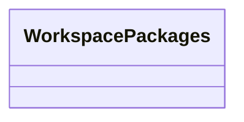

# src/logic/resources/packages 架构

## 设计意图

静态知识包的发布与预览导入；同时核仓库和知识版本，正式导入复用原知识事务。

## 主要组成

| 组成 | 定位 |
| --- | --- |
| [WorkspacePackages](workspace-packages.ts) | 把当前工作区的静态团队/业务架构发布到统一资源仓库，并提供持久化导入预览与显式提交。 |

<!-- architecture:generated:start -->

## 架构关系

[上层设计](../ARCHITECTURE.md)

<!-- architecture:generated:end -->
