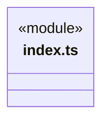
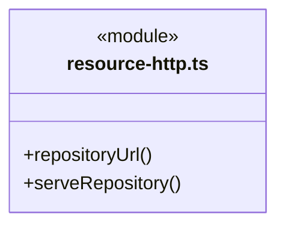
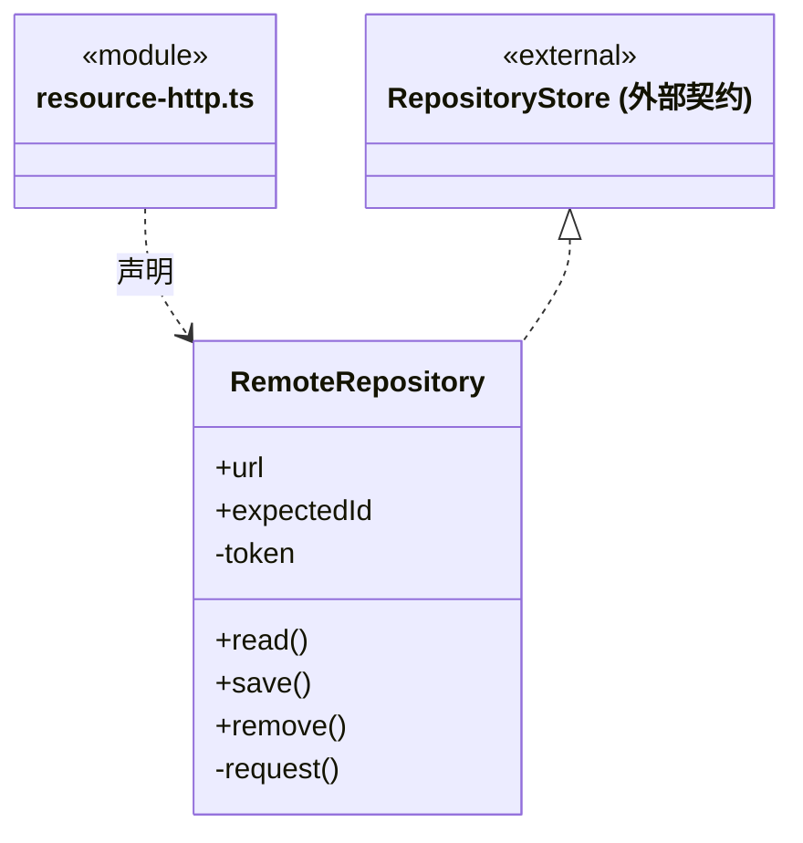
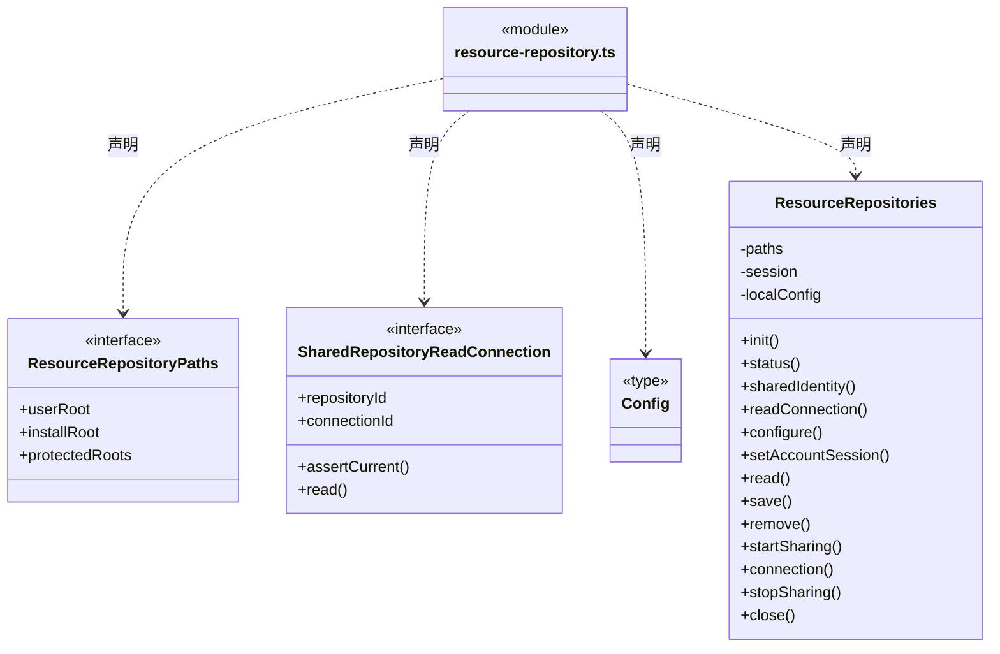
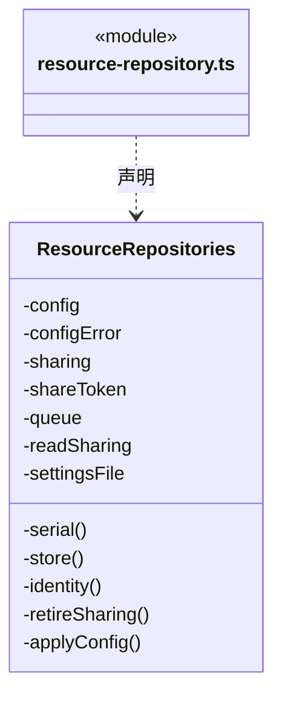
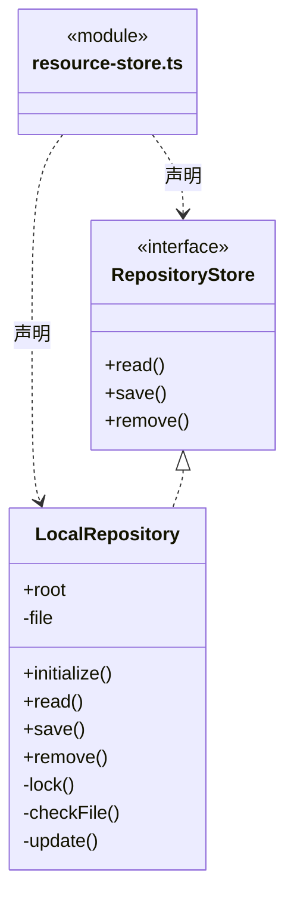
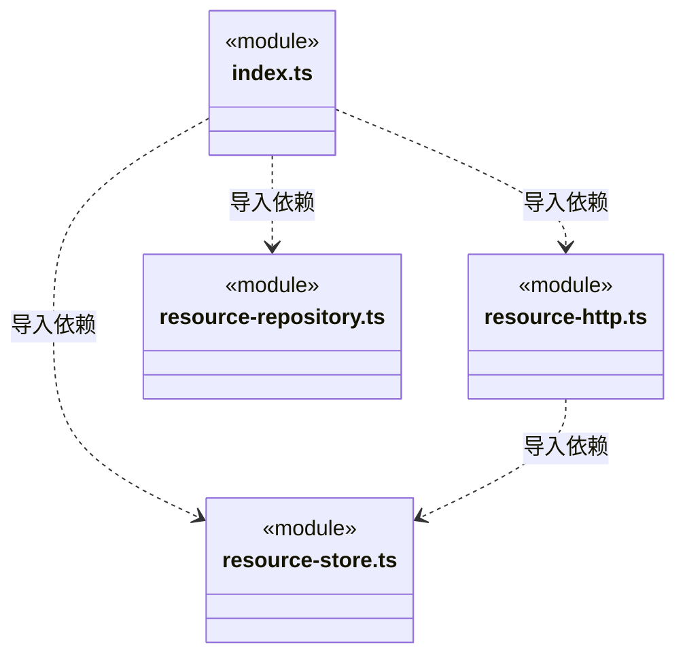
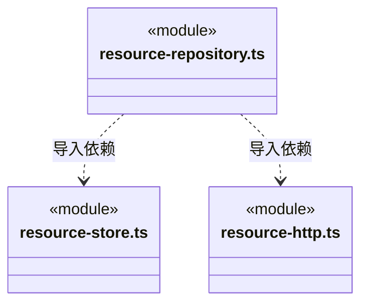

# src/logic/resources/service 架构

## 目录定位

本地/HTTP 资源仓库、版本与身份校验、共享代际与取消；宿主仅提供目录边界，不持有应用或 Bridge。

本文描述当前实现。通过分析目录边界后维护的 [源码架构脚本](../../../../scripts/source-architecture.mjs) 同步清单和声明；代码变更时仍须核对职责、关键成员与关系。

## 代码清单

| 文件 | 当前职责 |
| --- | --- |
| [index.ts](index.ts) | 资源仓库的宿主服务入口，组合本地存储、HTTP 和共享生命周期。 |
| [resource-http.ts](resource-http.ts) | RemoteRepository 与 serveRepository：HTTP 客户端和本机仓库共享服务。 |
| [resource-repository.ts](resource-repository.ts) | ResourceRepositories：统一三类资源的仓库选择、账号占位与共享生命周期。 |
| [resource-store.ts](resource-store.ts) | RepositoryStore 与 LocalRepository：本地资源仓库校验、版本检查及原子更新。 |

## 架构类图

### index.ts

直接依赖：[resource-store.ts](resource-store.ts)、[resource-http.ts](resource-http.ts)、[resource-repository.ts](resource-repository.ts)。

### resource-http.ts

直接依赖：[../../../core/utility/index.ts](../../../core/utility/index.ts)、[../../../core/errors.ts](../../../core/errors.ts)、[resource-store.ts](resource-store.ts)。

### resource-repository.ts

成员 1/2（同名节点为同一声明，跨图合并阅读）。

成员 2/2（同名节点为同一声明，跨图合并阅读）。

直接依赖：[../../../core/platform/node/files/index.ts](../../../core/platform/node/files/index.ts)、[../../../core/errors.ts](../../../core/errors.ts)、[../../../core/utility/index.ts](../../../core/utility/index.ts)、[resource-store.ts](resource-store.ts)、[resource-http.ts](resource-http.ts)、[../index.ts](../index.ts)。

### resource-store.ts

直接依赖：[../../../core/platform/node/locking.ts](../../../core/platform/node/locking.ts)、[../../../core/platform/node/files/index.ts](../../../core/platform/node/files/index.ts)、[../../../core/errors.ts](../../../core/errors.ts)、[../../../core/platform/node/digest.ts](../../../core/platform/node/digest.ts)、[../../../core/utility/index.ts](../../../core/utility/index.ts)、[../index.ts](../index.ts)。

### 本目录调用边界

## 子目录导航

无子目录。

[返回上层](../ARCHITECTURE.md)。

每次修改本目录代码，同步维护文件头、关键契约说明及本图。未实现的治理、证据验收和自动编排能力不列入当前类图。

## 设计契约 v1 与落地范围

以下内容区分已接通能力与后续设计；以各节的实现状态为准，不将目标图当作现状图。维护源：[CONTRACT.md](CONTRACT.md)；生成类图时同步附加，勿直接修改本附录。

# 资源仓库服务

index.ts 是宿主入口。LocalRepository 保留 8 MiB、符号链接拒绝、仓库身份与 revision CAS、原子写盘和原生锁。RemoteRepository 保留固定 v1 协议、8 秒时限、取消、大小限制及未知写结果不重试。ResourceRepositories 持有选择配置、串行队列和共享代际，退役时取消原只读闭包。

ResourceRepositoryPaths 只要求 userRoot、installRoot、protectedRoots，宿主的 Paths 结构兼容；服务不能因此访问工程身份、知识路径或其他应用方法。受保护目录及 .cbim 的拒绝规则、账号占位和共享令牌不变。文件格式、摘要和 HTTP 字节不变。

本片先迁移边界已闭合的仓库服务，知识发布导入和工作区授权连接仍在旧 Main；后续与知识契约一起迁移。单元验证本地 CAS，既有真实 HTTP/应用/授权集成继续保留，不使用替身删除协作覆盖。
