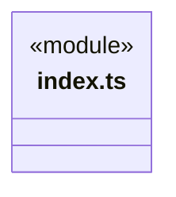
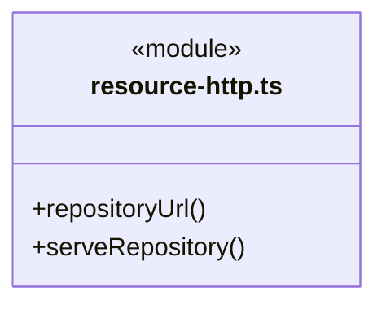
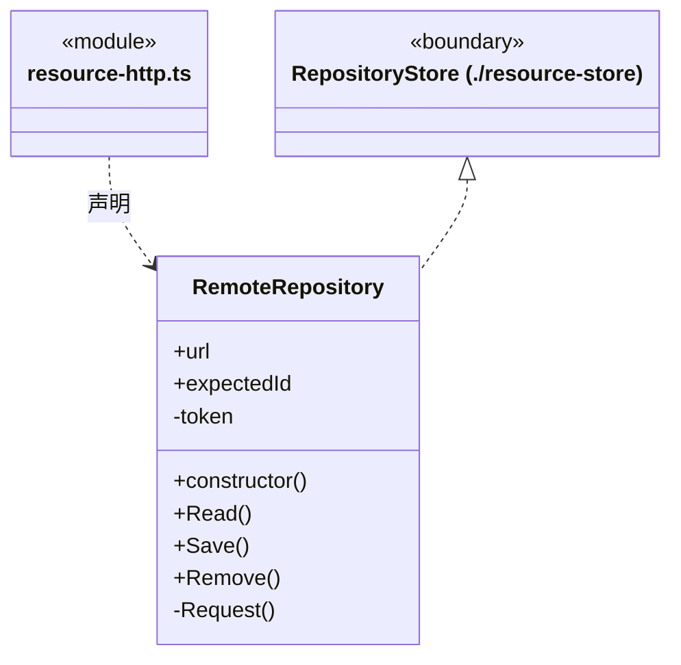
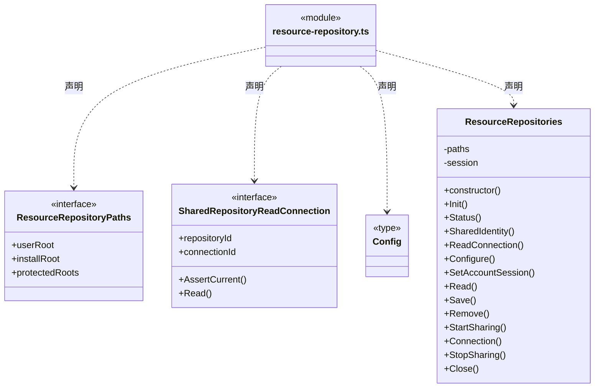
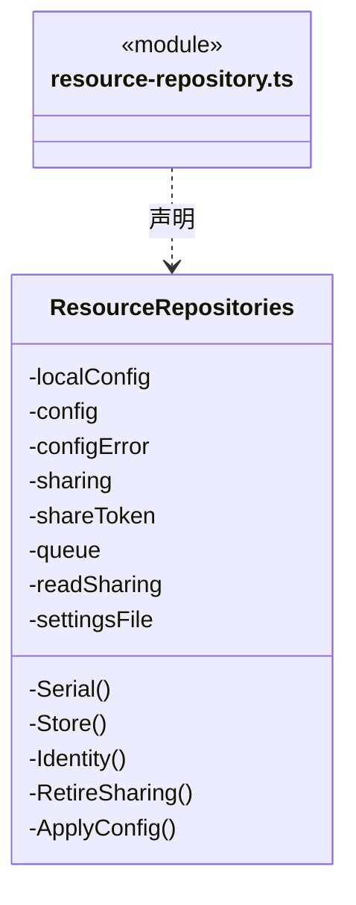
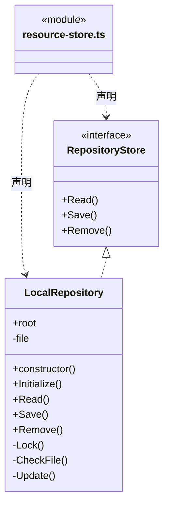
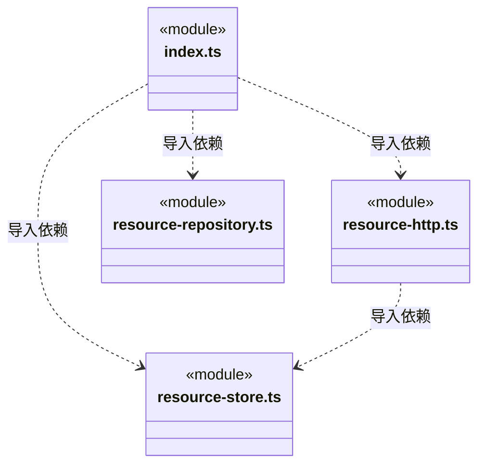
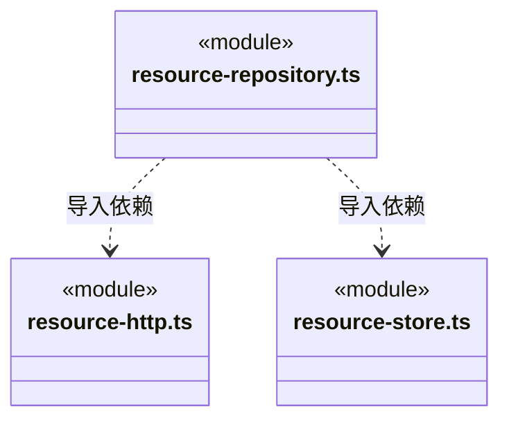

# src/logic/resources/service 架构

本目录只维护这一份说明。设计与契约直接编辑本文；文件清单、类图和导航由 [架构脚本](../../../../scripts/source-architecture.mjs) 更新，生成区域之外的人工说明会保留。

## 封装意图

本地/HTTP 资源仓库、版本与身份校验、共享代际与取消；宿主仅提供目录边界，不持有应用或 Bridge。

## 类与模块的设计意图

下表依据源码声明及文件头说明定位封装。字段表示该实例持有的状态或协作引用，不表示它拥有被引用服务的生命周期；实际资源责任和调用限制见下文契约及源码注释。

| 类／模块 | 实现形式与实例字段 | 封装依据 |
| --- | --- | --- |
| [index.ts](index.ts) | 函数／契约模块 | 只暴露实际消费者所需契约；登录、路径与权限由调用方明确提供。 |
| [RemoteRepository](resource-http.ts) | 实例类；持有 `url`、`token`、`expectedId` | 资源身份、令牌和业务错误留在本层；utility 显式取消正文 reader，保留 Node 22 挂起修复，不依赖 fetch 继续转发信号。 |
| [ResourceRepositories](resource-repository.ts) | 实例类；持有 `session`、`localConfig`、`config`、`configError`、`sharing`、`shareToken`、`queue`、`readSharing`、`paths` | 链接器、人才市场和模板共用当前身份的仓库；显式共享生成短期读写/只读凭据，代际退役会取消旧读取，登录占位不被当成账号连接。 |
| [LocalRepository](resource-store.ts) | 实例类；持有 `root` | 用统一接口隔离本地和远端仓库，写入要求仓库身份与版本一致；允许完整静态架构包，仍统一限制单项和仓库总字节数。 |

## 接口设计契约

### 资源仓库服务

index.ts 是宿主入口。LocalRepository 保留 8 MiB、符号链接拒绝、仓库身份与 revision CAS、原子写盘和原生锁。RemoteRepository 保留固定 v1 协议、8 秒时限、取消、大小限制及未知写结果不重试。ResourceRepositories 持有选择配置、串行队列和共享代际，退役时取消原只读闭包。

ResourceRepositoryPaths 只要求 userRoot、installRoot、protectedRoots，宿主的 Paths 结构兼容；服务不能因此访问工程身份、知识路径或其他应用方法。受保护目录及 .cbim 的拒绝规则、账号占位和共享令牌不变。文件格式、摘要和 HTTP 字节不变。

知识包发布导入归 [resources/packages](../packages/ARCHITECTURE.md#contract)，工作区授权连接归 [connectors/service](../../connectors/service/ARCHITECTURE.md#contract)，本目录只持有仓库及共享生命周期。单元验证本地 CAS，既有真实 HTTP/应用/授权集成继续保留，不使用替身删除协作覆盖。

#### 仓库响应与共享

RemoteRepository 组合 utility.readBoundedBytes，按 `MAX_BYTES + 65536` 限制原字节，显式取消挂起 reader 并释放锁/监听；保留 #70 已修复的 Node 22 信号转发缺口。取消或超时不交付半截 JSON。8 秒期限、CANCELLED/TIMEOUT/SIZE/CONNECTION/PROTOCOL 分类、令牌、仓库身份和不重试语义仍由 request 决定；基础流不接触 URL 或凭据。

链接器、人才市场和业务模板共用 `ResourceRepositories` 的当前仓库。未登录使用本机目录；已连接服务器仓库沿用现有账号会话抽象。界面尚未实现的账户服务不会被本模块冒充为云上传。仓库快照绑定 `repositoryId` 与 `revision`，资源整体 JSON 最多 8 MiB、单项正文最多 2 MiB。

#### 共享算法调用边界

本目录通过 Core 公开入口调用 `ByteUtils.ReadBoundedBytes`、`JsonUtils.FormatJson`。静态类只承载原算法；本目录继续决定字段、比较器、错误映射及资源生命周期。函数改为静态方法不改变原持久化字节或失败语义。

## 开闭边界

本目录的职责及允许协作由[封装意图](#封装意图)限定，输入输出、状态与失败语义以[接口设计契约](#接口设计契约)为准。扩展从已有公开入口及实际装配位置进入；没有明确可替换契约的部分按真实影响修改和验证，不预建未使用的基类或插件入口。

<!-- architecture:generated:start -->

## 文件清单

| 文件 | 形式 | 当前职责 |
| --- | --- | --- |
| [ARCHITECTURE.md](ARCHITECTURE.md) | 说明文档 | 本目录的文件清单、真实声明、依赖与子封装导航。 |
| [index.ts](index.ts) | 源码模块 | 资源仓库的宿主服务入口，组合本地存储、HTTP 和共享生命周期。 |
| [resource-http.ts](resource-http.ts) | 源码模块 | RemoteRepository 与 serveRepository：HTTP 客户端和本机仓库共享服务。 |
| [resource-repository.ts](resource-repository.ts) | 源码模块 | ResourceRepositories：统一三类资源的仓库选择、账号占位与共享生命周期。 |
| [resource-store.ts](resource-store.ts) | 源码模块 | RepositoryStore 与 LocalRepository：本地资源仓库校验、版本检查及原子更新。 |

## 架构类图

成员标记：`+` 公开、`-` 私有、`#` 受保护、`$` 静态；构造函数单独列出。文档和资源仅在文件清单中导航，不作为代码节点。

### index.ts

直接依赖：[resource-http.ts](resource-http.ts)、[resource-repository.ts](resource-repository.ts)、[resource-store.ts](resource-store.ts)。

### resource-http.ts

继承／实现来源：`RepositoryStore` → [resource-store.ts](resource-store.ts)。
直接依赖：[../../../core/errors.ts](../../../core/errors.ts)、[../../../core/utility/index.ts](../../../core/utility/index.ts)、[resource-store.ts](resource-store.ts)。

### resource-repository.ts

成员 1/2（同名节点为同一声明，跨图合并阅读）。

成员 2/2（同名节点为同一声明，跨图合并阅读）。

直接依赖：[../../../core/errors.ts](../../../core/errors.ts)、[../../../core/platform/node/files/index.ts](../../../core/platform/node/files/index.ts)、[../../../core/utility/index.ts](../../../core/utility/index.ts)、[../index.ts](../index.ts)、[resource-http.ts](resource-http.ts)、[resource-store.ts](resource-store.ts)。

### resource-store.ts

直接依赖：[../../../core/errors.ts](../../../core/errors.ts)、[../../../core/platform/node/digest.ts](../../../core/platform/node/digest.ts)、[../../../core/platform/node/files/index.ts](../../../core/platform/node/files/index.ts)、[../../../core/platform/node/locking.ts](../../../core/platform/node/locking.ts)、[../../../core/utility/index.ts](../../../core/utility/index.ts)、[../index.ts](../index.ts)。

### 本目录调用边界

## 子目录导航

无子目录。

[返回上层](../ARCHITECTURE.md)。

每次修改本目录代码，同步维护文件头、关键契约说明及本图。未实现的治理、证据验收和自动编排能力不列入当前类图。

<!-- architecture:generated:end -->
