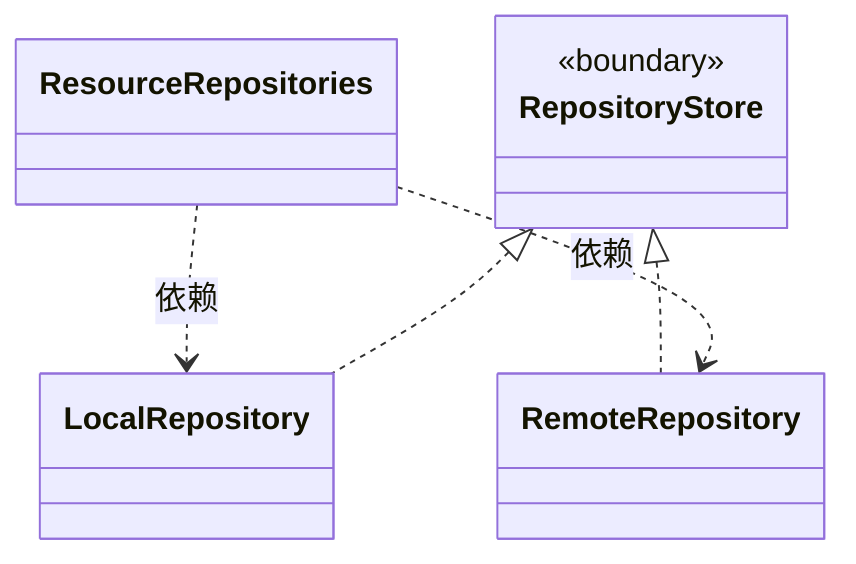

# src/logic/resources/service 架构

## 设计意图

本地/HTTP 资源仓库、版本与身份校验、共享代际与取消；宿主仅提供目录边界，不持有应用或 Bridge。

## 主要组成

| 组成 | 定位 |
| --- | --- |
| [RemoteRepository](resource-http.ts) | RemoteRepository 与 serveRepository：HTTP 客户端和本机仓库共享服务。 |
| [ResourceRepositories](resource-repository.ts) | ResourceRepositories：统一三类资源的仓库选择、账号占位与共享生命周期。 |
| [LocalRepository](resource-store.ts) | RepositoryStore 与 LocalRepository：本地资源仓库校验、版本检查及原子更新。 |

<!-- architecture:generated:start -->

## 架构关系

外部继承／实现边界：[RepositoryStore](resource-store.ts)。

[上层设计](../ARCHITECTURE.md)

<!-- architecture:generated:end -->
