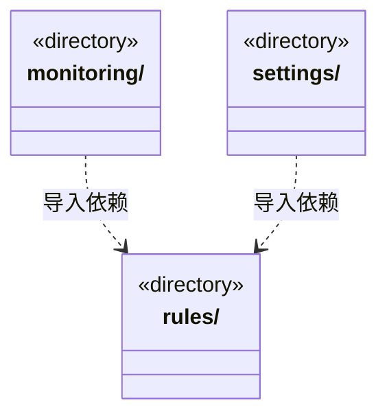

# src/logic/runtime 架构

本目录只维护这一份说明。设计与契约直接编辑本文；文件清单、类图和导航由 [架构脚本](../../../scripts/source-architecture.mjs) 更新，生成区域之外的人工说明会保留。

## 封装意图

运行状态及终态事实规则；服务与规则分开归属，实际依赖通过明确入口验证。

## 类与模块的设计意图

本层没有直接源码声明，负责组合下级封装；各子系统的类、状态与公开入口见本文的[子目录导航](#子目录导航)。

## 接口设计契约

本层没有独立代码入口或运行实例。公开契约与资源生命周期分别归属下级封装，按[子目录导航](#子目录导航)进入实际所有者。

## 开闭边界

本目录的职责及允许协作由[封装意图](#封装意图)限定，输入输出、状态与失败语义以[接口设计契约](#接口设计契约)为准。扩展从已有公开入口及实际装配位置进入；没有明确可替换契约的部分按真实影响修改和验证，不预建未使用的基类或插件入口。

<!-- architecture:generated:start -->

## 文件清单

| 文件 | 形式 | 当前职责 |
| --- | --- | --- |
| [ARCHITECTURE.md](ARCHITECTURE.md) | 说明文档 | 本目录的文件清单、真实声明、依赖与子封装导航。 |

本层无直接代码文件。

## 架构类图

成员标记：`+` 公开、`-` 私有、`#` 受保护、`$` 静态；`function` 为函数值成员，`get`／`set` 为访问器。调用／构造／索引签名按匿名签名列出，不虚构方法名；`global.` 表示全局声明补充，非运行时嵌套类。构造函数单独列出，运行时私有字段保留 `#`。文档和资源仅在文件清单中导航，不作为代码节点。

各图中的同名节点表示同一目录边界；跨组及完整直接依赖如下（无边不代表继承）：

- `monitoring` → `rules`：导入。
- `settings` → `rules`：导入。

## 子目录导航

- [monitoring/](monitoring/ARCHITECTURE.md)：监管、履历与全局并发准入职责分离。可靠提交同步周期白名单，scope-only 更新独立游标，未变投影不重复发布；检查点计待办而不占活动名额，报告用量不授予额度或恢复权。
- [rules/](rules/ARCHITECTURE.md)：应用级只读监管、真实周期白名单与独立准入契约。周期等待/结算和模型轮次分开，严格传输不补造缺失计量；游标、票据和占用不签发恢复权。
- [settings/](settings/ARCHITECTURE.md)：Logic 层的应用并发设置持久化：在工作区打开前恢复准入策略，配置可靠写盘后才影响新运行。协作方为 Application、GlobalRunAdmission 和可注入文件存储；不管理模型、网页、预算或知识配置。

[返回上层](../ARCHITECTURE.md)。

每次修改本目录代码，同步维护文件头、关键契约说明及本图。未实现的治理、证据验收和自动编排能力不列入当前类图。

<!-- architecture:generated:end -->
