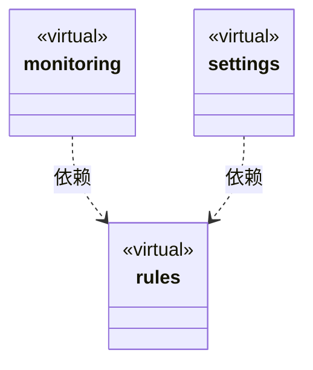

# src/logic/runtime 架构

## 设计意图

提供应用级运行观察与准入设置。规则定义可公开的运行事实，monitoring 聚合只读状态，settings 保存配置；观察状态不签发执行或恢复权限。

## 主要组成

本层由下列子模块组合，每个子模块作为独立的虚拟类封装参与本层协作。

<!-- architecture:generated:start -->

## 架构关系

标注为 `virtual` 的节点是直接子模块的虚拟类封装；内部设计沿下方入口阅读。

## 子模块

| 虚拟封装 | 整体职责 |
| --- | --- |
| [monitoring](monitoring/ARCHITECTURE.md) | 汇集成员、任务和目标周期的运行事实，向消费者提供增量只读视图。全局管理器维护监管投影，事件流按成员组织更新，不替代业务服务或运行准入。 |
| [rules](rules/ARCHITECTURE.md) | 应用级只读监管、真实周期白名单与独立准入契约。周期等待/结算和模型轮次分开，严格传输不补造缺失计量；游标、票据和占用不签发恢复权。 |
| [settings](settings/ARCHITECTURE.md) | Logic 层的应用并发设置持久化：在工作区打开前恢复准入策略，配置可靠写盘后才影响新运行。协作方为 Application、GlobalRunAdmission 和可注入文件存储；不管理模型、网页、预算或知识配置。 |

[上层设计](../ARCHITECTURE.md)

<!-- architecture:generated:end -->
