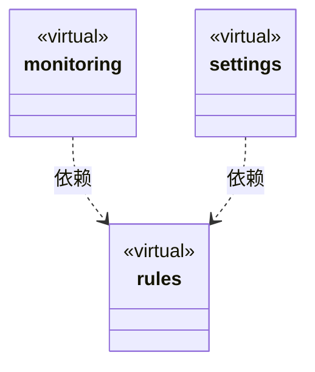

# src/logic/runtime 架构

## 设计意图

提供应用级运行事实的只读观察与并发策略配置，使监管不成为第二套调度系统。

`rules` 定义公开事实和准入数据，`monitoring` 聚合已提交状态，`settings` 保存后续运行使用的配置。运行轮次、业务周期及资源占用分别展示，读取游标或历史状态不签发执行和恢复权限。

## 主要组成

本层没有直接产品实现，由下方子模块组成；每个直接子模块作为一个虚拟封装，只在本层呈现整体职责与协作。

<!-- architecture:generated:start -->

## 架构关系

标注为 `virtual` 的节点是直接子模块的虚拟类封装；内部设计沿下方入口阅读。

## 子模块

| 虚拟封装 | 整体职责 |
| --- | --- |
| [monitoring](monitoring/ARCHITECTURE.md) | 汇集已提交的人员、任务、目标周期和执行事件，向界面提供一致的增量只读投影。 |
| [rules](rules/ARCHITECTURE.md) | 定义监管快照、周期摘要和准入票据的纯数据边界，防止展示信息被解释成执行许可。 |
| [settings](settings/ARCHITECTURE.md) | 持久保存应用并发策略，在工作区装配前恢复并向准入协调器应用配置。 |

[上层设计](../ARCHITECTURE.md)

<!-- architecture:generated:end -->
