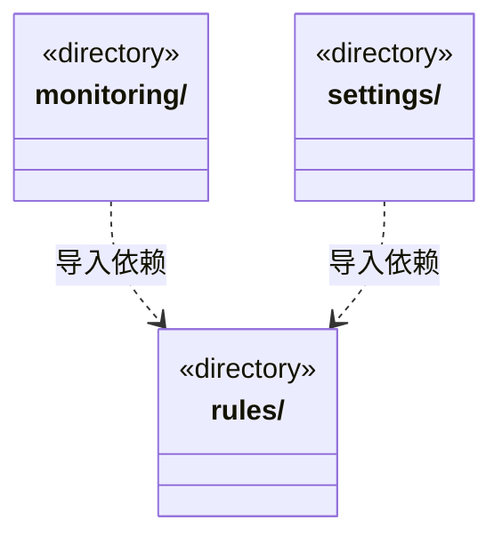

# src/logic/runtime 架构

## 目录定位

运行状态及终态事实规则；服务与规则分开归属，实际依赖通过明确入口验证。

本文描述当前实现。通过分析目录边界后维护的 [源码架构脚本](../../../scripts/source-architecture.mjs) 同步清单和声明；代码变更时仍须核对职责、关键成员与关系。

## 代码清单

本层无直接代码文件。

## 架构类图

各图中的同名节点表示同一目录边界；跨组及完整直接依赖如下（无边不代表继承）：

- `monitoring` → `rules`：导入。
- `settings` → `rules`：导入。

## 子目录导航

- [monitoring/](monitoring/ARCHITECTURE.md)：监管、履历与全局并发准入职责分离。可靠提交同步周期白名单，scope-only 更新独立游标，未变投影不重复发布；检查点计待办而不占活动名额，报告用量不授予额度或恢复权。
- [rules/](rules/ARCHITECTURE.md)：应用级只读监管、真实周期白名单与独立准入契约。周期等待/结算和模型轮次分开，严格传输不补造缺失计量；游标、票据和占用不签发恢复权。
- [settings/](settings/ARCHITECTURE.md)：应用设置及命名文件存储；与模型配置、派发、运行及知识持久化分开定位。

[返回上层](../ARCHITECTURE.md)。

每次修改本目录代码，同步维护文件头、关键契约说明及本图。未实现的治理、证据验收和自动编排能力不列入当前类图。
