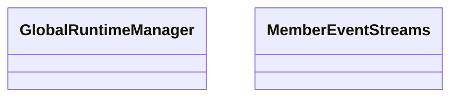

# src/logic/runtime/monitoring 架构

## 设计意图

汇集已提交的人员、任务、目标周期和执行事件，向界面提供一致的增量只读投影。

`GlobalRuntimeManager` 维护应用监管索引，`MemberEventStreams` 按真实运行关联事件与缓存，公开事件投影剔除私有信息。观察由应用装配接入，更新失败不能反向改写派发事实；模型轮次终态不替代周期结算。

## 主要组成

| 组成 | 定位 |
| --- | --- |
| [GlobalRuntimeManager](global-runtime.ts) | 保存应用级人员、派发、周期和消耗的只读投影，接收应用装配提供的可靠提交。 |
| [MemberEventStreams](member-events.ts) | 将成员运行日志投影为可公开的连续事件流，并按 run 缓存首次恢复及后续已落盘增量。 |

<!-- architecture:generated:start -->

## 架构关系

[上层设计](../ARCHITECTURE.md)

<!-- architecture:generated:end -->
