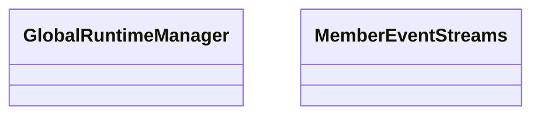

# src/logic/runtime/monitoring 架构

## 设计意图

汇集成员、任务和目标周期的运行事实，向消费者提供增量只读视图。全局管理器维护监管投影，事件流按成员组织更新，不替代业务服务或运行准入。

## 主要组成

| 组成 | 定位 |
| --- | --- |
| [GlobalRuntimeManager](global-runtime.ts) | 维护整个应用的成员、派发任务、目标周期与实际 Loop 消耗索引，接收 main 的可靠提交；周期结算独立于模型轮次，成员运行不重复生成任务。 |
| [MemberEventStreams](member-events.ts) | 将成员运行日志投影为可公开的连续事件流，并按 run 缓存首次恢复及后续已落盘增量。 |

<!-- architecture:generated:start -->

## 架构关系

[上层设计](../ARCHITECTURE.md)

<!-- architecture:generated:end -->
