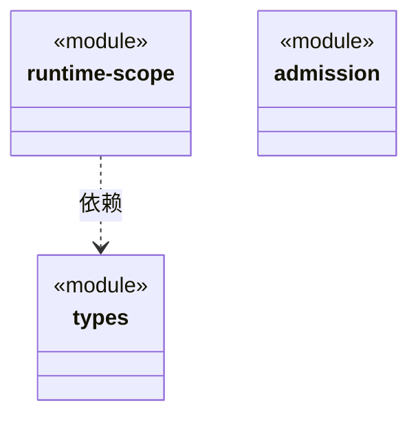

# src/logic/runtime/rules 架构

## 设计意图

定义监管快照、周期摘要和准入票据的纯数据边界，防止展示信息被解释成执行许可。

`types` 与校验函数限定公开字段，`runtime-scope` 从已提交周期投影事实，`admission` 表达等待与占用。缺失计量保持缺失，不补造零费用或运行终态；读取和状态转换由不同消费者承担。

## 主要组成

| 组成 | 定位 |
| --- | --- |
| [types](types.ts) | 定义应用级人员、任务与运行消耗的只读监管契约，供调度索引和桌面桥接共同使用。 |
| [admission](admission.ts) | 定义应用级执行准入的公开策略、身份、占用、等待票据与独立读取游标。 |
| [runtime-scope](runtime-scope.ts) | 从已提交 DispatchScope 生成应用级监管的最小周期事实，供运行索引恢复和增量提交共用。 |

<!-- architecture:generated:start -->

## 架构关系

[上层设计](../ARCHITECTURE.md)

<!-- architecture:generated:end -->
