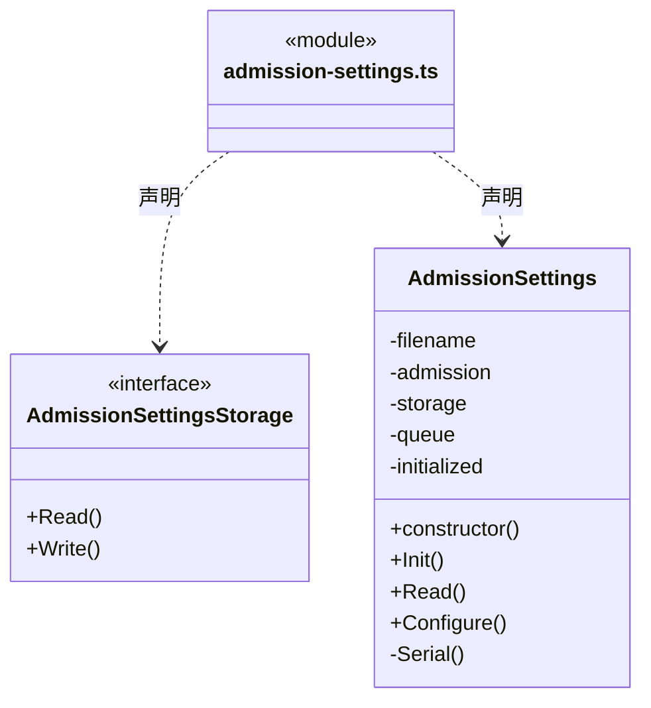

# src/logic/runtime/settings 架构

本目录只维护这一份说明。设计与契约直接编辑本文；文件清单、类图和导航由 [架构脚本](../../../../scripts/source-architecture.mjs) 更新，生成区域之外的人工说明会保留。

## 封装意图

Logic 层的应用并发设置持久化：在工作区打开前恢复准入策略，配置可靠写盘后才影响新运行。协作方为 Application、GlobalRunAdmission 和可注入文件存储；不管理模型、网页、预算或知识配置。

## 类与模块的设计意图

下表依据源码声明及文件头说明定位封装。字段表示该实例持有的状态或协作引用，不表示它拥有被引用服务的生命周期；实际资源责任和调用限制见下文契约及源码注释。

| 类／模块 | 实现形式与实例字段 | 封装依据 |
| --- | --- | --- |
| [AdmissionSettings](admission-settings.ts) | 实例类；持有 `queue`、`initialized`、`filename`、`admission`、`storage` | 应用唯一实例；只在 Init 成功后向桌面提供配置入口。 |

## 接口设计契约

`AdmissionSettings` 是本目录唯一设置服务，由 Application 持有。它只负责并发上限的持久化和启动恢复，准入票据、运行占用与唤醒仍归 [GlobalRunAdmission](../../execution/admission/run-admission.ts)。

`Init()` 与保存共用实例 SerialQueue，在工作区打开前读取 `version:1 + policy:{revision,maxConcurrentRuns}`。仅 ENOENT 沿用准入器默认值（初始为 4）；损坏或读取错误报告 `ADMISSION_SETTINGS_INVALID`，不覆盖原文件。初始化成功后重复调用不重复恢复。

`Read()` 返回已生效策略的副本；未初始化报告 `ADMISSION_NOT_READY`。`Configure(raw)` 严格要求 1～32 的整数上限及当前 revision。版本不符报 `ADMISSION_SETTINGS_CONFLICT`；相同上限直接返回，版本用尽拒绝。变更先原子写盘，成功后在无 await 的同一阶段应用新策略，写入失败保留原上限并报告 `ADMISSION_SETTINGS_WRITE`。降低上限不终止已获准运行。

`AdmissionSettingsStorage.Read/Write` 是已有文件适配点，默认使用 fs 与 Core 的 atomic；测试可注入读取／写入失败，不向 IPC 暴露路径或函数。本服务不持有长期文件句柄，没有取消或 Close 接口；串行队列只约束同一实例，不提供跨进程互斥。

网页、模型、主 Agent 和预算设置已分别归属 [web/service](../../web/service/ARCHITECTURE.md)、[models/service](../../models/service/ARCHITECTURE.md)、[team/settings](../../team/settings/ARCHITECTURE.md)、[budget/settings](../../budget/settings/ARCHITECTURE.md)；引擎模型兼容与多角色准备归 [engines/service](../../engines/service/ARCHITECTURE.md)。本目录不再复制这些配置契约。上方保留旧章节锚点供既有导航兼容。

## 开闭边界

本目录的职责及允许协作由[封装意图](#封装意图)限定，输入输出、状态与失败语义以[接口设计契约](#接口设计契约)为准。扩展从已有公开入口及实际装配位置进入；没有明确可替换契约的部分按真实影响修改和验证，不预建未使用的基类或插件入口。

<!-- architecture:generated:start -->

## 文件清单

| 文件 | 形式 | 当前职责 |
| --- | --- | --- |
| [ARCHITECTURE.md](ARCHITECTURE.md) | 说明文档 | 本目录的文件清单、真实声明、依赖与子封装导航。 |
| [admission-settings.ts](admission-settings.ts) | 源码模块 | 持久化应用级并发上限，并在工作区装配前恢复准入策略。 |

## 架构类图

成员标记：`+` 公开、`-` 私有、`#` 受保护、`$` 静态；`function` 为函数值成员，`get`／`set` 为访问器。调用／构造／索引签名按匿名签名列出，不虚构方法名；`global.` 表示全局声明补充，非运行时嵌套类。构造函数单独列出，运行时私有字段保留 `#`。文档和资源仅在文件清单中导航，不作为代码节点。

### admission-settings.ts

[查看源码](admission-settings.ts)。

直接依赖：[../../../core/errors.ts](../../../core/errors.ts)、[../../../core/platform/node/files/index.ts](../../../core/platform/node/files/index.ts)、[../../../core/utility/index.ts](../../../core/utility/index.ts)、[../../execution/admission/run-admission.ts](../../execution/admission/run-admission.ts)、[../rules/admission.ts](../rules/admission.ts)。

## 子目录导航

无子目录。

[返回上层](../ARCHITECTURE.md)。

每次修改本目录代码，同步维护文件头、关键契约说明及本图。未实现的治理、证据验收和自动编排能力不列入当前类图。

<!-- architecture:generated:end -->
