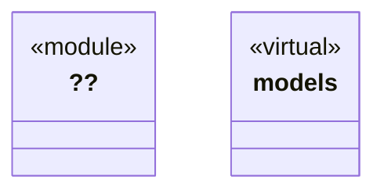

# 应用设置

## 设计意图

负责应用设置。

## 主要组成

| ?? | ?? |
| --- | --- |
| [??](index.ts) | index.ts 预留模块的公共入口。 |

<!-- architecture:generated:start -->

## 架构关系

标注为 `virtual` 的节点是直接子模块的虚拟类封装；内部设计沿下方入口阅读。

## 子模块

| 虚拟封装 | 整体职责 |
| --- | --- |
| [models](models/ARCHITECTURE.md) | 为新桌面的供应商配置表单与助理模型选择提供统一的配置校验和连接选择规则。 |

[上层设计](../ARCHITECTURE.md)

<!-- architecture:generated:end -->
