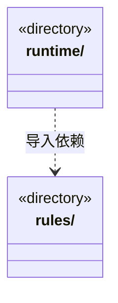

# src/logic/tasks 架构

## 目录定位

目标、任务依赖、人工决策及协作状态规则；服务与规则分开归属，实际依赖通过明确入口验证。

本文描述当前实现。通过分析目录边界后维护的 [源码架构脚本](../../../scripts/source-architecture.mjs) 同步清单和声明；代码变更时仍须核对职责、关键成员与关系。

## 代码清单

本层无直接代码文件。

## 架构类图

各图中的同名节点表示同一目录边界；跨组及完整直接依赖如下（无边不代表继承）：

- `runtime` → `rules`：导入。

## 子目录导航

- [rules/](rules/ARCHITECTURE.md)：任务计划、派发图、目标与等待。资料清单保留旧文件v1，新增严格v2来源并核同序与字节；快照不等于当前来源或业务验收。依赖追加核实两端及后继未领取、当前计划与真实图，完整审计验证后才放行精确新边；保留原任务/实例，领取时绑定真实结果。运行内补充以pending/accepted/rejected/unknown分开，接受与waiting共享连续输入版本，未知阻止完成。流程选择共用叶子契约，缺省与显式分开匹配，已派发选择不可改写；严格输出区分保存与交付，历史不补造授权或证据。 model-request-budget-storage 只公开请求预算状态、追加命令及准入能力，不授予其它领域写入。 正式协议将目标分配、任务、准备、模型和历史审计相互核对；岗位绑定不可重写，旧在途仅按原事实收束。 检查点显式放弃有独立严格协议与精确联合变更校验；原任务和检查点证据不可重写，纯 ACK 与后续周期释放保持可用。 原主命令核实定义八工具的有界报告；原工具结果、事务保存和业务验收分开，查询回执不能成为交付证据。 主／成员影响来源使用严格联合；观察、不可变处置和新核实／修复引用分别表达，当前文件不补造成功基线或业务验收。纯 scope-public 白名单供主工具与会话详情共用，保留安全恢复来源并隐藏原生上下文。 影响报告的可选知识事务摘要保留原工具状态并参与观察依据；旧处置缺省不补字段。 单文件操作公开协议不含正文备份；私有意图与阶段严格绑定原成员运行和原授权，补偿引用可靠 applied 与真实 before，终态不可改写。 保守产物时序包含外部写，GitHub 回执不能充当文件基线来源。
- [runtime/](runtime/ARCHITECTURE.md)：目标周期、等待、续执行、恢复与重计划编排。ScopeGoalService 的跨域依赖仍在，目录迁移不冒充职责重构。

[返回上层](../ARCHITECTURE.md)。

每次修改本目录代码，同步维护文件头、关键契约说明及本图。未实现的治理、证据验收和自动编排能力不列入当前类图。
