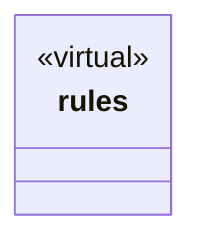

# src/logic/tasks 架构

## 设计意图

保存独立引擎包需要的任务与事件数据契约。当前 Office 派发和队列由 projects 模块持有，本目录不包含旧任务调度服务。

## 主要组成

本层只划分子模块；规则与运行边界沿下方子模块阅读。

<!-- architecture:generated:start -->

## 架构关系

标注为 `virtual` 的节点是直接子模块的虚拟类封装；内部设计沿下方入口阅读。

## 子模块

| 虚拟封装 | 整体职责 |
| --- | --- |
| [rules](rules/ARCHITECTURE.md) | 保存独立引擎包需要的任务与事件数据契约。当前 Office 派发和队列由 projects 模块持有，本目录不包含旧任务调度服务。 |

[上层设计](../ARCHITECTURE.md)

<!-- architecture:generated:end -->
