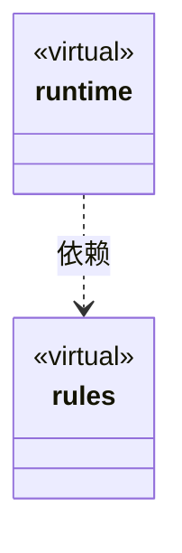

# src/logic/tasks 架构

## 设计意图

定义任务依赖、目标周期、等待与人工处置的业务语义，避免把模型运行状态当作任务完成。

`rules` 核实状态与联合变化，`runtime` 组织补充、依赖调整、恢复和重新规划。服务通过 dispatch 的事务端口与 execution、evidence 协作；原目标、原运行和新周期保持不同身份，未知副作用不能由重规划覆盖。

## 主要组成

本层没有直接产品实现，由下方子模块组成；每个直接子模块作为一个虚拟封装，只在本层呈现整体职责与协作。

<!-- architecture:generated:start -->

## 架构关系

标注为 `virtual` 的节点是直接子模块的虚拟类封装；内部设计沿下方入口阅读。

## 子模块

| 虚拟封装 | 整体职责 |
| --- | --- |
| [rules](rules/ARCHITECTURE.md) | 以纯契约、状态投影和不变量定义任务图与目标周期，使提交、重放和界面读取依据相同业务事实。 |
| [runtime](runtime/ARCHITECTURE.md) | 将任务规则连接到可信日志、知识和派发事务，按命令责任协调目标变更与人工处置。 |

[上层设计](../ARCHITECTURE.md)

<!-- architecture:generated:end -->
