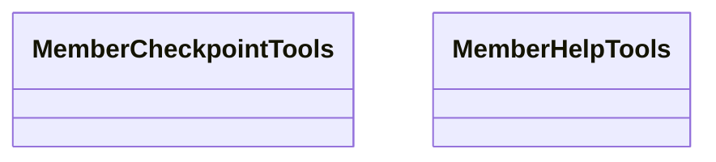

# src/logic/tasks/rules 架构

## 设计意图

定义任务图、目标、等待与人工决定的纯规则。按业务事实和状态变化组织协议，工具类将检查点与求助接到可信端口；不直接启动运行或修改文件。

## 主要组成

| 组成 | 定位 |
| --- | --- |
| [MemberCheckpointTools](member-checkpoint-tools.ts) | 包装正式执行成员的检查点工具，限制模型输入并将真实调用 ID 交给运行时。 |
| [MemberHelpTools](member-help-tools.ts) | 为正式执行成员提供一次性求助工具，并在求助授权至本轮结束期间封住后续工具调用。 |

<!-- architecture:generated:start -->

## 架构关系

[上层设计](../ARCHITECTURE.md)

<!-- architecture:generated:end -->
