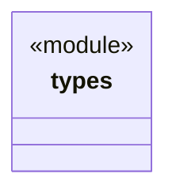

# src/logic/tasks/rules 架构

## 设计意图

保存独立引擎包需要的任务与事件数据契约。当前 Office 派发和队列由 projects 模块持有，本目录不包含旧任务调度服务。

## 主要组成

| 组成 | 定位 |
| --- | --- |
| [types](types.ts) | 业务目标和冻结上下文的任务定义。 |

<!-- architecture:generated:start -->

## 架构关系

[上层设计](../ARCHITECTURE.md)

<!-- architecture:generated:end -->
