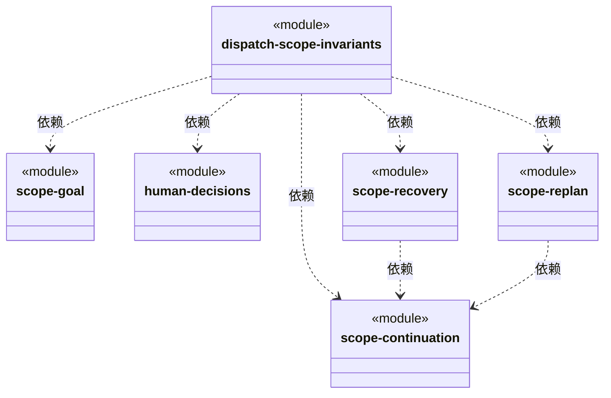
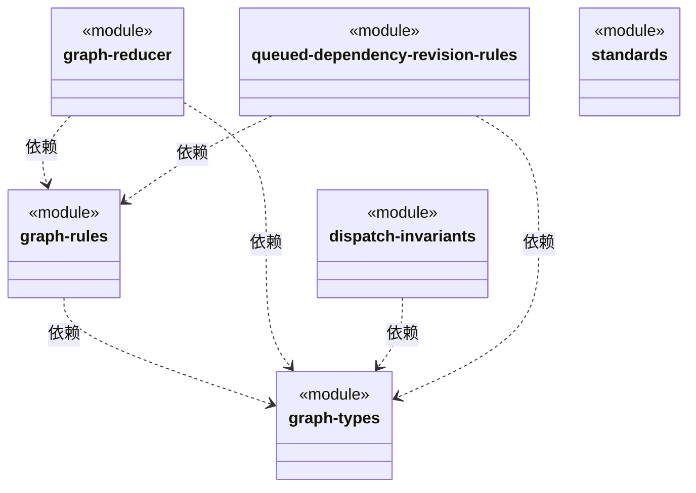

# src/logic/tasks/rules 架构

## 设计意图

以纯契约、状态投影和不变量定义任务图与目标周期，使提交、重放和界面读取依据相同业务事实。

图规则核对节点、依赖和等待，周期与目标规则保存原需求及版本，检查点、人工意见、补充和恢复分别有独立协议。跨对象不变量由 dispatch 存储在同一事务前缀调用；工具包装仅连接可信端口，不直接启动运行或修改文件。组成表选出主要规则入口，具体附属协议沿源码引用阅读。

## 主要组成

| 组成 | 定位 |
| --- | --- |
| [standards](standards.ts) | 任务执行、知识基线与恢复的内置规范，执行准备通过知识目录冻结正文版本。 |
| [MemberCheckpointTools](member-checkpoint-tools.ts) | 包装正式执行成员的检查点工具，限制模型输入并将真实调用 ID 交给运行时。 |
| [MemberHelpTools](member-help-tools.ts) | 为正式执行成员提供一次性求助工具，并在求助授权至本轮结束期间封住后续工具调用。 |
| [graph-types](graph-types.ts) | 表达任务节点、依赖与图事件的可序列化领域模型。 |
| [graph-rules](graph-rules.ts) | 核验节点状态、身份以及派发、依赖和等待关系。 |
| [graph-reducer](graph-reducer.ts) | 把已提交图事件原子投影为状态及增量读取结果。 |
| [dispatch-invariants](dispatch-invariants.ts) | 核实成员执行、任务图和邮箱在同一事务前缀下的联合约束。 |
| [dispatch-scope-invariants](dispatch-scope-invariants.ts) | 核验周期、待回传、等待及接续的不可变事实和原子变化。 |
| [scope-goal](scope-goal.ts) | 定义原目标、版本化计划和审阅规则，区分申请完成与验收。 |
| [queued-dependency-revision-rules](queued-dependency-revision-rules.ts) | 计算未领取任务的完整前置增删闭包，保护原任务身份。 |
| [human-decisions](human-decisions.ts) | 描述本机人工决定及其明确的候选和证据归属。 |
| [scope-continuation](scope-continuation.ts) | 表达安全等待与用户补充的一次性启动意图。 |
| [scope-recovery](scope-recovery.ts) | 表达从异常事实新建只读核实周期的请求及回执。 |
| [scope-replan](scope-replan.ts) | 表达核实之后创建正式新周期的预览与冻结依据。 |

<!-- architecture:generated:start -->

## 架构关系

### 关系组 1：dispatch-scope-invariants

### 关系组 2：graph-types

### 关系组 3：MemberCheckpointTools

### 跨图协作

按引用方归并目标，保留全部跨图关系；分图只用于阅读，不表示新增模块或依赖边界。

| 引用方 | 关系 | 目标 |
| --- | --- | --- |
| [queued-dependency-revision-rules](queued-dependency-revision-rules.ts)（图 2） | 依赖 | [scope-goal](scope-goal.ts)（图 1） |

[上层设计](../ARCHITECTURE.md)

<!-- architecture:generated:end -->
