# src/logic/tasks/runtime 架构

本目录只维护这一份说明。设计与契约直接编辑本文；文件清单、类图和导航由 [架构脚本](../../../../scripts/source-architecture.mjs) 更新，生成区域之外的人工说明会保留。

## 封装意图

目标周期、等待、续执行、恢复与重计划编排。ScopeGoalService 的跨域依赖仍在，目录迁移不冒充职责重构。

## 类与模块的设计意图

下表依据源码声明及文件头说明定位封装。字段表示该实例持有的状态或协作引用，不表示它拥有被引用服务的生命周期；实际资源责任和调用限制见下文契约及源码注释。

| 类／模块 | 实现形式与实例字段 | 封装依据 |
| --- | --- | --- |
| [main-command-request.ts](main-command-request.ts) | 函数／契约模块 | 运行原始 inputHash 与领域解析后的指纹不同；复原保留 trim、缺省和键序，不能用今日执行资格拒绝旧命令查询。 |
| [OfficeHistoryService](office-history-service.ts) | 实例类；持有 `workspaceId`、`store`、`ports` | 保存的是原 canonical；此服务只生成可重建目录并读取明确选择的一份内容。 |
| [QueuedDependencyAdditionService](queued-dependency-addition-service.ts) | 实例类；持有 `owner`、`store`、`goals`、`owners` | 后创建的任务也能成为先前待办的前置；在 Knowledge→模型→Store 锁序内重核全部待办岗位、角色和 Workflow，审计和等待状态一起保存，不能靠事件名称绕过门禁。 |
| [QueuedDependencyReplacementService](queued-dependency-replacement-service.ts) | 实例类；持有 `owner`、`store`、`goals`、`owners` | 图上的 result_ready 不足以授权后续执行；失败/求助或已放弃检查点及新候选按原日志核实，未领取闭包在 Knowledge→模型→Store 锁序中核当前岗位；旧边与原执行保持。 |
| [QueuedDependencyRevisionService](queued-dependency-revision-service.ts) | 实例类；持有 `owner`、`store`、`goals`、`owners` | 知识→模型→Store 固定锁序核全部受影响岗位，增删后的图一次生效；不改原计划、实例或信封。 |
| [QueuedTaskCancelService](queued-task-cancel-service.ts) | 实例类；持有 `owner`、`store` | 只依赖当前工作区有效性与派发存储；不读取模型密钥、知识正文或运行工具。 |
| [scope-active-input-evidence.ts](scope-active-input-evidence.ts) | 函数／契约模块 | Scope 与运行日志是两个真实存储，不能靠单边记录推断原生已经接收；未知不会被旧 review 或普通聊天完成例外洗白。 |
| [ScopeActiveInputService](scope-active-input-service.ts) | 实例类；持有 `owner`、`store` | 发送前先占用输入额度，确认后才提升目标版本；原生发送与磁盘事务不冒称原子，失败保留原尝试且不重放。 |
| [ScopeContinuationService](scope-continuation-service.ts) | 实例类；持有 `owner`、`store`、`budgets`、`memberPauses` | 先查原命令，再由可信启动闭包提交清单；运行中插入与等待补充共用输入次数和正文额度。预算读取后及提交前复核停止，拒绝不会消费等待或运行额度。 |
| [ScopeGoalService](scope-goal-service.ts) | 实例类；持有 `owner`、`store`、`ports`、`humanPorts`、`owners`、`memberPauses` | 业务计划重核岗位、来源和模型后冻结绑定；候选按原岗位及 Workflow 比较，不用当前登记覆盖历史。模型只能申请完成或等待，结算再核证据、任务压力与副作用；明确返工不把旧文件再次放行。 |
| [ScopeHumanContinuationService](scope-human-continuation-service.ts) | 实例类；持有 `owner`、`store`、`goals`、`logs`、`artifacts`、`budgets` | 保存意见和恢复运行分开；先在任务事务外核证，再按知识快照→任务短事务消费等待、提高输入版本，避免来源提交与证据读取形成逆序锁；预算拒绝保持检查点。 |
| [ScopeHumanDecisionService](scope-human-decision-service.ts) | 实例类；持有 `owner`、`store`、`goals`、`logs`、`ports`、`assertCurrent` | 历史候选真实性与当前接受许可分开；提交在事务外重建文件及日志依据，再按知识快照→任务短事务核版本，避免知识来源写入与验收形成逆向等待。 |
| [ScopeRecoveryService](scope-recovery-service.ts) | 实例类；持有 `owner`、`store`、`logs`、`budgets`、`effects` | 旧运行未知时不能续接或重放；成员/主来源在事务外核实，再以短事务核原身份和会话槽。原请求先查回执，新周期冻结明确处置且不放宽只读权限。 |
| [ScopeReplanService](scope-replan-service.ts) | 实例类；持有 `owner`、`store`、`goals`、`logs`、`budgets`、`effects` | 旧任务和未知回执保持封存；事务外核实主/成员来源及完整只读证据，知识短锁内仅做 Store CAS。重复命令先读原回执，明确处置只关联新目标，不修正旧失败。 |
| [TopicInterruptionService](topic-interruption-service.ts) | 实例类；持有 `owner`、`store` | 复用原目标接续事务推进输入版本，独立记录停止前的请求；无法证实退出时保持原意图，不恢复旧运行或伪造暂停成功。 |

## 接口设计契约

<a id="contract"></a>

<a id="contract-候选批准与最终目标审阅"></a>

#### 候选批准与最终目标审阅

ScopeGoalService.ReviewCandidate 由当前主运行调用，要求活动且已规划目标、无未核实插入、精确任务版本及未审阅候选。复用原运行、工具证据、岗位、知识与产物核实，在同一 DispatchStore 事务内追加 candidateReview；相同命令返回原回执，不重新审阅，不允许改判。磁盘 RunSummary 对尚未结算日志也标 interrupted，所以活性使用调用闭包与当前主身份，可靠事件用于排除已有终态，不能以磁盘 status=running 判断。

accept 仅允许后继使用此结果；reject 的候选不能作为最终目标证据。最终 cbim_goal_review 及 human 决定仍独立。拒绝后应撤销相关未启动后继并新建返工链；不把 rejected/result_ready 当作已有 replace_dependency 所允许的失败来源。追加、替换和修订依赖的新边统一启用 reviewRequired。

<a id="contract-指定话题补充与排空"></a>

#### 指定话题补充与排空

`TopicInterruptionService` 负责用户指定话题补充的持久意图和排空后的等待提交，不停止引擎。prepare 检查原输入版本、剩余主轮/决策/正文额度并保存原请求；park 重核可信主轮日志完整性、原生文件身份和全部原话题成员终态。新等待不伪造 awaiting_user 审阅；ScopeContinuationService 只消费同一 commandId、原文、附件和选型，拒绝更换权限或冒充人工决定。可靠等待重启可显式查询/接续，未可靠排空不自动执行。

OfficeHistoryService 从原 DispatchStore、mainRunIds、task.scopeId 和信封生成归档目录，仅选中引用才读 canonical 正文；不另存正文。完整公开消息按版本分块，内部成员提示词、原生会话和工具正文仍走公开白名单；旧记录缺少明确归属不按时间猜测。主归档和当前模型工作窗口分开，查询不启动、复活或验收历史运行。


<a id="contract-根运行插入回执"></a>

#### 根运行插入回执

ScopeActiveInputService.Send 是新根生命周期与旧协调器共用的输入事务入口：发送前持久 prepare，可信 ACK 后 accepted，停止/失效 rejected，回执丢失 unknown；原尝试不可自动重放。持久核证继续由 prepare/resolve/inspect 承担，不复制状态账本。


<a id="contract-递归执行记录核实"></a>

#### 递归执行记录核实

ScopeRecoveryService 的旧任务执行报告来源明确拒绝递归 executionModel 或缺少旧任务版本的报告。递归来源必须使用 member_run 影响观察及精确 taskId/runId/toolCallIds；冻结 executionModel=agent-tools-v1、原周期、日志前缀和观察依据，由 Store 核验原业务调用已关闭且归属一致，不伪造 TaskNode 修订号。只读核实建立独立原生上下文，原调用与副作用事实不被改写。


<a id="contract-递归工具迁移收口"></a>

##### 递归工具迁移收口

ScopeReplanService 对递归来源要求原 AgentBusinessRun.request，缺少原验收要求时拒绝自动推断。ScopeGoalService 委托 RecursiveInspectionEvidence 重读完整根与子调用、冻结 Workflow、当前文件及来源身份，并二次读取检测变化。原业务影响仍按原主体观察，旧记录不改写；事务再次核依据，只有显式新意图可进入 ask/execute。

## 开闭边界

本目录的职责及允许协作由[封装意图](#封装意图)限定，输入输出、状态与失败语义以[接口设计契约](#接口设计契约)为准。扩展从已有公开入口及实际装配位置进入；没有明确可替换契约的部分按真实影响修改和验证，不预建未使用的基类或插件入口。

<!-- architecture:generated:start -->

## 文件清单

| 文件 | 形式 | 当前职责 |
| --- | --- | --- |
| [ARCHITECTURE.md](ARCHITECTURE.md) | 说明文档 | 本目录的文件清单、真实声明、依赖与子封装导航。 |
| [main-command-request.ts](main-command-request.ts) | 源码模块 | 共享主调度原命令的指纹构造，从已核实 canonical 参数复原历史请求，包含原子前置增删。 |
| [office-history-service.ts](office-history-service.ts) | 源码模块 | 按主 Session → 原话题 → 内容引用读取现有调度及公开对话日志。 |
| [queued-dependency-addition-service.ts](queued-dependency-addition-service.ts) | 源码模块 | 在同一派发事务核实未领取任务及两端后继，为原目标追加一条结果前置。 |
| [queued-dependency-replacement-service.ts](queued-dependency-replacement-service.ts) | 源码模块 | 主调度在同一事务核实旧前置、安全替代候选与未启动后继，并原子提交单条依赖替换。 |
| [queued-dependency-revision-service.ts](queued-dependency-revision-service.ts) | 源码模块 | 在同一可靠事务中退役和新增未领取目标的多条前置，保存原请求与完整闭包审计。 |
| [queued-task-cancel-service.ts](queued-task-cancel-service.ts) | 源码模块 | 主调度在单个派发事务中撤销明确的一组尚未启动任务。 |
| [scope-active-input-evidence.ts](scope-active-input-evidence.ts) | 源码模块 | 把目标补充的持久接收记录与原主运行的可信插入日志逐项核对。 |
| [scope-active-input-service.ts](scope-active-input-service.ts) | 源码模块 | 在派发事务中登记运行中插入的准备、真实接收和不确定事实。 |
| [scope-continuation-service.ts](scope-continuation-service.ts) | 源码模块 | 原子消费安全等待，保存用户原始补充、可选附件快照清单和一次性主运行意图。 |
| [scope-goal-service.ts](scope-goal-service.ts) | 源码模块 | 保存目标计划与审阅，核验返工前的原始日志及精确拒绝候选；替代仍须真实新成果，人工项不因业务拒绝而降级。 |
| [scope-human-continuation-service.ts](scope-human-continuation-service.ts) | 源码模块 | 将当前等待中的最新人工决定全集转换成一次可信主运行接续意图。 |
| [scope-human-decision-service.ts](scope-human-decision-service.ts) | 源码模块 | 核实安全等待中的人工验收项和明确选定文件，保存本机显式决定及不可变依据。 |
| [scope-recovery-service.ts](scope-recovery-service.ts) | 源码模块 | 为已关闭周期的异常执行创建独立只读核实周期，持久化用户观察和一次性全新上下文意图。 |
| [scope-replan-service.ts](scope-replan-service.ts) | 源码模块 | 在完成的只读核实基础上创建独立业务周期，冻结真实证据、原人工约束和用户明确的新目标。 |
| [topic-interruption-service.ts](topic-interruption-service.ts) | 源码模块 | 保存整话题补充意图，并在可信协调器排空全部参与者后建立等待检查点。 |

## 架构类图

成员标记：`+` 公开、`-` 私有、`#` 受保护、`$` 静态；构造函数单独列出。文档和资源仅在文件清单中导航，不作为代码节点。

### main-command-request.ts

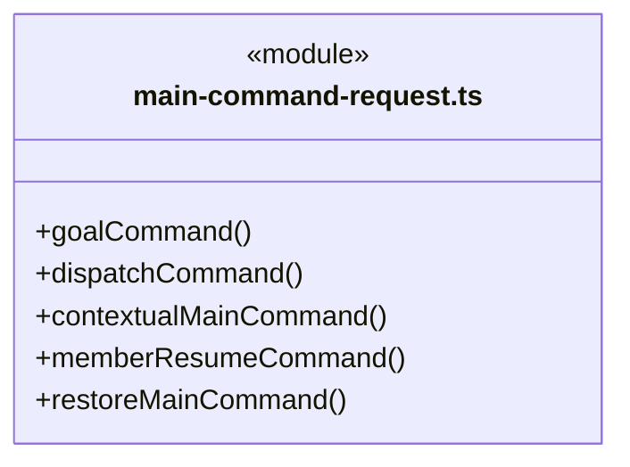

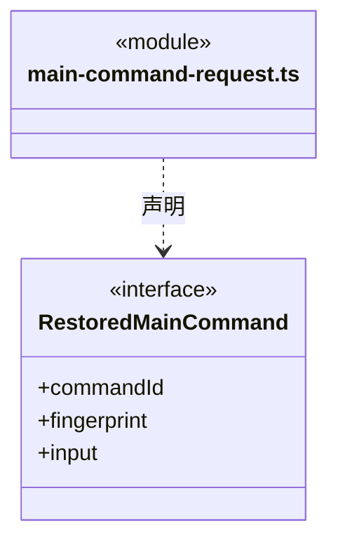

直接依赖：[../../../core/platform/node/serialization.ts](../../../core/platform/node/serialization.ts)、[../../../core/errors.ts](../../../core/errors.ts)、[../rules/graph-types.ts](../rules/graph-types.ts)、[../../dispatch/rules/dispatch-storage.ts](../../dispatch/rules/dispatch-storage.ts)、[../rules/dispatch-commands.ts](../rules/dispatch-commands.ts)、[../rules/scope-goal.ts](../rules/scope-goal.ts)、[../rules/queued-task-cancel.ts](../rules/queued-task-cancel.ts)、[../rules/queued-dependency-replacement.ts](../rules/queued-dependency-replacement.ts)、[../rules/queued-dependency-addition.ts](../rules/queued-dependency-addition.ts)、[../rules/queued-dependency-revision.ts](../rules/queued-dependency-revision.ts)、[../rules/queued-member-resume.ts](../rules/queued-member-resume.ts)、[../rules/checkpoint-handoff.ts](../rules/checkpoint-handoff.ts)、[../rules/command-verification.ts](../rules/command-verification.ts)、[../rules/main-tool-output.ts](../rules/main-tool-output.ts)、[../../tools/runtime/main-tool-contracts.ts](../../tools/runtime/main-tool-contracts.ts)。

### office-history-service.ts

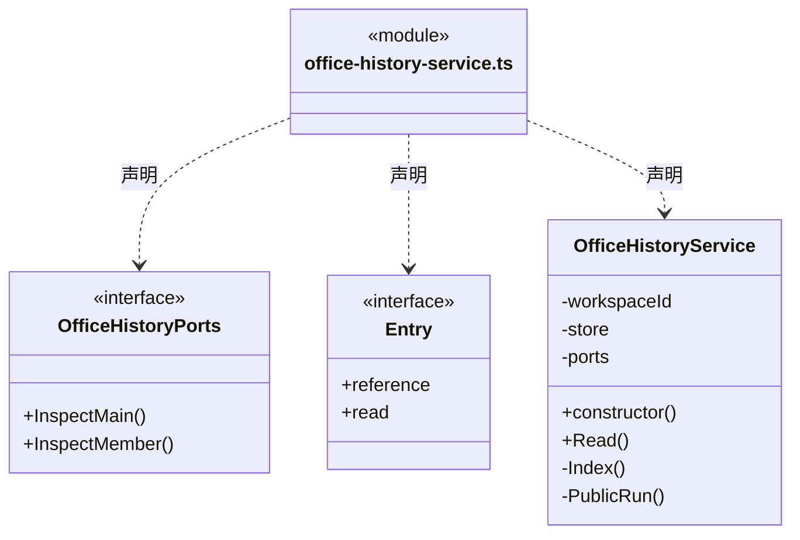

直接依赖：[../../../core/errors.ts](../../../core/errors.ts)、[../../../core/platform/node/serialization.ts](../../../core/platform/node/serialization.ts)、[../../dispatch/rules/dispatch-storage.ts](../../dispatch/rules/dispatch-storage.ts)、[../rules/graph-types.ts](../rules/graph-types.ts)、[../../execution/rules/types.ts](../../execution/rules/types.ts)、[../rules/dispatch-execution.ts](../rules/dispatch-execution.ts)、[../../runtime/monitoring/public-run-events.ts](../../runtime/monitoring/public-run-events.ts)、[../rules/scope-public.ts](../rules/scope-public.ts)、[../rules/office-history.ts](../rules/office-history.ts)。

### queued-dependency-addition-service.ts


直接依赖：[../../../core/errors.ts](../../../core/errors.ts)、[../../../core/platform/node/serialization.ts](../../../core/platform/node/serialization.ts)、[main-command-request.ts](main-command-request.ts)、[../../dispatch/rules/dispatch-storage.ts](../../dispatch/rules/dispatch-storage.ts)、[../rules/graph-types.ts](../rules/graph-types.ts)、[../rules/queued-dependency-addition.ts](../rules/queued-dependency-addition.ts)、[../rules/queued-dependency-addition-rules.ts](../rules/queued-dependency-addition-rules.ts)、[../../execution/context/execution-context.ts](../../execution/context/execution-context.ts)、[../../team/runtime/member-state.ts](../../team/runtime/member-state.ts)、[scope-goal-service.ts](scope-goal-service.ts)、[../../dispatch/runtime/owner-execution-service.ts](../../dispatch/runtime/owner-execution-service.ts)、[../../team/rules/member-execution-binding.ts](../../team/rules/member-execution-binding.ts)。

### queued-dependency-replacement-service.ts

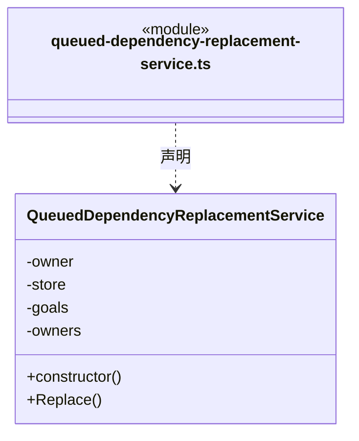

直接依赖：[../../../core/errors.ts](../../../core/errors.ts)、[../../../core/platform/node/serialization.ts](../../../core/platform/node/serialization.ts)、[main-command-request.ts](main-command-request.ts)、[../../dispatch/rules/dispatch-storage.ts](../../dispatch/rules/dispatch-storage.ts)、[../rules/graph-types.ts](../rules/graph-types.ts)、[../rules/queued-dependency-replacement.ts](../rules/queued-dependency-replacement.ts)、[../rules/queued-dependency-replacement-rules.ts](../rules/queued-dependency-replacement-rules.ts)、[../../execution/context/execution-context.ts](../../execution/context/execution-context.ts)、[../../team/runtime/member-state.ts](../../team/runtime/member-state.ts)、[scope-goal-service.ts](scope-goal-service.ts)、[../../dispatch/runtime/owner-execution-service.ts](../../dispatch/runtime/owner-execution-service.ts)、[../../team/rules/member-execution-binding.ts](../../team/rules/member-execution-binding.ts)。

### queued-dependency-revision-service.ts

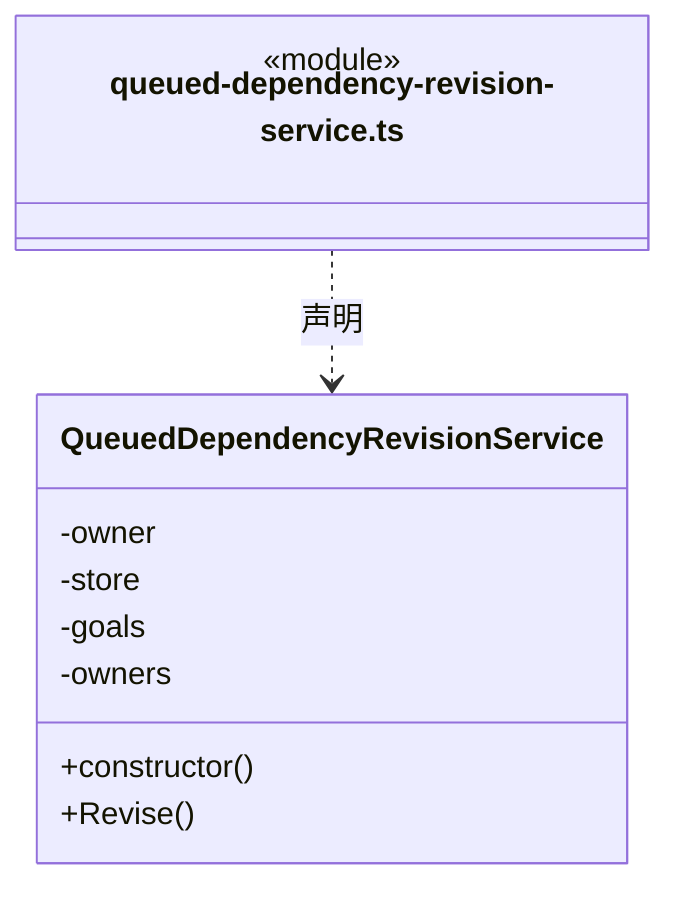

直接依赖：[../../../core/errors.ts](../../../core/errors.ts)、[main-command-request.ts](main-command-request.ts)、[../../dispatch/rules/dispatch-storage.ts](../../dispatch/rules/dispatch-storage.ts)、[../rules/graph-types.ts](../rules/graph-types.ts)、[../rules/queued-dependency-revision.ts](../rules/queued-dependency-revision.ts)、[../rules/queued-dependency-revision-rules.ts](../rules/queued-dependency-revision-rules.ts)、[../../execution/context/execution-context.ts](../../execution/context/execution-context.ts)、[../../team/runtime/member-state.ts](../../team/runtime/member-state.ts)、[scope-goal-service.ts](scope-goal-service.ts)、[../../dispatch/runtime/owner-execution-service.ts](../../dispatch/runtime/owner-execution-service.ts)、[../../team/rules/member-execution-binding.ts](../../team/rules/member-execution-binding.ts)。

### queued-task-cancel-service.ts

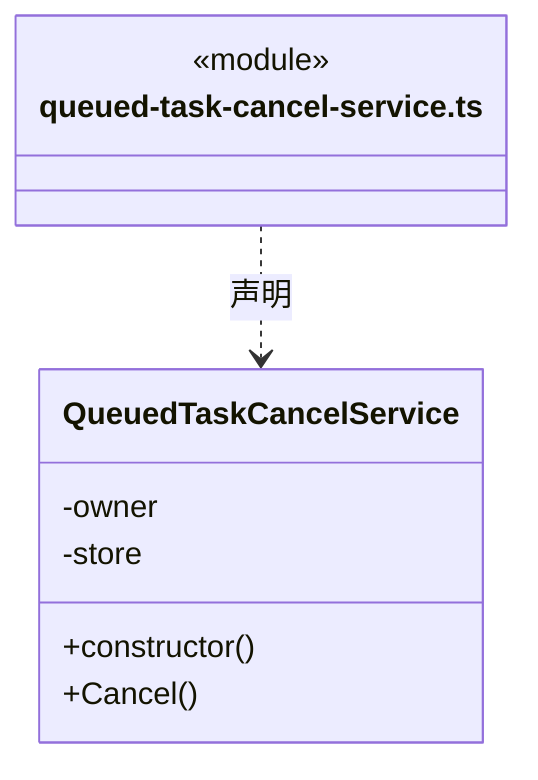

直接依赖：[../../../core/errors.ts](../../../core/errors.ts)、[../../../core/platform/node/serialization.ts](../../../core/platform/node/serialization.ts)、[main-command-request.ts](main-command-request.ts)、[../../knowledge/rules/ports.ts](../../knowledge/rules/ports.ts)、[../../dispatch/rules/dispatch-storage.ts](../../dispatch/rules/dispatch-storage.ts)、[../rules/graph-types.ts](../rules/graph-types.ts)、[../rules/queued-task-cancel.ts](../rules/queued-task-cancel.ts)、[../rules/queued-task-cancel-rules.ts](../rules/queued-task-cancel-rules.ts)。

### scope-active-input-evidence.ts

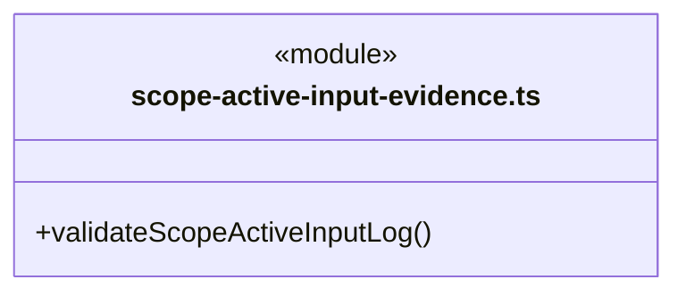

直接依赖：[../../../core/errors.ts](../../../core/errors.ts)、[../../execution/rules/types.ts](../../execution/rules/types.ts)、[../rules/dispatch-scope.ts](../rules/dispatch-scope.ts)、[../rules/scope-goal.ts](../rules/scope-goal.ts)、[../rules/scope-active-input.ts](../rules/scope-active-input.ts)、[../rules/scope-active-input-rules.ts](../rules/scope-active-input-rules.ts)。

### scope-active-input-service.ts

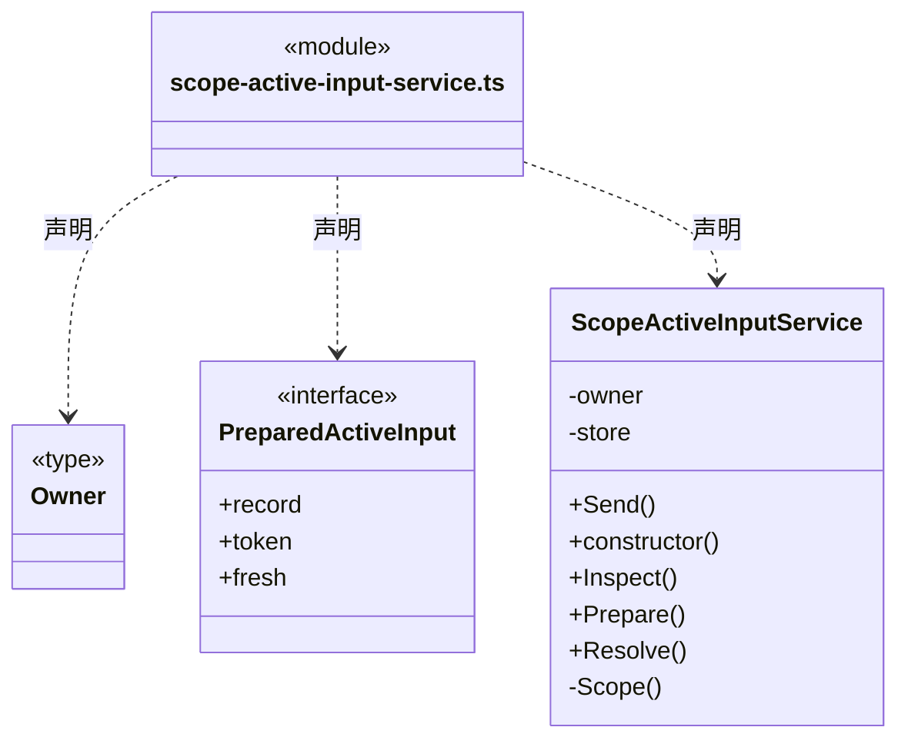

直接依赖：[../../../core/errors.ts](../../../core/errors.ts)、[../../../core/platform/node/serialization.ts](../../../core/platform/node/serialization.ts)、[../../knowledge/rules/ports.ts](../../knowledge/rules/ports.ts)、[../../dispatch/rules/dispatch-storage.ts](../../dispatch/rules/dispatch-storage.ts)、[../rules/dispatch-scope.ts](../rules/dispatch-scope.ts)、[../rules/graph-types.ts](../rules/graph-types.ts)、[../rules/scope-goal.ts](../rules/scope-goal.ts)、[../rules/scope-continuation-record.ts](../rules/scope-continuation-record.ts)、[../rules/scope-active-input.ts](../rules/scope-active-input.ts)、[../rules/scope-active-input-rules.ts](../rules/scope-active-input-rules.ts)。

### scope-continuation-service.ts

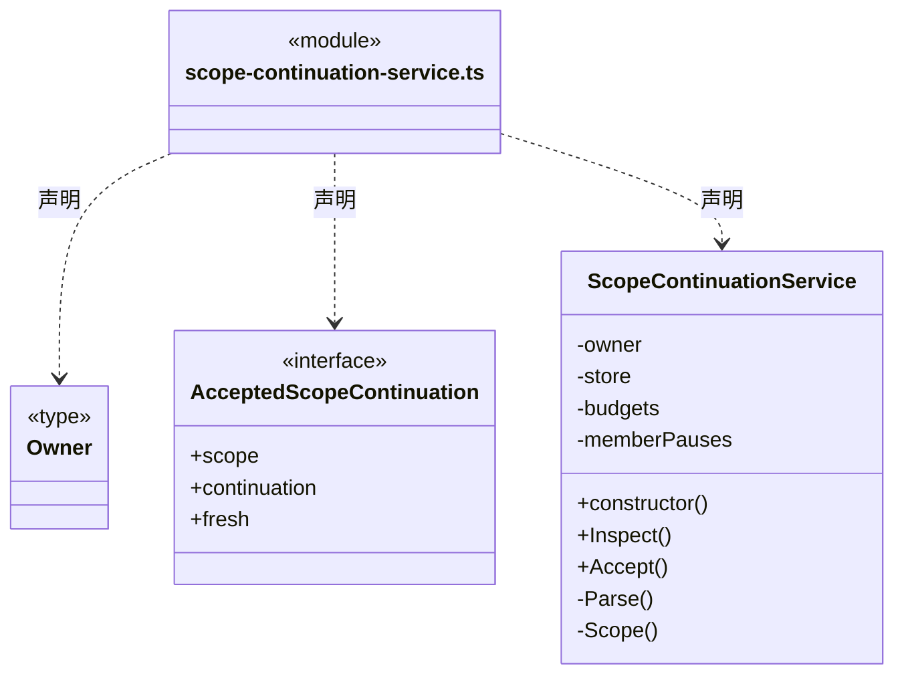

直接依赖：[../../../core/errors.ts](../../../core/errors.ts)、[../../execution/ports/identity.ts](../../execution/ports/identity.ts)、[../../../core/platform/node/serialization.ts](../../../core/platform/node/serialization.ts)、[../../knowledge/rules/ports.ts](../../knowledge/rules/ports.ts)、[../../dispatch/rules/dispatch-storage.ts](../../dispatch/rules/dispatch-storage.ts)、[../rules/dispatch-scope.ts](../rules/dispatch-scope.ts)、[../rules/scope-run-tracking.ts](../rules/scope-run-tracking.ts)、[../rules/scope-goal.ts](../rules/scope-goal.ts)、[../rules/scope-continuation-attachments.ts](../rules/scope-continuation-attachments.ts)、[../rules/scope-continuation.ts](../rules/scope-continuation.ts)、[../../budget/runtime/scope-budget-service.ts](../../budget/runtime/scope-budget-service.ts)、[../rules/scope-continuation-record.ts](../rules/scope-continuation-record.ts)、[../rules/scope-active-input.ts](../rules/scope-active-input.ts)、[../../team/runtime/member-pause-service.ts](../../team/runtime/member-pause-service.ts)、[../../dispatch/runtime/owner-execution-service.ts](../../dispatch/runtime/owner-execution-service.ts)。

### scope-goal-service.ts

成员 1/3（同名节点为同一声明，跨图合并阅读）。

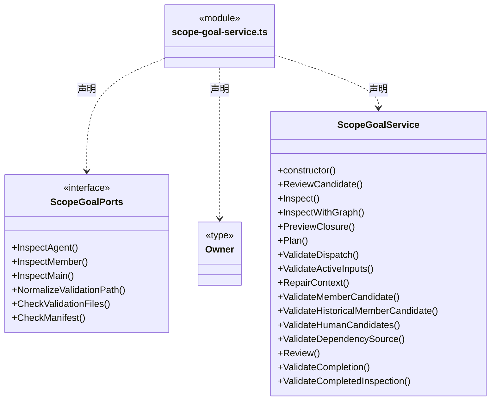

成员 2/3（同名节点为同一声明，跨图合并阅读）。

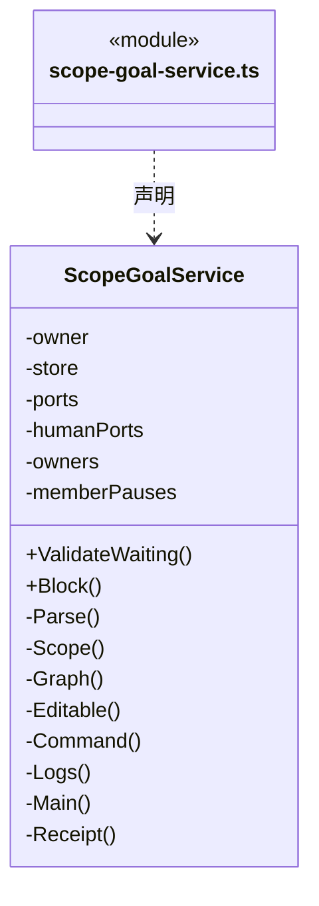

成员 3/3（同名节点为同一声明，跨图合并阅读）。

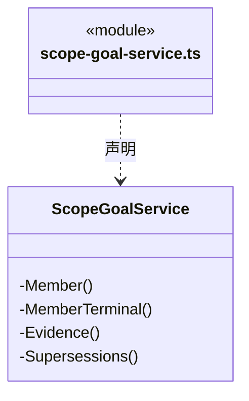

直接依赖：[../../evidence/runtime/recursive-inspection-evidence.ts](../../evidence/runtime/recursive-inspection-evidence.ts)、[../../execution/context/automatic-context.ts](../../execution/context/automatic-context.ts)、[../../team/rules/automatic-execution.ts](../../team/rules/automatic-execution.ts)、[../rules/candidate-review.ts](../rules/candidate-review.ts)、[../../tools/rules/questions.ts](../../tools/rules/questions.ts)、[../rules/scope-active-input.ts](../rules/scope-active-input.ts)、[scope-active-input-evidence.ts](scope-active-input-evidence.ts)、[../../../core/errors.ts](../../../core/errors.ts)、[../../../core/platform/node/serialization.ts](../../../core/platform/node/serialization.ts)、[main-command-request.ts](main-command-request.ts)、[../../knowledge/rules/ports.ts](../../knowledge/rules/ports.ts)、[../../execution/rules/types.ts](../../execution/rules/types.ts)、[../../tools/rules/types.ts](../../tools/rules/types.ts)、[../../dispatch/rules/dispatch-storage.ts](../../dispatch/rules/dispatch-storage.ts)、[../rules/dispatch-execution.ts](../rules/dispatch-execution.ts)、[../rules/dispatch-commands.ts](../rules/dispatch-commands.ts)、[../rules/dispatch-scope.ts](../rules/dispatch-scope.ts)、[../rules/graph-types.ts](../rules/graph-types.ts)、[../rules/scope-goal.ts](../rules/scope-goal.ts)、[../../execution/context/dispatch-context.ts](../../execution/context/dispatch-context.ts)、[../../evidence/runtime/execution-report-facts.ts](../../evidence/runtime/execution-report-facts.ts)、[../../team/runtime/member-help-state.ts](../../team/runtime/member-help-state.ts)、[../../runtime/monitoring/member-events.ts](../../runtime/monitoring/member-events.ts)、[../../evidence/runtime/human-decision-evidence.ts](../../evidence/runtime/human-decision-evidence.ts)、[../rules/human-decisions.ts](../rules/human-decisions.ts)、[../rules/human-continuation-rules.ts](../rules/human-continuation-rules.ts)、[../../team/runtime/member-workflow.ts](../../team/runtime/member-workflow.ts)、[../../evidence/rules/output-manifest.ts](../../evidence/rules/output-manifest.ts)、[../../evidence/rules/artifact-baseline.ts](../../evidence/rules/artifact-baseline.ts)、[../rules/workflow-selection.ts](../rules/workflow-selection.ts)、[../../team/rules/member-execution-binding.ts](../../team/rules/member-execution-binding.ts)、[../../dispatch/runtime/owner-execution-service.ts](../../dispatch/runtime/owner-execution-service.ts)、[../rules/checkpoint-handoff-rules.ts](../rules/checkpoint-handoff-rules.ts)、[../../team/runtime/member-checkpoint-verifier.ts](../../team/runtime/member-checkpoint-verifier.ts)、[../../team/runtime/member-pause-service.ts](../../team/runtime/member-pause-service.ts)、[../rules/coordination-preview.ts](../rules/coordination-preview.ts)、[../rules/queued-task-cancel.ts](../rules/queued-task-cancel.ts)、[../../team/rules/workspace-member.ts](../../team/rules/workspace-member.ts)。

### scope-human-continuation-service.ts

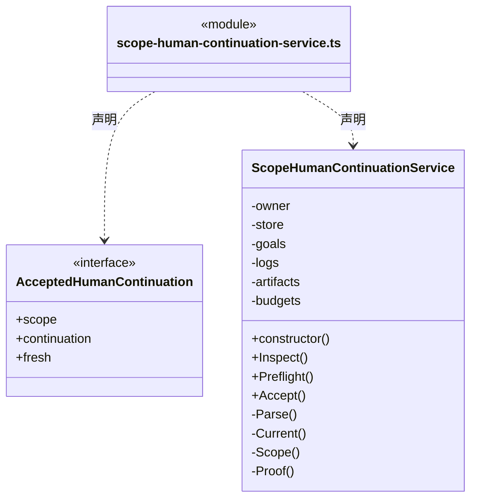

直接依赖：[../../../core/errors.ts](../../../core/errors.ts)、[../../../core/platform/node/serialization.ts](../../../core/platform/node/serialization.ts)、[../../execution/ports/identity.ts](../../execution/ports/identity.ts)、[../../knowledge/rules/ports.ts](../../knowledge/rules/ports.ts)、[../../dispatch/rules/dispatch-storage.ts](../../dispatch/rules/dispatch-storage.ts)、[../rules/dispatch-scope.ts](../rules/dispatch-scope.ts)、[../rules/scope-goal.ts](../rules/scope-goal.ts)、[../rules/scope-run-tracking.ts](../rules/scope-run-tracking.ts)、[../rules/human-continue.ts](../rules/human-continue.ts)、[../rules/scope-continuation-record.ts](../rules/scope-continuation-record.ts)、[../rules/human-continuation-rules.ts](../rules/human-continuation-rules.ts)、[scope-goal-service.ts](scope-goal-service.ts)、[../../evidence/runtime/human-decision-evidence.ts](../../evidence/runtime/human-decision-evidence.ts)、[../../budget/runtime/scope-budget-service.ts](../../budget/runtime/scope-budget-service.ts)、[../../evidence/runtime/human-evidence-state.ts](../../evidence/runtime/human-evidence-state.ts)。

### scope-human-decision-service.ts

成员 1/2（同名节点为同一声明，跨图合并阅读）。

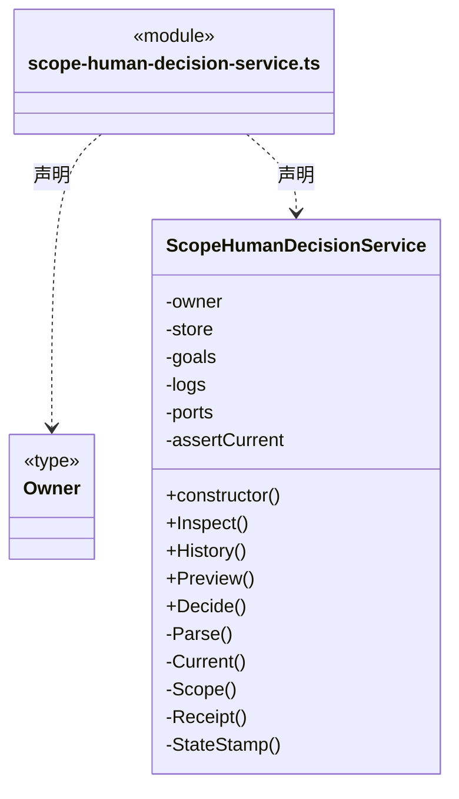

成员 2/2（同名节点为同一声明，跨图合并阅读）。

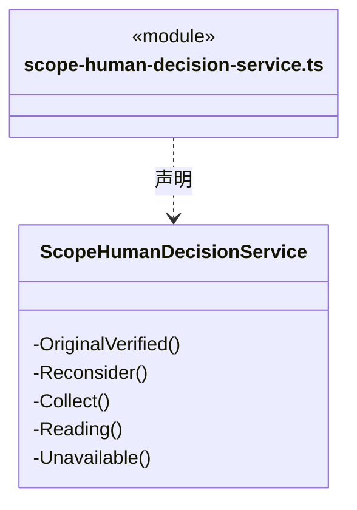

直接依赖：[../../../core/errors.ts](../../../core/errors.ts)、[../../../core/platform/node/serialization.ts](../../../core/platform/node/serialization.ts)、[../../knowledge/rules/ports.ts](../../knowledge/rules/ports.ts)、[../../dispatch/rules/dispatch-storage.ts](../../dispatch/rules/dispatch-storage.ts)、[../rules/dispatch-scope.ts](../rules/dispatch-scope.ts)、[../rules/scope-goal.ts](../rules/scope-goal.ts)、[../../evidence/rules/artifact-baseline.ts](../../evidence/rules/artifact-baseline.ts)、[../../evidence/rules/artifact-evidence.ts](../../evidence/rules/artifact-evidence.ts)、[../../evidence/rules/complete-output-evidence.ts](../../evidence/rules/complete-output-evidence.ts)、[../../evidence/rules/output-manifest.ts](../../evidence/rules/output-manifest.ts)、[../rules/human-decisions.ts](../rules/human-decisions.ts)、[../rules/human-decision-proof.ts](../rules/human-decision-proof.ts)、[../rules/human-reconsideration.ts](../rules/human-reconsideration.ts)、[scope-goal-service.ts](scope-goal-service.ts)、[../../evidence/runtime/human-decision-evidence.ts](../../evidence/runtime/human-decision-evidence.ts)、[../../evidence/runtime/human-evidence-state.ts](../../evidence/runtime/human-evidence-state.ts)。

### scope-recovery-service.ts

成员 1/2（同名节点为同一声明，跨图合并阅读）。

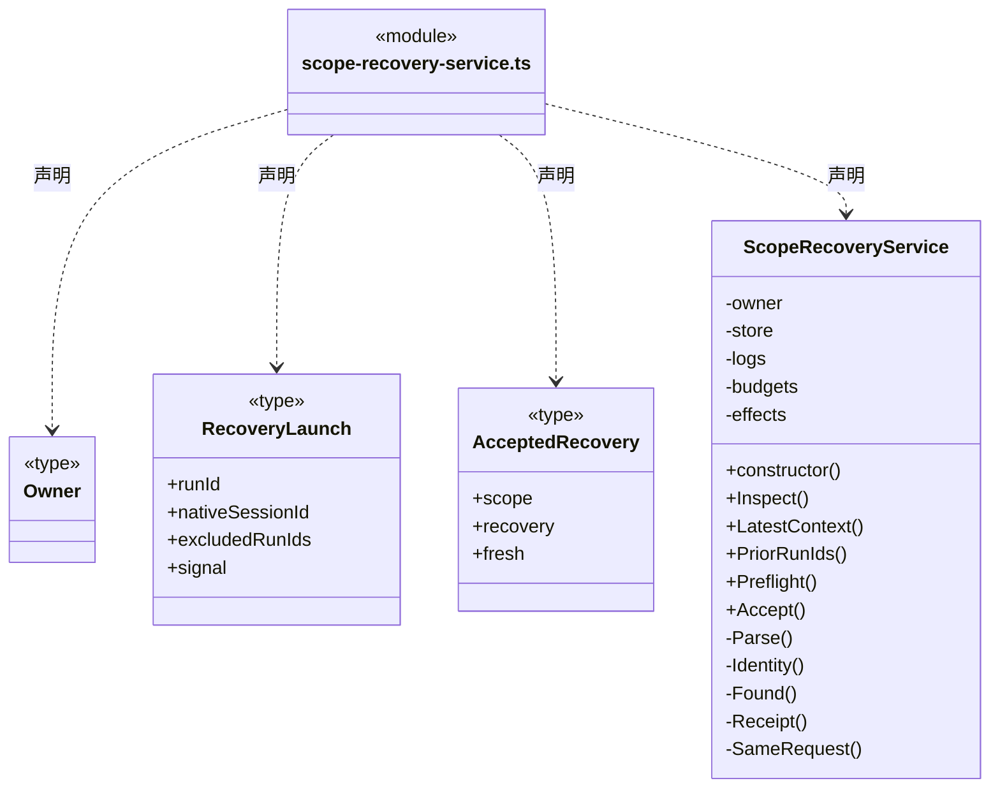

成员 2/2（同名节点为同一声明，跨图合并阅读）。

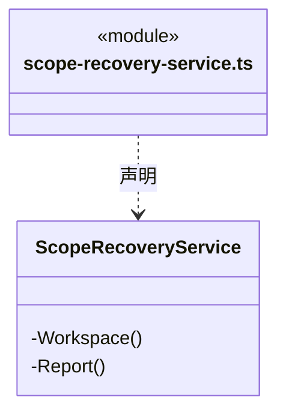

直接依赖：[../../../core/errors.ts](../../../core/errors.ts)、[../../../core/platform/node/serialization.ts](../../../core/platform/node/serialization.ts)、[../../knowledge/rules/ports.ts](../../knowledge/rules/ports.ts)、[../../dispatch/rules/dispatch-storage.ts](../../dispatch/rules/dispatch-storage.ts)、[../rules/dispatch-scope.ts](../rules/dispatch-scope.ts)、[../rules/graph-types.ts](../rules/graph-types.ts)、[../rules/dispatch-commands.ts](../rules/dispatch-commands.ts)、[../rules/scope-recovery.ts](../rules/scope-recovery.ts)、[../rules/scope-goal.ts](../rules/scope-goal.ts)、[../rules/fresh-context.ts](../rules/fresh-context.ts)、[../../evidence/runtime/execution-report-service.ts](../../evidence/runtime/execution-report-service.ts)、[scope-goal-service.ts](scope-goal-service.ts)、[../rules/scope-run-tracking.ts](../rules/scope-run-tracking.ts)、[../../evidence/runtime/effect-observation-service.ts](../../evidence/runtime/effect-observation-service.ts)、[../../evidence/runtime/effect-source.ts](../../evidence/runtime/effect-source.ts)、[../rules/effect-observation.ts](../rules/effect-observation.ts)、[../../budget/runtime/scope-budget-service.ts](../../budget/runtime/scope-budget-service.ts)。

### scope-replan-service.ts

成员 1/2（同名节点为同一声明，跨图合并阅读）。

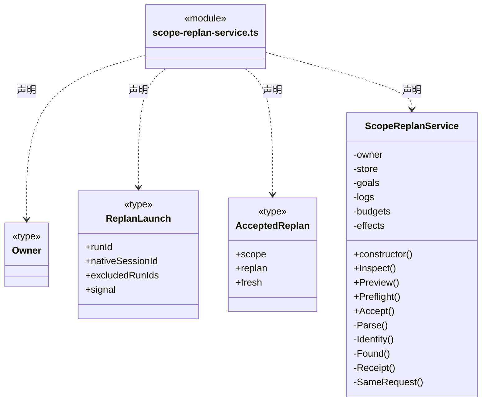

成员 2/2（同名节点为同一声明，跨图合并阅读）。

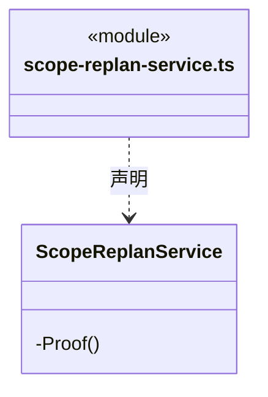

直接依赖：[../../../core/errors.ts](../../../core/errors.ts)、[../../../core/platform/node/serialization.ts](../../../core/platform/node/serialization.ts)、[../../knowledge/rules/ports.ts](../../knowledge/rules/ports.ts)、[../../dispatch/rules/dispatch-storage.ts](../../dispatch/rules/dispatch-storage.ts)、[../rules/dispatch-scope.ts](../rules/dispatch-scope.ts)、[../rules/fresh-context.ts](../rules/fresh-context.ts)、[../rules/scope-replan.ts](../rules/scope-replan.ts)、[../rules/scope-goal.ts](../rules/scope-goal.ts)、[scope-goal-service.ts](scope-goal-service.ts)、[../rules/scope-run-tracking.ts](../rules/scope-run-tracking.ts)、[../../evidence/runtime/execution-report-service.ts](../../evidence/runtime/execution-report-service.ts)、[../../execution/context/dispatch-context.ts](../../execution/context/dispatch-context.ts)、[../../evidence/runtime/effect-observation-service.ts](../../evidence/runtime/effect-observation-service.ts)、[../../evidence/runtime/effect-source.ts](../../evidence/runtime/effect-source.ts)、[../rules/effect-observation.ts](../rules/effect-observation.ts)、[../../budget/runtime/scope-budget-service.ts](../../budget/runtime/scope-budget-service.ts)。

### topic-interruption-service.ts

```mermaid
classDiagram
class N_src_logic_tasks_runtime_topic_interruption_service_ts["topic-interruption-service.ts"] {
  <<module>>
}
class N_src_logic_tasks_runtime_topic_interruption_service_ts_TopicInterruptionService["TopicInterruptionService"] {
  +constructor()
  +Prepare()
  +Park()
  -owner
  -store
  -Scope()
}
N_src_logic_tasks_runtime_topic_interruption_service_ts ..> N_src_logic_tasks_runtime_topic_interruption_service_ts_TopicInterruptionService : 声明
```

直接依赖：[../../../core/errors.ts](../../../core/errors.ts)、[../../../core/platform/node/serialization.ts](../../../core/platform/node/serialization.ts)、[../../knowledge/rules/ports.ts](../../knowledge/rules/ports.ts)、[../../dispatch/rules/dispatch-storage.ts](../../dispatch/rules/dispatch-storage.ts)、[../../execution/rules/types.ts](../../execution/rules/types.ts)、[../rules/dispatch-scope.ts](../rules/dispatch-scope.ts)、[../rules/scope-goal.ts](../rules/scope-goal.ts)、[../rules/scope-continuation.ts](../rules/scope-continuation.ts)、[../rules/scope-active-input.ts](../rules/scope-active-input.ts)、[../rules/topic-interruption.ts](../rules/topic-interruption.ts)。

### 本目录调用边界

```mermaid
classDiagram
class N_src_logic_tasks_runtime_queued_dependency_addition_service_ts["queued-dependency-addition-service.ts"] {
  <<module>>
}
class N_src_logic_tasks_runtime_main_command_request_ts["main-command-request.ts"] {
  <<module>>
}
class N_src_logic_tasks_runtime_scope_goal_service_ts["scope-goal-service.ts"] {
  <<module>>
}
class N_src_logic_tasks_runtime_queued_dependency_replacement_service_ts["queued-dependency-replacement-service.ts"] {
  <<module>>
}
N_src_logic_tasks_runtime_queued_dependency_addition_service_ts ..> N_src_logic_tasks_runtime_main_command_request_ts : 导入依赖
N_src_logic_tasks_runtime_queued_dependency_addition_service_ts ..> N_src_logic_tasks_runtime_scope_goal_service_ts : 导入依赖
N_src_logic_tasks_runtime_queued_dependency_replacement_service_ts ..> N_src_logic_tasks_runtime_main_command_request_ts : 导入依赖
N_src_logic_tasks_runtime_queued_dependency_replacement_service_ts ..> N_src_logic_tasks_runtime_scope_goal_service_ts : 导入依赖
```

```mermaid
classDiagram
class N_src_logic_tasks_runtime_queued_dependency_revision_service_ts["queued-dependency-revision-service.ts"] {
  <<module>>
}
class N_src_logic_tasks_runtime_main_command_request_ts["main-command-request.ts"] {
  <<module>>
}
class N_src_logic_tasks_runtime_scope_goal_service_ts["scope-goal-service.ts"] {
  <<module>>
}
class N_src_logic_tasks_runtime_queued_task_cancel_service_ts["queued-task-cancel-service.ts"] {
  <<module>>
}
class N_src_logic_tasks_runtime_scope_active_input_evidence_ts["scope-active-input-evidence.ts"] {
  <<module>>
}
N_src_logic_tasks_runtime_queued_dependency_revision_service_ts ..> N_src_logic_tasks_runtime_main_command_request_ts : 导入依赖
N_src_logic_tasks_runtime_queued_dependency_revision_service_ts ..> N_src_logic_tasks_runtime_scope_goal_service_ts : 导入依赖
N_src_logic_tasks_runtime_queued_task_cancel_service_ts ..> N_src_logic_tasks_runtime_main_command_request_ts : 导入依赖
N_src_logic_tasks_runtime_scope_goal_service_ts ..> N_src_logic_tasks_runtime_scope_active_input_evidence_ts : 导入依赖
```

```mermaid
classDiagram
class N_src_logic_tasks_runtime_scope_goal_service_ts["scope-goal-service.ts"] {
  <<module>>
}
class N_src_logic_tasks_runtime_main_command_request_ts["main-command-request.ts"] {
  <<module>>
}
class N_src_logic_tasks_runtime_scope_human_continuation_service_ts["scope-human-continuation-service.ts"] {
  <<module>>
}
class N_src_logic_tasks_runtime_scope_human_decision_service_ts["scope-human-decision-service.ts"] {
  <<module>>
}
class N_src_logic_tasks_runtime_scope_recovery_service_ts["scope-recovery-service.ts"] {
  <<module>>
}
N_src_logic_tasks_runtime_scope_goal_service_ts ..> N_src_logic_tasks_runtime_main_command_request_ts : 导入依赖
N_src_logic_tasks_runtime_scope_human_continuation_service_ts ..> N_src_logic_tasks_runtime_scope_goal_service_ts : 导入依赖
N_src_logic_tasks_runtime_scope_human_decision_service_ts ..> N_src_logic_tasks_runtime_scope_goal_service_ts : 导入依赖
N_src_logic_tasks_runtime_scope_recovery_service_ts ..> N_src_logic_tasks_runtime_scope_goal_service_ts : 导入依赖
```

```mermaid
classDiagram
class N_src_logic_tasks_runtime_scope_replan_service_ts["scope-replan-service.ts"] {
  <<module>>
}
class N_src_logic_tasks_runtime_scope_goal_service_ts["scope-goal-service.ts"] {
  <<module>>
}
N_src_logic_tasks_runtime_scope_replan_service_ts ..> N_src_logic_tasks_runtime_scope_goal_service_ts : 导入依赖
```


## 子目录导航

无子目录。

[返回上层](../ARCHITECTURE.md)。

每次修改本目录代码，同步维护文件头、关键契约说明及本图。未实现的治理、证据验收和自动编排能力不列入当前类图。

<!-- architecture:generated:end -->
