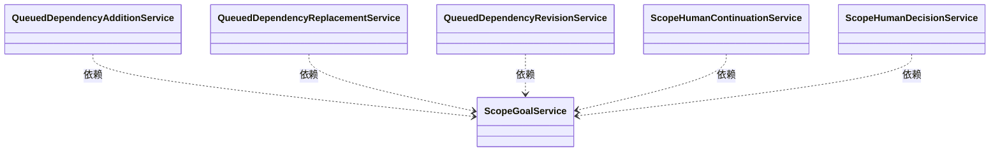
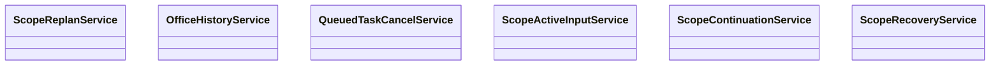
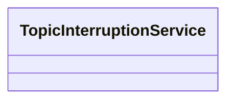

# src/logic/tasks/runtime 架构

## 设计意图

围绕目标周期协调补充、依赖调整、人工决定、续执行与恢复。服务按命令责任分开，通过派发、证据和执行端口协作；ScopeGoalService 仍承担跨域目标编排。

## 主要组成

| 组成 | 定位 |
| --- | --- |
| [OfficeHistoryService](office-history-service.ts) | 按主 Session → 原话题 → 内容引用读取现有调度及公开对话日志。 |
| [QueuedDependencyAdditionService](queued-dependency-addition-service.ts) | 在同一派发事务核实未领取任务及两端后继，为原目标追加一条结果前置。 |
| [QueuedDependencyReplacementService](queued-dependency-replacement-service.ts) | 主调度在同一事务核实旧前置、安全替代候选与未启动后继，并原子提交单条依赖替换。 |
| [QueuedDependencyRevisionService](queued-dependency-revision-service.ts) | 在同一可靠事务中退役和新增未领取目标的多条前置，保存原请求与完整闭包审计。 |
| [QueuedTaskCancelService](queued-task-cancel-service.ts) | 主调度在单个派发事务中撤销明确的一组尚未启动任务。 |
| [ScopeActiveInputService](scope-active-input-service.ts) | 在派发事务中登记运行中插入的准备、真实接收和不确定事实。 |
| [ScopeContinuationService](scope-continuation-service.ts) | 原子消费安全等待，保存用户原始补充、可选附件快照清单和一次性主运行意图。 |
| [ScopeGoalService](scope-goal-service.ts) | 保存目标计划与审阅，核验返工前的原始日志及精确拒绝候选；替代仍须真实新成果，人工项不因业务拒绝而降级。 |
| [ScopeHumanContinuationService](scope-human-continuation-service.ts) | 将当前等待中的最新人工决定全集转换成一次可信主运行接续意图。 |
| [ScopeHumanDecisionService](scope-human-decision-service.ts) | 核实安全等待中的人工验收项和明确选定文件，保存本机显式决定及不可变依据。 |
| [ScopeRecoveryService](scope-recovery-service.ts) | 为已关闭周期的异常执行创建独立只读核实周期，持久化用户观察和一次性全新上下文意图。 |
| [ScopeReplanService](scope-replan-service.ts) | 在完成的只读核实基础上创建独立业务周期，冻结真实证据、原人工约束和用户明确的新目标。 |
| [TopicInterruptionService](topic-interruption-service.ts) | 保存整话题补充意图，并在可信协调器排空全部参与者后建立等待检查点。 |

<!-- architecture:generated:start -->

## 架构关系

### 关系组 1

### 关系组 2

### 关系组 3

### 跨图协作

- [ScopeReplanService](scope-replan-service.ts)（图 2）→ [ScopeGoalService](scope-goal-service.ts)（图 1）：依赖。

[上层设计](../ARCHITECTURE.md)

<!-- architecture:generated:end -->
