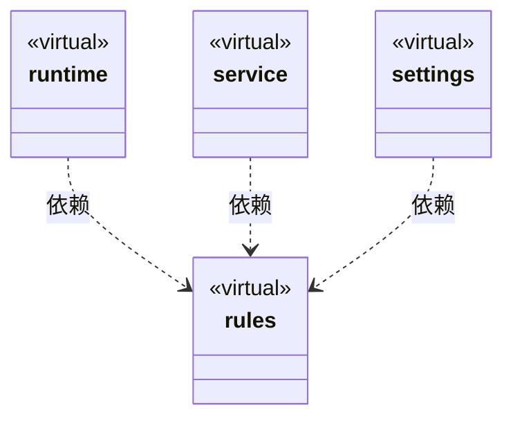

# src/logic/team 架构

## 设计意图

区分静态角色、长期岗位与真实执行，让能力配置、来源采纳和运行身份各自清楚。

`rules` 定义角色与岗位协议，`service` 登记和采纳岗位，`runtime` 执行已派发任务及检查点流程，`settings` 保存主 Agent 选型。岗位存在、配置可用和已取得执行准入是不同事实，实例退役不删除角色履历。

## 主要组成

本层没有直接产品实现，由下方子模块组成；每个直接子模块作为一个虚拟封装，只在本层呈现整体职责与协作。

<!-- architecture:generated:start -->

## 架构关系

标注为 `virtual` 的节点是直接子模块的虚拟类封装；内部设计沿下方入口阅读。

## 子模块

| 虚拟封装 | 整体职责 |
| --- | --- |
| [rules](rules/ARCHITECTURE.md) | 表达团队角色、岗位、执行绑定和会话履历的纯契约，为派发与存储提供共同身份依据。 |
| [runtime](runtime/ARCHITECTURE.md) | 执行已派发成员任务并维护安全停泊、续执行和明确放弃，保留原任务与各运行段的关系。 |
| [service](service/ARCHITECTURE.md) | 提供工作区岗位登记、来源采纳与差异查询，使长期人员配置独立于模型执行。 |
| [settings](settings/ARCHITECTURE.md) | 保存每个工作区主 Agent 的引擎与模型选择，让对话栏和团队配置使用同一份状态。 |

[上层设计](../ARCHITECTURE.md)

<!-- architecture:generated:end -->
