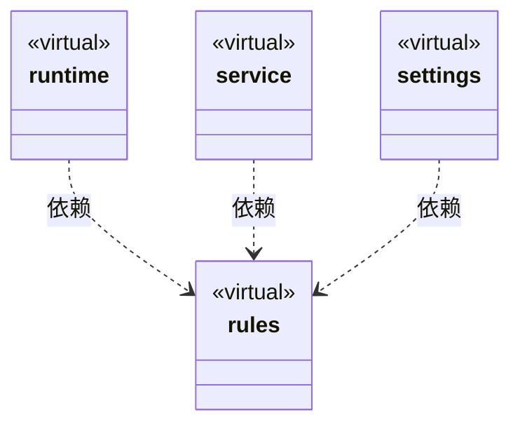

# src/logic/team 架构

## 设计意图

封装团队角色、稳定岗位与成员执行。规则维护身份和绑定，service 管理岗位登记，runtime 管理运行过程，settings 保存主 Agent 的选型。

## 主要组成

本层由下列子模块组合，每个子模块作为独立的虚拟类封装参与本层协作。

<!-- architecture:generated:start -->

## 架构关系

标注为 `virtual` 的节点是直接子模块的虚拟类封装；内部设计沿下方入口阅读。

## 子模块

| 虚拟封装 | 整体职责 |
| --- | --- |
| [rules](rules/ARCHITECTURE.md) | 定义团队角色、岗位、执行绑定和角色履历的纯业务契约。登记、来源采纳与真实执行分别表达，岗位存在不代表已经取得运行许可。 |
| [runtime](runtime/ARCHITECTURE.md) | 正式成员执行、自动协作与检查点服务；按冻结任务/Workflow 建立真实运行，保留取消、等待与证据绑定。 |
| [service](service/ARCHITECTURE.md) | 岗位、来源与责任登记的应用服务；协调知识、文件实现和 Logic 领域规则，不拥有正式运行准入。 |
| [settings](settings/ARCHITECTURE.md) | 仅保留主 Agent 设置及工作区 revision 校验；模型配置服务已迁至 logic/models/service，经 logic/engines/service 的引擎投影复用同一个模型配置短锁。 |

[上层设计](../ARCHITECTURE.md)

<!-- architecture:generated:end -->
