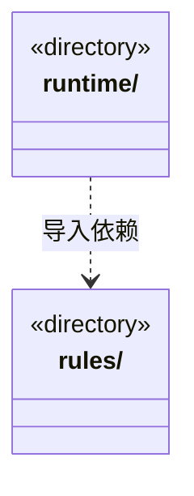

# src/logic/team 架构

## 目录定位

团队成员、岗位与履历契约；服务与规则分开归属，实际依赖通过明确入口验证。

本文描述当前实现。通过分析目录边界后维护的 [源码架构脚本](../../../scripts/source-architecture.mjs) 同步清单和声明；代码变更时仍须核对职责、关键成员与关系。

## 代码清单

本层无直接代码文件。

## 架构类图

各图中的同名节点表示同一目录边界；跨组及完整直接依赖如下（无边不代表继承）：

- `runtime` → `rules`：导入。

## 子目录导航

- [rules/](rules/ARCHITECTURE.md)：Team、小组、Agent 和父链 Skill 视图、实例及静态角色 Session 履历契约。主实例归主会话，业务实例归周期与任务；履历按角色聚合真实通道，释放或删定义后保留，旧记录不补造实例。另含稳定工作区岗位的严格DTO、采纳快照与不可变登记规则；岗位启用不等于执行许可。 model.ts 是知识读取模块的私有实现，外部通过 knowledge/read-models 访问；岗位与执行状态契约不归读取视图所有。 负责岗位选择、冻结执行绑定、当前来源/能力/模型判定及只读分组发现均为纯契约；同角色多岗位独立。
- [runtime/](runtime/ARCHITECTURE.md)：正式成员执行、自动协作与检查点服务；按冻结任务/Workflow 建立真实运行，保留取消、等待与证据绑定。

[返回上层](../ARCHITECTURE.md)。

每次修改本目录代码，同步维护文件头、关键契约说明及本图。未实现的治理、证据验收和自动编排能力不列入当前类图。
