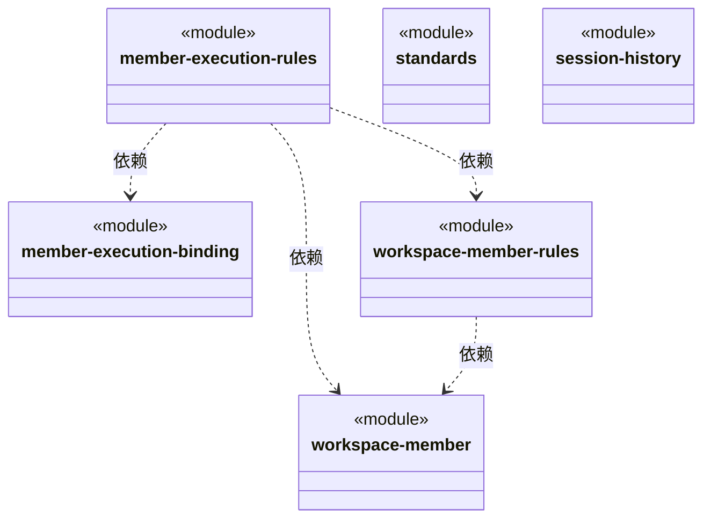

# src/logic/team/rules 架构

## 设计意图

表达团队角色、岗位、执行绑定和会话履历的纯契约，为派发与存储提供共同身份依据。

静态规范描述能力，岗位规则核对登记及来源，执行选择规则从同一快照核实负责人；逻辑会话和历史索引保存长期关联。契约不创建模型或授予运行许可，正式执行仍需准入、知识与冻结配置复核。

## 主要组成

| 组成 | 定位 |
| --- | --- |
| [standards](standards.ts) | Agent、团队 Skill 及派生注册表的规范与 Schema，结构校验和资料查询共用。 |
| [workspace-member](workspace-member.ts) | 定义工作区长期岗位、采纳快照、版本化登记命令与公开查询协议，供业务服务、Store 和桌面契约共用。 |
| [member-execution-binding](member-execution-binding.ts) | 岗位负责人派发的纯选择与冻结身份契约，供目标、任务、运行和公开视图共用。 |
| [session-history](session-history.ts) | 定义按静态 Agent 归档的独立 Session、任务轮次及公开事件查询协议。 |
| [member-execution-rules](member-execution-rules.ts) | 从同一岗位、责任和来源快照核实可信执行选择。 |
| [workspace-member-rules](workspace-member-rules.ts) | 计算岗位登记依据、命令指纹及不可变事件投影。 |

<!-- architecture:generated:start -->

## 架构关系

[上层设计](../ARCHITECTURE.md)

<!-- architecture:generated:end -->
