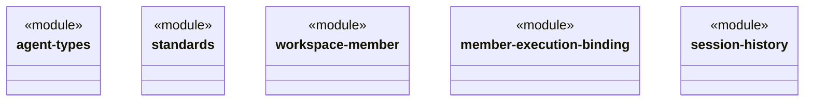

# src/logic/team/rules 架构

## 设计意图

定义团队角色、岗位、执行绑定和角色履历的纯业务契约。登记、来源采纳与真实执行分别表达，岗位存在不代表已经取得运行许可。

## 主要组成

| 组成 | 定位 |
| --- | --- |
| [standards](standards.ts) | Agent、团队 Skill 及派生注册表的规范与 Schema，结构校验和资料查询共用。 |
| [agent-types](agent-types.ts) | 虚拟成员的角色配置、持久化实例及独立会话身份，供调度和存储共同使用。 |
| [workspace-member](workspace-member.ts) | 定义工作区长期岗位、采纳快照、版本化登记命令与公开查询协议，供 Main、Store 和桌面共用。 |
| [member-execution-binding](member-execution-binding.ts) | 岗位负责人派发的纯选择与冻结身份契约，供目标、任务、运行和公开视图共用。 |
| [session-history](session-history.ts) | 定义按静态 Agent 归档的独立 Session、任务轮次及公开事件查询协议。 |

<!-- architecture:generated:start -->

## 架构关系

[上层设计](../ARCHITECTURE.md)

<!-- architecture:generated:end -->
