# src/logic/team/runtime 架构

本目录只维护这一份说明。设计与契约直接编辑本文；文件清单、类图和导航由 [架构脚本](../../../../scripts/source-architecture.mjs) 更新，生成区域之外的人工说明会保留。

## 封装意图

正式成员执行、自动协作与检查点服务；按冻结任务/Workflow 建立真实运行，保留取消、等待与证据绑定。

## 类与模块的设计意图

下表依据源码声明及文件头说明定位封装。字段表示该实例持有的状态或协作引用，不表示它拥有被引用服务的生命周期；实际资源责任和调用限制见下文契约及源码注释。

| 类／模块 | 实现形式与实例字段 | 封装依据 |
| --- | --- | --- |
| [agent-manager.ts](agent-manager.ts) | 函数／契约模块 | 主/子逻辑对话按办公室与角色唯一保留；任务执行租约和原生通道继续隔离，旧无周期登记仍按原规则恢复。返回待提交对象，由调度事务统一保存。 |
| [CheckpointAbandonmentService](checkpoint-abandonment-service.ts) | 实例类；持有 `owner`、`store`、`ports` | 先查原回执，再在事务外核历史日志，最后仅作 Store CAS；处置不依赖当前知识、模型或文件仍可执行，避免反向锁和旧待办无法终止。 |
| [member-checkpoint-verifier.ts](member-checkpoint-verifier.ts) | 函数／契约模块 | 续执行仍须当前知识及全部文件匹配；放弃只核原冻结证明，不能因来源或模型变化阻止结束旧待办，也不能据历史真实性获得新执行许可。 |
| [MemberExecutionManager](member-execution.ts) | 实例类；持有 `closing`、`initialized`、`handles`、`pendingStarts`、`launches`、`listeners`、`approvals`、`questions`、`eventStreams`、`owner`、`store`、`ports` | 每个活动工作区一个执行管理器，与派发服务共享 store；调用方须先关闭本管理器再关闭存储。 |
| [member-help-state.ts](member-help-state.ts) | 函数／契约模块 | 模型调用成功不等于可交接；必须正常结束、没有未决工具且求助后没有新工作，才允许主调度另派新任务。 |
| [MemberPauseService](member-pause-service.ts) | 实例类；持有 `owner`、`store`、`owners`、`ports` | 重启只读登记等待，不触碰原生会话；继续先取业务读占用，再按知识→模型→Store 的顺序核实，失败不消费等待。预检结果不缓存为执行许可，预约及领取仍各自重核。 |
| [MemberResumeService](member-resume-service.ts) | 实例类；持有 `owner`、`store`、`ports`、`owners` | 主轮仍占执行资源时不能立刻启动成员；预约和真正领取分开，并各自在 Knowledge→模型→Store 顺序核原岗位。旧回执不重新解析来源，未确认补充阻止新预约，停止或重启不会自动重放。 |
| [member-state.ts](member-state.ts) | 函数／契约模块 | 纯状态计算与进程生命周期分开；已请求求助的运行不能同时产出交付候选，模型正文不签发完成或验收事实。 |
| [member-workflow.ts](member-workflow.ts) | 函数／契约模块 | 工具成功不等于结构验证通过；canonical 核验包括本轮冻结岗位身份，原要求及当前文件共同约束出口。历史返工核实保留原证明，不能因文件已修改而抹掉过去的真实结果。 |

## 接口设计契约

#### 长期对话与执行登记

成员领取冻结当前话题的 `topicContext` 引用，排除其他话题任务和其他角色的隐式历史。前置候选必须来自同话题；旧原生通道不能跨任务/话题复用。同任务检查点保持原身份与证明核验，长期逻辑子 Session 不作为原生线程复用依据。

`prepareMember` 返回 `teamSession`，按当前工作区、主会话和角色查找已有长期身份，首次登记才生成新 ID。返回隔离副本、不直接保存；派发服务将它与主根/成员/任务一同提交。任务租约仍按原规则冻结和结算，关闭任务不删除长期逻辑对话。不同主会话不会复用同一角色的逻辑对话。

新成员领取在保存 starting 之前核 `teamSessionBusy`。同办公室同角色已有 starting/running 返回 `TEAM_SESSION_BUSY`，本次不创建运行、不调用引擎、不占执行租约；原任务仍待办。原运行真实结算并释放后可再领取。

#### 失败原因与任务卡

成员结算为 `failed/interrupted` 时，从身份已核实的 `RunSummary` 最后一条匹配终态取得 `error`，通过 Logic 领域规则 `publicRunFailure` 重建公开原因，和运行状态一起保存到 `TaskNode.waitReason` 与 `DispatchRun.error`。任务图既有原因区域直接消费此字段，不需要前端另猜错误。工具自身失败或旧轮错误不冒充本轮终态；无错误时保持原缺省说明，恢复关闭等明确原因仍优先。未决工具、候选资格、占用排空及用户取消语义不变；历史已保存的任务节点不批量重写。

#### 审阅后领取

dependenciesReady 同时供自动协调器和实际成员领取使用：有候选、计划和锁定结果匹配后，reviewRequired 边还须 candidateAccepted。检查先于执行占用；事务层再检查相同约束。旧未带标志依赖保持原行为，候选审阅不会修改运行事实或替代产物核实。

#### 指定话题补充与排空

原话题存在尚未消费的用户补充时，成员领取返回 TOPIC_PAUSING，不创建新 run 或借逻辑子会话重启旧任务。已经运行的成员依旧按真实引擎结果结算；停止请求不自行清除占用。其他办公室及已封存话题的未消费补充不占用当前办公室新话题。

##### 多角色执行准备

领取从被冻结版本的岗位 RuntimePolicy 或正式 fallbackBinding 恢复 modelRoles，连同 primary 在模型配置短锁中准备。完整 configurationHash 和成员版本仍由领取事务核对；公开预览不携带密钥，解密准备不能在回调结束后重新调用。

#### 旧成员 Workflow 预检复用

MemberExecutionManager 在持有准入、冻结知识之后且领取/运行登记之前，调用 workspace/rules 的 assertWorkflowCapabilities。原 PreparedEngine 提供可信普通/范围工具和验证器清单，artifacts 端口仍单独检查；规则与新递归入口共用，旧事务、错误码和失败释放语义不变。

#### 递归执行记录核实

MemberExecutionManager.Report 将独立 inspectAgent 传给 ExecutionReportService；登记决定日志来源，旧 inspect 与递归端口不可按最近记录互相回退。报告核实不领取、不准备引擎、不修改执行状态。

##### 递归工具迁移收口

validateBusinessWorkflow 以原 TaskSpec 及冻结 binding/prepared/session 核验同一套 Workflow、验证记录和完整出口；原 validateMemberWorkflow 仅适配旧 TaskNode。递归只读核实与旧候选验证共用稳定算法，权限/来源/生命周期由各自调用方核对。

## 开闭边界

本目录的职责及允许协作由[封装意图](#封装意图)限定，输入输出、状态与失败语义以[接口设计契约](#接口设计契约)为准。扩展从已有公开入口及实际装配位置进入；没有明确可替换契约的部分按真实影响修改和验证，不预建未使用的基类或插件入口。

<!-- architecture:generated:start -->

## 文件清单

| 文件 | 形式 | 当前职责 |
| --- | --- | --- |
| [ARCHITECTURE.md](ARCHITECTURE.md) | 说明文档 | 本目录的文件清单、真实声明、依赖与子封装导航。 |
| [agent-manager.ts](agent-manager.ts) | 源码模块 | 根据已核实角色配置注册持久化成员，按主会话分配独立逻辑 Session。 |
| [checkpoint-abandonment-service.ts](checkpoint-abandonment-service.ts) | 源码模块 | 主调度明确放弃本周期尚未消费的检查点及可选恢复预约，保留旧执行与证明。 |
| [member-checkpoint-verifier.ts](member-checkpoint-verifier.ts) | 源码模块 | 核实逐段检查点的完整 canonical、累计文件与最新私有原生历史，分别支持续执行许可与明确放弃旧待办的历史真实性检查。 |
| [member-execution.ts](member-execution.ts) | 源码模块 | 让已派发任务在独立成员执行通道中运行，已登记办公室同角色串行领取，提交启动、结果、中断及一次安全停泊/续执行事实。 |
| [member-help-state.ts](member-help-state.ts) | 源码模块 | 从成员 canonical 运行日志核实一次结构化求助的安全交接候选。 |
| [member-pause-service.ts](member-pause-service.ts) | 源码模块 | 核实持久等待的成员原记录，并在用户明确继续时重新检查岗位、知识、native 与文件。 |
| [member-resume-service.ts](member-resume-service.ts) | 源码模块 | 当前主调度为本周期最新安全检查点预约一次原任务续执行，逐段保留原预约和独立待领取信封。 |
| [member-state.ts](member-state.ts) | 源码模块 | 成员执行事务的图增量、占用和交付候选投影，并提供独立求助验证入口。 |
| [member-workflow.ts](member-workflow.ts) | 源码模块 | 在成员交付结算与主目标审阅时重算冻结 Workflow，并复核被验证文件的当前字节。 |

## 架构类图

成员标记：`+` 公开、`-` 私有、`#` 受保护、`$` 静态；构造函数单独列出。文档和资源仅在文件清单中导航，不作为代码节点。

### agent-manager.ts

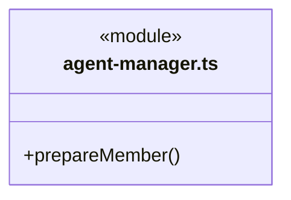

直接依赖：[../../../core/errors.ts](../../../core/errors.ts)、[../../dispatch/rules/dispatch-storage.ts](../../dispatch/rules/dispatch-storage.ts)、[../../tasks/rules/graph-types.ts](../../tasks/rules/graph-types.ts)、[../rules/agent-types.ts](../rules/agent-types.ts)、[../rules/team-session.ts](../rules/team-session.ts)。

### checkpoint-abandonment-service.ts

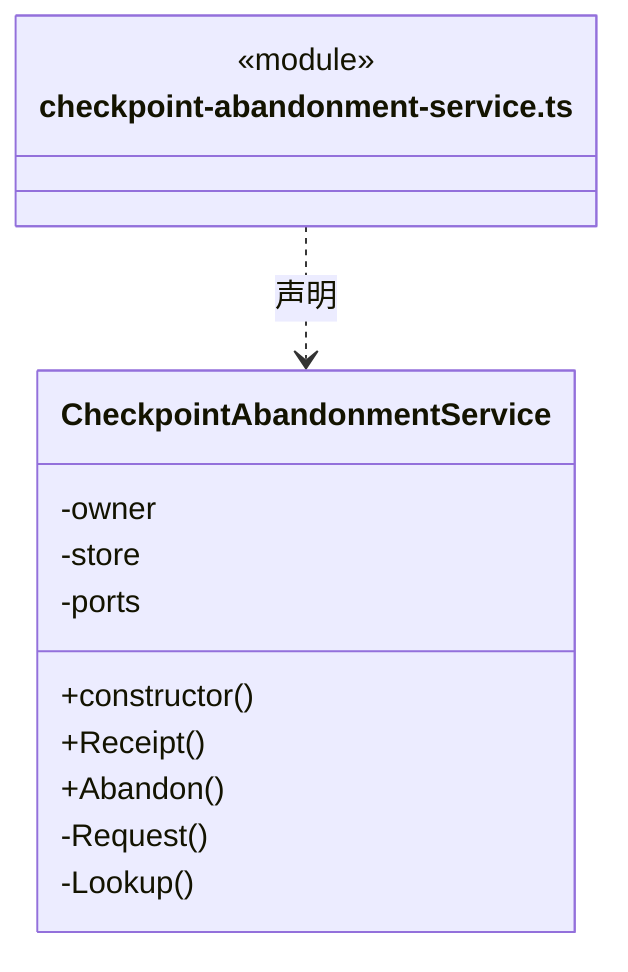

直接依赖：[../../../core/errors.ts](../../../core/errors.ts)、[../../../core/platform/node/serialization.ts](../../../core/platform/node/serialization.ts)、[../../dispatch/rules/dispatch-storage.ts](../../dispatch/rules/dispatch-storage.ts)、[../../knowledge/rules/ports.ts](../../knowledge/rules/ports.ts)、[../../tasks/rules/checkpoint-handoff-rules.ts](../../tasks/rules/checkpoint-handoff-rules.ts)、[../../tasks/rules/checkpoint-handoff.ts](../../tasks/rules/checkpoint-handoff.ts)、[../../tasks/rules/graph-types.ts](../../tasks/rules/graph-types.ts)、[../../tasks/runtime/main-command-request.ts](../../tasks/runtime/main-command-request.ts)、[member-checkpoint-verifier.ts](member-checkpoint-verifier.ts)。

### member-checkpoint-verifier.ts

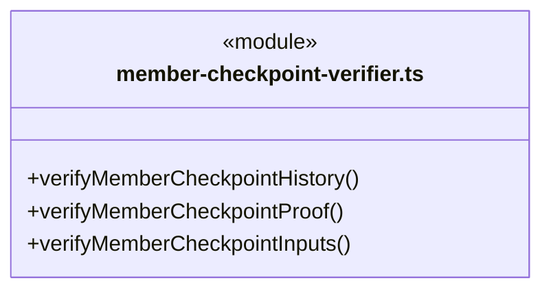

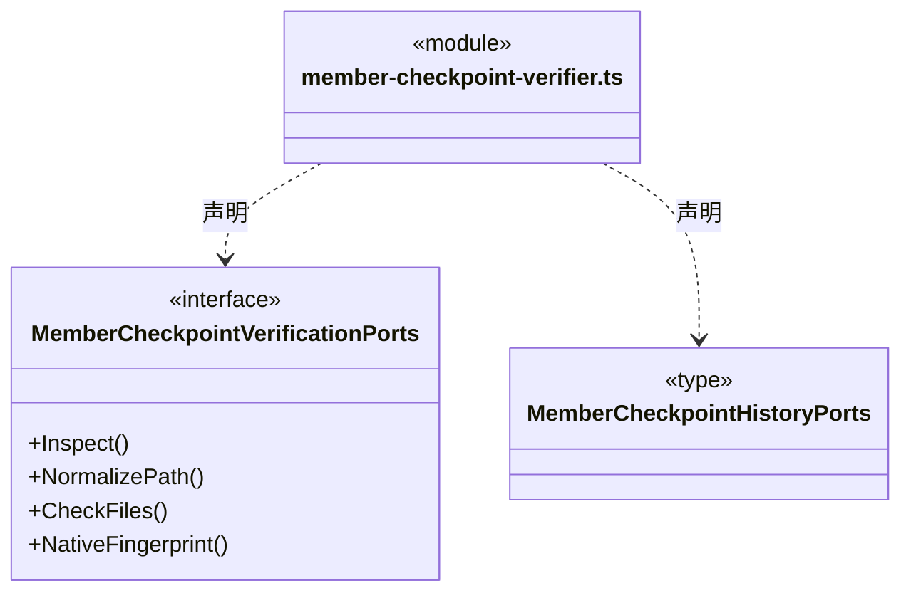

直接依赖：[../../../core/errors.ts](../../../core/errors.ts)、[../../../core/platform/node/serialization.ts](../../../core/platform/node/serialization.ts)、[../../evidence/rules/artifact-baseline.ts](../../evidence/rules/artifact-baseline.ts)、[../../execution/context/execution-context.ts](../../execution/context/execution-context.ts)、[../../execution/rules/types.ts](../../execution/rules/types.ts)、[../../knowledge/rules/ports.ts](../../knowledge/rules/ports.ts)、[../../runtime/monitoring/member-events.ts](../../runtime/monitoring/member-events.ts)、[../../tasks/rules/dispatch-execution.ts](../../tasks/rules/dispatch-execution.ts)、[../../tasks/rules/graph-types.ts](../../tasks/rules/graph-types.ts)、[../../tasks/rules/member-checkpoint-evidence.ts](../../tasks/rules/member-checkpoint-evidence.ts)、[../../tasks/rules/member-checkpoint.ts](../../tasks/rules/member-checkpoint.ts)。

### member-execution.ts

成员 1/3（同名节点为同一声明，跨图合并阅读）。

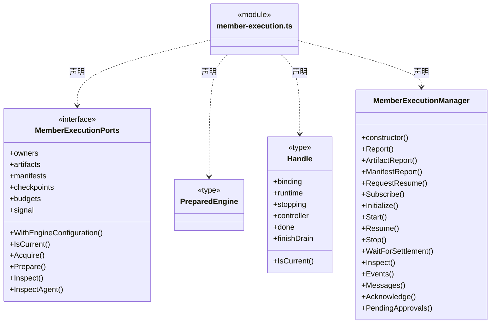

成员 2/3（同名节点为同一声明，跨图合并阅读）。

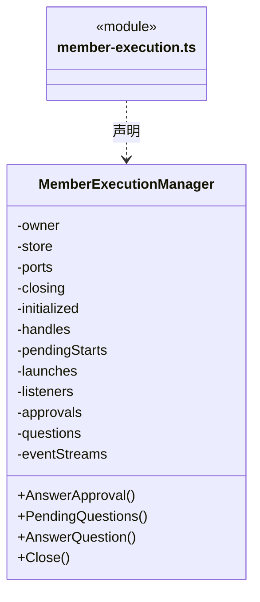

成员 3/3（同名节点为同一声明，跨图合并阅读）。

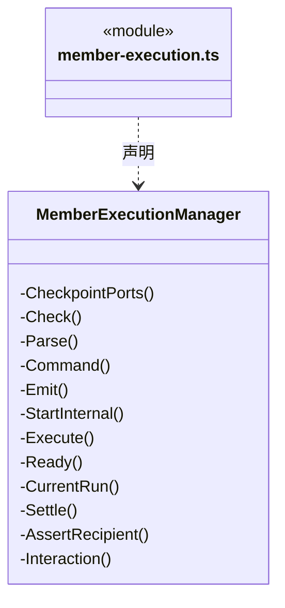

直接依赖：[../../../core/errors.ts](../../../core/errors.ts)、[../../../core/platform/node/serialization.ts](../../../core/platform/node/serialization.ts)、[../../budget/runtime/scope-budget-service.ts](../../budget/runtime/scope-budget-service.ts)、[../../conversation/runtime/approvals.ts](../../conversation/runtime/approvals.ts)、[../../conversation/runtime/questions.ts](../../conversation/runtime/questions.ts)、[../../dispatch/rules/dispatch-storage.ts](../../dispatch/rules/dispatch-storage.ts)、[../../dispatch/runtime/owner-execution-service.ts](../../dispatch/runtime/owner-execution-service.ts)、[../../engines/index.ts](../../engines/index.ts)、[../../evidence/rules/artifact-baseline.ts](../../evidence/rules/artifact-baseline.ts)、[../../evidence/rules/output-manifest.ts](../../evidence/rules/output-manifest.ts)、[../../evidence/runtime/artifact-report-service.ts](../../evidence/runtime/artifact-report-service.ts)、[../../evidence/runtime/execution-report-service.ts](../../evidence/runtime/execution-report-service.ts)、[../../evidence/runtime/output-manifest-report-service.ts](../../evidence/runtime/output-manifest-report-service.ts)、[../../execution/admission/admission-wait.ts](../../execution/admission/admission-wait.ts)、[../../execution/context/execution-context.ts](../../execution/context/execution-context.ts)、[../../execution/rules/business-run.ts](../../execution/rules/business-run.ts)、[../../execution/rules/run-failure.ts](../../execution/rules/run-failure.ts)、[../../execution/rules/runtime/runtime.ts](../../execution/rules/runtime/runtime.ts)、[../../execution/rules/types.ts](../../execution/rules/types.ts)、[../../knowledge/rules/ports.ts](../../knowledge/rules/ports.ts)、[../../runtime/monitoring/member-events.ts](../../runtime/monitoring/member-events.ts)、[../../tasks/rules/dispatch-execution.ts](../../tasks/rules/dispatch-execution.ts)、[../../tasks/rules/execution-context.ts](../../tasks/rules/execution-context.ts)、[../../tasks/rules/execution-report.ts](../../tasks/rules/execution-report.ts)、[../../tasks/rules/graph-types.ts](../../tasks/rules/graph-types.ts)、[../../tasks/rules/member-checkpoint-chain.ts](../../tasks/rules/member-checkpoint-chain.ts)、[../../tasks/rules/member-checkpoint.ts](../../tasks/rules/member-checkpoint.ts)、[../../tasks/rules/member-commands.ts](../../tasks/rules/member-commands.ts)、[../../tasks/rules/member-events.ts](../../tasks/rules/member-events.ts)、[../../tasks/rules/member-help.ts](../../tasks/rules/member-help.ts)、[../../tasks/rules/member-topic-context-rules.ts](../../tasks/rules/member-topic-context-rules.ts)、[../../tasks/rules/queued-member-resume.ts](../../tasks/rules/queued-member-resume.ts)、[../../tasks/rules/scope-active-input.ts](../../tasks/rules/scope-active-input.ts)、[../../tasks/rules/scope-goal.ts](../../tasks/rules/scope-goal.ts)、[../../tasks/rules/topic-interruption.ts](../../tasks/rules/topic-interruption.ts)、[../../tasks/rules/workflow-selection.ts](../../tasks/rules/workflow-selection.ts)、[../rules/automatic-execution.ts](../rules/automatic-execution.ts)、[../rules/member-execution-binding.ts](../rules/member-execution-binding.ts)、[../rules/team-session.ts](../rules/team-session.ts)、[../rules/workspace-member.ts](../rules/workspace-member.ts)、[member-checkpoint-verifier.ts](member-checkpoint-verifier.ts)、[member-resume-service.ts](member-resume-service.ts)、[member-state.ts](member-state.ts)、[member-workflow.ts](member-workflow.ts)、[../../workspace/rules/workflow-contract.ts](../../workspace/rules/workflow-contract.ts)。

### member-help-state.ts

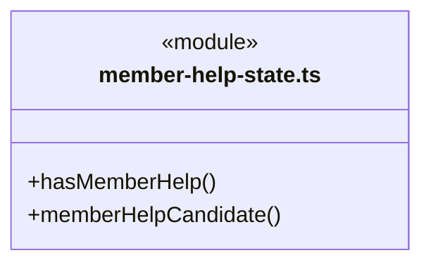

直接依赖：[../../../core/errors.ts](../../../core/errors.ts)、[../../../core/platform/node/serialization.ts](../../../core/platform/node/serialization.ts)、[../../evidence/runtime/execution-report-facts.ts](../../evidence/runtime/execution-report-facts.ts)、[../../execution/rules/types.ts](../../execution/rules/types.ts)、[../../tasks/rules/dispatch-execution.ts](../../tasks/rules/dispatch-execution.ts)、[../../tasks/rules/graph-types.ts](../../tasks/rules/graph-types.ts)、[../../tasks/rules/member-help.ts](../../tasks/rules/member-help.ts)。

### member-pause-service.ts

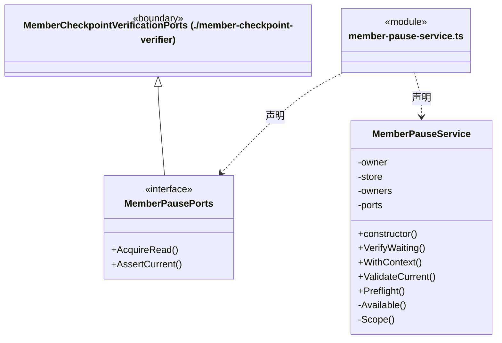

继承／实现来源：`MemberCheckpointVerificationPorts` → [member-checkpoint-verifier.ts](member-checkpoint-verifier.ts)。
直接依赖：[../../../core/errors.ts](../../../core/errors.ts)、[../../dispatch/rules/dispatch-storage.ts](../../dispatch/rules/dispatch-storage.ts)、[../../dispatch/runtime/owner-execution-service.ts](../../dispatch/runtime/owner-execution-service.ts)、[../../execution/context/execution-context.ts](../../execution/context/execution-context.ts)、[../../tasks/rules/dispatch-scope.ts](../../tasks/rules/dispatch-scope.ts)、[../../tasks/rules/member-pause-rules.ts](../../tasks/rules/member-pause-rules.ts)、[../../tasks/rules/member-pause.ts](../../tasks/rules/member-pause.ts)、[../../tasks/rules/scope-continuation.ts](../../tasks/rules/scope-continuation.ts)、[member-checkpoint-verifier.ts](member-checkpoint-verifier.ts)。

### member-resume-service.ts

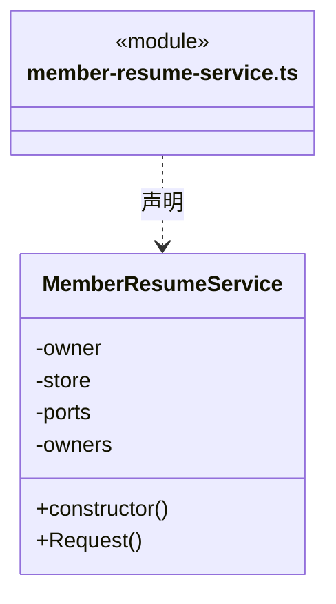

直接依赖：[../../../core/errors.ts](../../../core/errors.ts)、[../../../core/platform/node/serialization.ts](../../../core/platform/node/serialization.ts)、[../../dispatch/rules/dispatch-storage.ts](../../dispatch/rules/dispatch-storage.ts)、[../../dispatch/runtime/owner-execution-service.ts](../../dispatch/runtime/owner-execution-service.ts)、[../../knowledge/rules/ports.ts](../../knowledge/rules/ports.ts)、[../../tasks/rules/graph-types.ts](../../tasks/rules/graph-types.ts)、[../../tasks/rules/member-checkpoint-chain.ts](../../tasks/rules/member-checkpoint-chain.ts)、[../../tasks/rules/queued-member-resume-rules.ts](../../tasks/rules/queued-member-resume-rules.ts)、[../../tasks/rules/queued-member-resume.ts](../../tasks/rules/queued-member-resume.ts)、[../../tasks/rules/scope-active-input.ts](../../tasks/rules/scope-active-input.ts)、[../../tasks/runtime/main-command-request.ts](../../tasks/runtime/main-command-request.ts)、[member-checkpoint-verifier.ts](member-checkpoint-verifier.ts)、[member-state.ts](member-state.ts)。

### member-state.ts

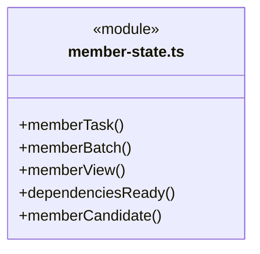

直接依赖：[../../../core/errors.ts](../../../core/errors.ts)、[../../dispatch/rules/dispatch-storage.ts](../../dispatch/rules/dispatch-storage.ts)、[../../execution/rules/types.ts](../../execution/rules/types.ts)、[../../tasks/rules/candidate-review.ts](../../tasks/rules/candidate-review.ts)、[../../tasks/rules/graph-types.ts](../../tasks/rules/graph-types.ts)、[../../tasks/rules/member-tool-output.ts](../../tasks/rules/member-tool-output.ts)、[../rules/agent-types.ts](../rules/agent-types.ts)、[member-help-state.ts](member-help-state.ts)。

### member-workflow.ts

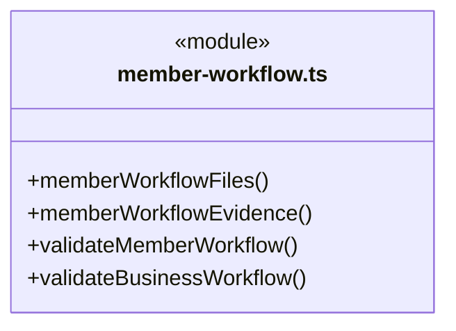

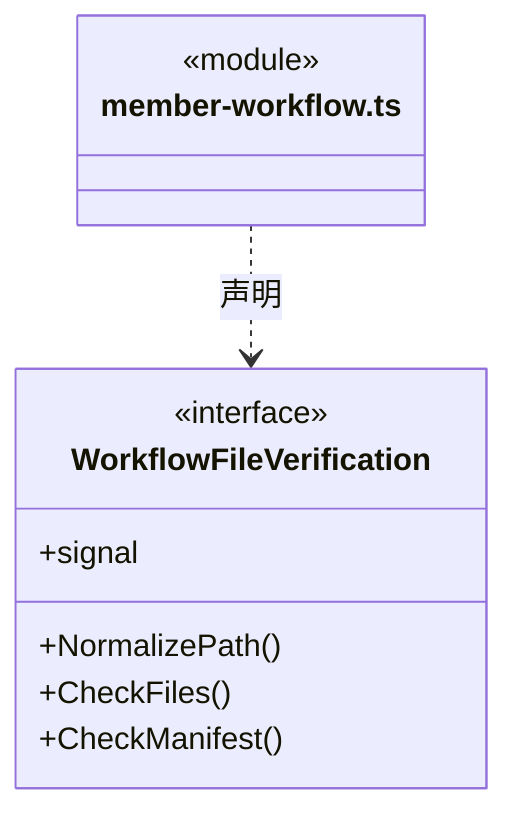

直接依赖：[../../../core/errors.ts](../../../core/errors.ts)、[../../evidence/rules/artifact-baseline.ts](../../evidence/rules/artifact-baseline.ts)、[../../evidence/rules/complete-output-evidence.ts](../../evidence/rules/complete-output-evidence.ts)、[../../evidence/rules/output-manifest-evidence.ts](../../evidence/rules/output-manifest-evidence.ts)、[../../evidence/rules/output-manifest.ts](../../evidence/rules/output-manifest.ts)、[../../evidence/rules/validation-evidence.ts](../../evidence/rules/validation-evidence.ts)、[../../evidence/rules/workflow-evidence.ts](../../evidence/rules/workflow-evidence.ts)、[../../execution/rules/types.ts](../../execution/rules/types.ts)、[../../runtime/monitoring/member-events.ts](../../runtime/monitoring/member-events.ts)、[../../tasks/rules/dispatch-execution.ts](../../tasks/rules/dispatch-execution.ts)、[../../tasks/rules/execution-context.ts](../../tasks/rules/execution-context.ts)、[../../tasks/rules/graph-types.ts](../../tasks/rules/graph-types.ts)、[../../tasks/rules/scope-goal.ts](../../tasks/rules/scope-goal.ts)、[../../workspace/rules/artifact-scope.ts](../../workspace/rules/artifact-scope.ts)。

### 本目录调用边界

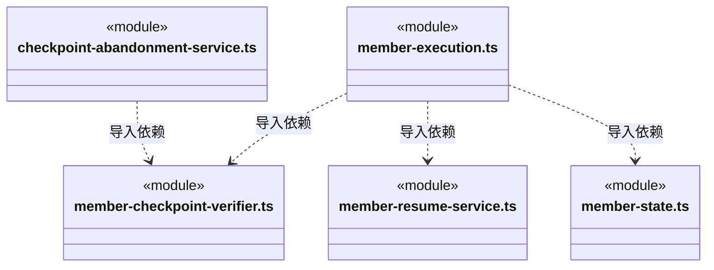

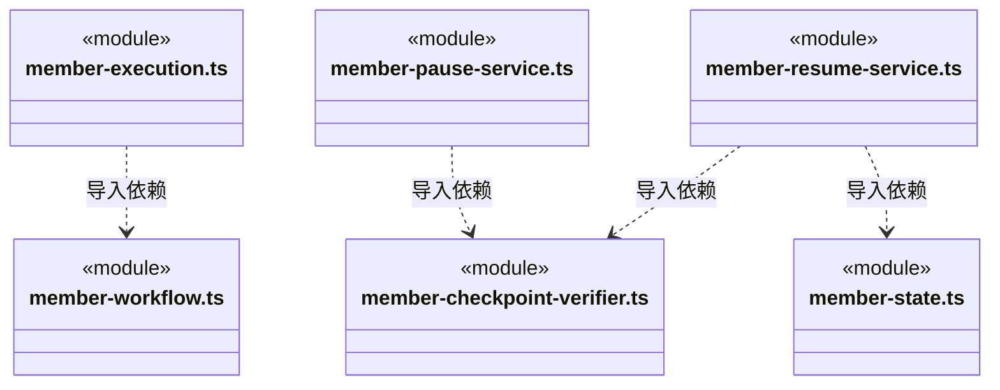

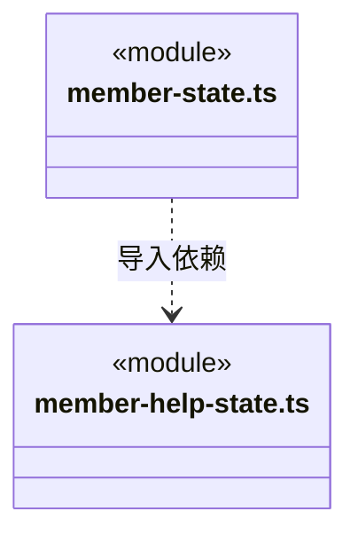

## 子目录导航

无子目录。

[返回上层](../ARCHITECTURE.md)。

每次修改本目录代码，同步维护文件头、关键契约说明及本图。未实现的治理、证据验收和自动编排能力不列入当前类图。

<!-- architecture:generated:end -->
