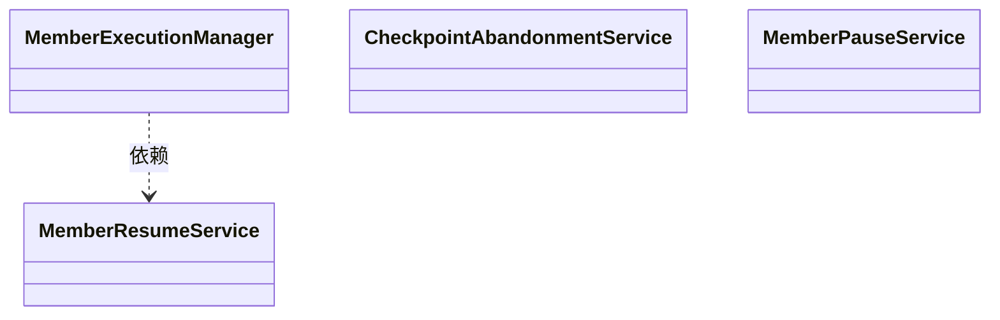

# src/logic/team/runtime 架构

## 设计意图

执行已派发成员任务并维护安全停泊、续执行和明确放弃，保留原任务与各运行段的关系。

`MemberExecutionManager` 领取任务并建立真实通道，暂停与续执行服务核实检查点及知识、文件、原生历史，放弃服务保存独立处置。图变化通过共享事务提交，预约不等于消费检查点，取消后须核实实际排空。

## 主要组成

| 组成 | 定位 |
| --- | --- |
| [CheckpointAbandonmentService](checkpoint-abandonment-service.ts) | 主调度明确放弃本周期尚未消费的检查点及可选恢复预约，保留旧执行与证明。 |
| [MemberExecutionManager](member-execution.ts) | 让已派发任务在独立成员执行通道中运行，已登记办公室同角色串行领取，提交启动、结果、中断及一次安全停泊/续执行事实。 |
| [MemberPauseService](member-pause-service.ts) | 核实持久等待的成员原记录，并在用户明确继续时重新检查岗位、知识、native 与文件。 |
| [MemberResumeService](member-resume-service.ts) | 当前主调度为本周期最新安全检查点预约一次原任务续执行，逐段保留原预约和独立待领取信封。 |

<!-- architecture:generated:start -->

## 架构关系

[上层设计](../ARCHITECTURE.md)

<!-- architecture:generated:end -->
