# src/logic/team/runtime 架构

## 目录定位

正式成员执行、自动协作与检查点服务；按冻结任务/Workflow 建立真实运行，保留取消、等待与证据绑定。

本文描述当前实现。通过分析目录边界后维护的 [源码架构脚本](../../../../scripts/source-architecture.mjs) 同步清单和声明；代码变更时仍须核对职责、关键成员与关系。

## 代码清单

| 文件 | 当前职责 |
| --- | --- |
| [agent-manager.ts](agent-manager.ts) | 根据已核实角色配置注册持久化成员，按主会话分配独立逻辑 Session。 |
| [checkpoint-abandonment-service.ts](checkpoint-abandonment-service.ts) | 主调度明确放弃本周期尚未消费的检查点及可选恢复预约，保留旧执行与证明。 |
| [member-checkpoint-verifier.ts](member-checkpoint-verifier.ts) | 核实逐段检查点的完整 canonical、累计文件与最新私有原生历史，分别支持续执行许可与明确放弃旧待办的历史真实性检查。 |
| [member-execution.ts](member-execution.ts) | 让已派发任务在独立成员执行通道中运行，已登记办公室同角色串行领取，提交启动、结果、中断及一次安全停泊/续执行事实。 |
| [member-help-state.ts](member-help-state.ts) | 从成员 canonical 运行日志核实一次结构化求助的安全交接候选。 |
| [member-pause-service.ts](member-pause-service.ts) | 核实持久等待的成员原记录，并在用户明确继续时重新检查岗位、知识、native 与文件。 |
| [member-resume-service.ts](member-resume-service.ts) | 当前主调度为本周期最新安全检查点预约一次原任务续执行，逐段保留原预约和独立待领取信封。 |
| [member-state.ts](member-state.ts) | 成员执行事务的图增量、占用和交付候选投影，并提供独立求助验证入口。 |
| [member-workflow.ts](member-workflow.ts) | 在成员交付结算与主目标审阅时重算冻结 Workflow，并复核被验证文件的当前字节。 |

## 架构类图

### agent-manager.ts

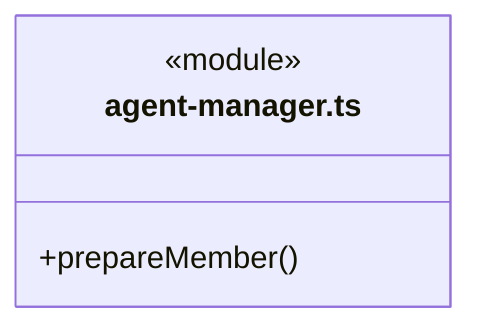

直接依赖：[../../../core/errors.ts](../../../core/errors.ts)、[../rules/agent-types.ts](../rules/agent-types.ts)、[../../dispatch/rules/dispatch-storage.ts](../../dispatch/rules/dispatch-storage.ts)、[../../tasks/rules/graph-types.ts](../../tasks/rules/graph-types.ts)、[../rules/team-session.ts](../rules/team-session.ts)。

### checkpoint-abandonment-service.ts

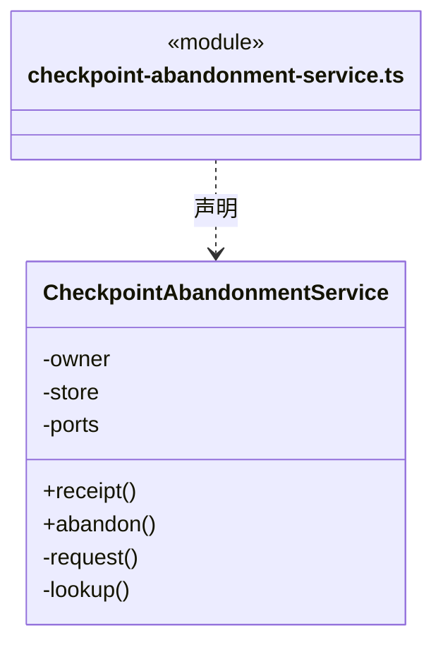

直接依赖：[../../../core/errors.ts](../../../core/errors.ts)、[../../../core/platform/node/serialization.ts](../../../core/platform/node/serialization.ts)、[../../tasks/runtime/main-command-request.ts](../../tasks/runtime/main-command-request.ts)、[../../knowledge/rules/ports.ts](../../knowledge/rules/ports.ts)、[../../dispatch/rules/dispatch-storage.ts](../../dispatch/rules/dispatch-storage.ts)、[../../tasks/rules/graph-types.ts](../../tasks/rules/graph-types.ts)、[../../tasks/rules/checkpoint-handoff.ts](../../tasks/rules/checkpoint-handoff.ts)、[../../tasks/rules/checkpoint-handoff-rules.ts](../../tasks/rules/checkpoint-handoff-rules.ts)、[member-checkpoint-verifier.ts](member-checkpoint-verifier.ts)。

### member-checkpoint-verifier.ts

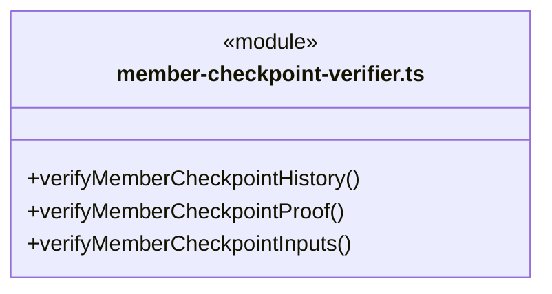

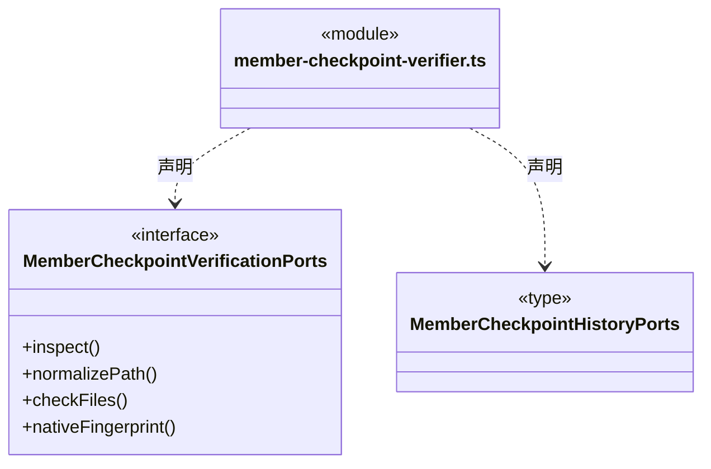

直接依赖：[../../../core/errors.ts](../../../core/errors.ts)、[../../../core/platform/node/serialization.ts](../../../core/platform/node/serialization.ts)、[../../knowledge/rules/ports.ts](../../knowledge/rules/ports.ts)、[../../execution/rules/types.ts](../../execution/rules/types.ts)、[../../tasks/rules/dispatch-execution.ts](../../tasks/rules/dispatch-execution.ts)、[../../tasks/rules/graph-types.ts](../../tasks/rules/graph-types.ts)、[../../evidence/rules/artifact-baseline.ts](../../evidence/rules/artifact-baseline.ts)、[../../tasks/rules/member-checkpoint.ts](../../tasks/rules/member-checkpoint.ts)、[../../tasks/rules/member-checkpoint-evidence.ts](../../tasks/rules/member-checkpoint-evidence.ts)、[../../execution/context/execution-context.ts](../../execution/context/execution-context.ts)、[../../runtime/monitoring/member-events.ts](../../runtime/monitoring/member-events.ts)。

### member-execution.ts

成员 1/3（同名节点为同一声明，跨图合并阅读）。

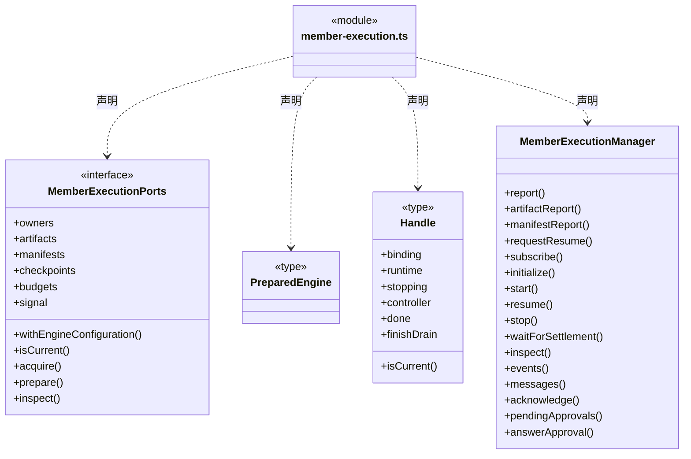

成员 2/3（同名节点为同一声明，跨图合并阅读）。

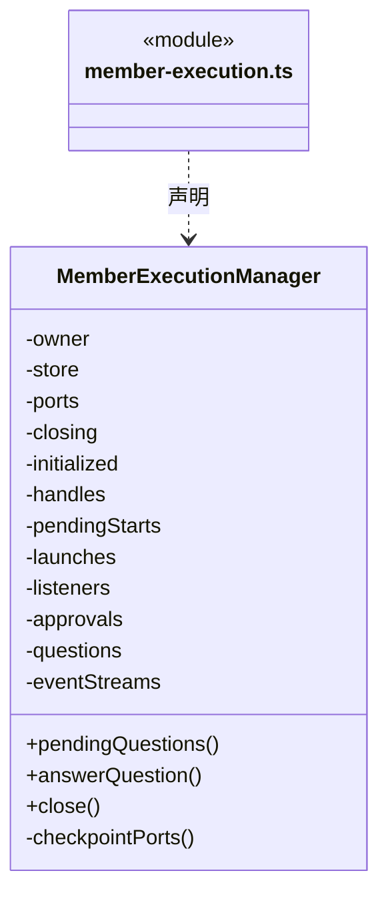

成员 3/3（同名节点为同一声明，跨图合并阅读）。

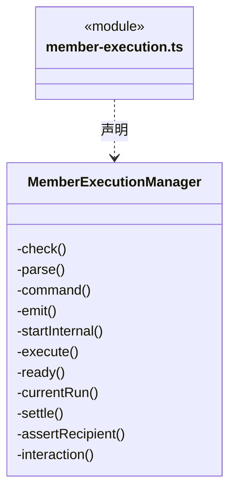

直接依赖：[../rules/workspace-member.ts](../rules/workspace-member.ts)、[../rules/team-session.ts](../rules/team-session.ts)、[../../tasks/rules/topic-interruption.ts](../../tasks/rules/topic-interruption.ts)、[../../tasks/rules/member-topic-context-rules.ts](../../tasks/rules/member-topic-context-rules.ts)、[../rules/automatic-execution.ts](../rules/automatic-execution.ts)、[../../../core/errors.ts](../../../core/errors.ts)、[../../../core/platform/node/serialization.ts](../../../core/platform/node/serialization.ts)、[../../knowledge/rules/ports.ts](../../knowledge/rules/ports.ts)、[../../execution/rules/runtime/runtime.ts](../../execution/rules/runtime/runtime.ts)、[../../engines/index.ts](../../engines/index.ts)、[../../execution/rules/types.ts](../../execution/rules/types.ts)、[../../execution/rules/run-failure.ts](../../execution/rules/run-failure.ts)、[../../tasks/rules/dispatch-execution.ts](../../tasks/rules/dispatch-execution.ts)、[../../dispatch/rules/dispatch-storage.ts](../../dispatch/rules/dispatch-storage.ts)、[../../tasks/rules/graph-types.ts](../../tasks/rules/graph-types.ts)、[../../workspace/rules/execution-scope.ts](../../workspace/rules/execution-scope.ts)、[../../tasks/rules/member-commands.ts](../../tasks/rules/member-commands.ts)、[../../execution/context/execution-context.ts](../../execution/context/execution-context.ts)、[../../conversation/runtime/approvals.ts](../../conversation/runtime/approvals.ts)、[../../conversation/runtime/questions.ts](../../conversation/runtime/questions.ts)、[member-state.ts](member-state.ts)、[../../tasks/rules/member-help.ts](../../tasks/rules/member-help.ts)、[../../tasks/rules/member-events.ts](../../tasks/rules/member-events.ts)、[../../runtime/monitoring/member-events.ts](../../runtime/monitoring/member-events.ts)、[../../evidence/runtime/execution-report-service.ts](../../evidence/runtime/execution-report-service.ts)、[../../evidence/runtime/artifact-report-service.ts](../../evidence/runtime/artifact-report-service.ts)、[../../evidence/runtime/output-manifest-report-service.ts](../../evidence/runtime/output-manifest-report-service.ts)、[../../evidence/rules/output-manifest.ts](../../evidence/rules/output-manifest.ts)、[../../evidence/rules/artifact-baseline.ts](../../evidence/rules/artifact-baseline.ts)、[../../tasks/rules/execution-report.ts](../../tasks/rules/execution-report.ts)、[../../execution/admission/admission-wait.ts](../../execution/admission/admission-wait.ts)、[../../budget/runtime/scope-budget-service.ts](../../budget/runtime/scope-budget-service.ts)、[../../tasks/rules/member-checkpoint.ts](../../tasks/rules/member-checkpoint.ts)、[../../tasks/rules/member-checkpoint-chain.ts](../../tasks/rules/member-checkpoint-chain.ts)、[member-checkpoint-verifier.ts](member-checkpoint-verifier.ts)、[member-resume-service.ts](member-resume-service.ts)、[../../tasks/rules/queued-member-resume.ts](../../tasks/rules/queued-member-resume.ts)、[../../tasks/rules/scope-goal.ts](../../tasks/rules/scope-goal.ts)、[../../tasks/rules/scope-active-input.ts](../../tasks/rules/scope-active-input.ts)、[../../tasks/rules/execution-context.ts](../../tasks/rules/execution-context.ts)、[member-workflow.ts](member-workflow.ts)、[../../workspace/rules/json-validation-schema.ts](../../workspace/rules/json-validation-schema.ts)、[../../tasks/rules/workflow-selection.ts](../../tasks/rules/workflow-selection.ts)、[../rules/member-execution-binding.ts](../rules/member-execution-binding.ts)、[../../dispatch/runtime/owner-execution-service.ts](../../dispatch/runtime/owner-execution-service.ts)。

### member-help-state.ts

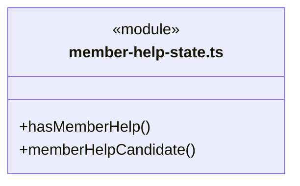

直接依赖：[../../../core/errors.ts](../../../core/errors.ts)、[../../../core/platform/node/serialization.ts](../../../core/platform/node/serialization.ts)、[../../execution/rules/types.ts](../../execution/rules/types.ts)、[../../tasks/rules/dispatch-execution.ts](../../tasks/rules/dispatch-execution.ts)、[../../tasks/rules/graph-types.ts](../../tasks/rules/graph-types.ts)、[../../tasks/rules/member-help.ts](../../tasks/rules/member-help.ts)、[../../evidence/runtime/execution-report-facts.ts](../../evidence/runtime/execution-report-facts.ts)。

### member-pause-service.ts

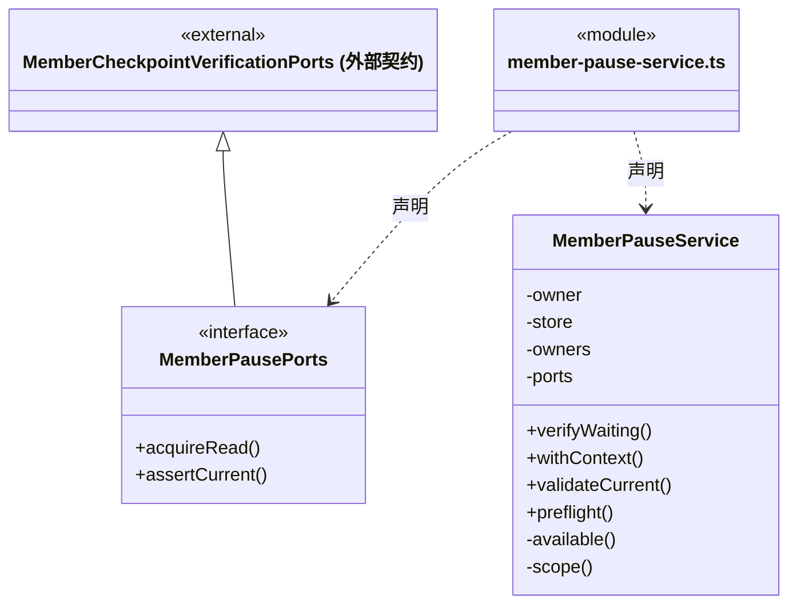

直接依赖：[../../../core/errors.ts](../../../core/errors.ts)、[../../execution/context/execution-context.ts](../../execution/context/execution-context.ts)、[../../dispatch/rules/dispatch-storage.ts](../../dispatch/rules/dispatch-storage.ts)、[../../tasks/rules/dispatch-scope.ts](../../tasks/rules/dispatch-scope.ts)、[../../tasks/rules/scope-continuation.ts](../../tasks/rules/scope-continuation.ts)、[../../tasks/rules/member-pause.ts](../../tasks/rules/member-pause.ts)、[../../tasks/rules/member-pause-rules.ts](../../tasks/rules/member-pause-rules.ts)、[member-checkpoint-verifier.ts](member-checkpoint-verifier.ts)、[../../dispatch/runtime/owner-execution-service.ts](../../dispatch/runtime/owner-execution-service.ts)。

### member-resume-service.ts

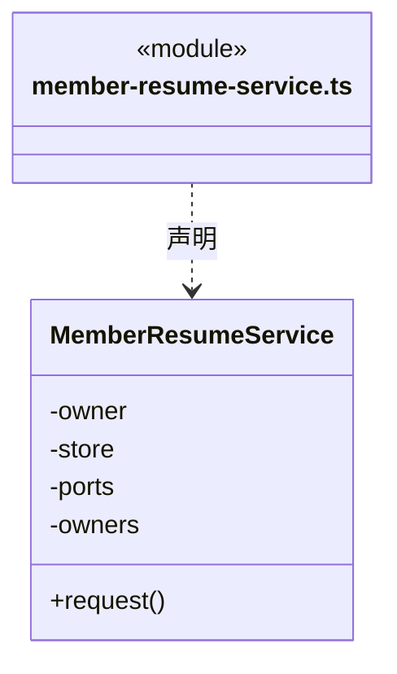

直接依赖：[../../../core/errors.ts](../../../core/errors.ts)、[../../../core/platform/node/serialization.ts](../../../core/platform/node/serialization.ts)、[../../tasks/runtime/main-command-request.ts](../../tasks/runtime/main-command-request.ts)、[../../knowledge/rules/ports.ts](../../knowledge/rules/ports.ts)、[../../dispatch/rules/dispatch-storage.ts](../../dispatch/rules/dispatch-storage.ts)、[../../tasks/rules/graph-types.ts](../../tasks/rules/graph-types.ts)、[../../tasks/rules/queued-member-resume.ts](../../tasks/rules/queued-member-resume.ts)、[../../tasks/rules/queued-member-resume-rules.ts](../../tasks/rules/queued-member-resume-rules.ts)、[../../tasks/rules/scope-active-input.ts](../../tasks/rules/scope-active-input.ts)、[member-state.ts](member-state.ts)、[member-checkpoint-verifier.ts](member-checkpoint-verifier.ts)、[../../dispatch/runtime/owner-execution-service.ts](../../dispatch/runtime/owner-execution-service.ts)、[../../tasks/rules/member-checkpoint-chain.ts](../../tasks/rules/member-checkpoint-chain.ts)。

### member-state.ts

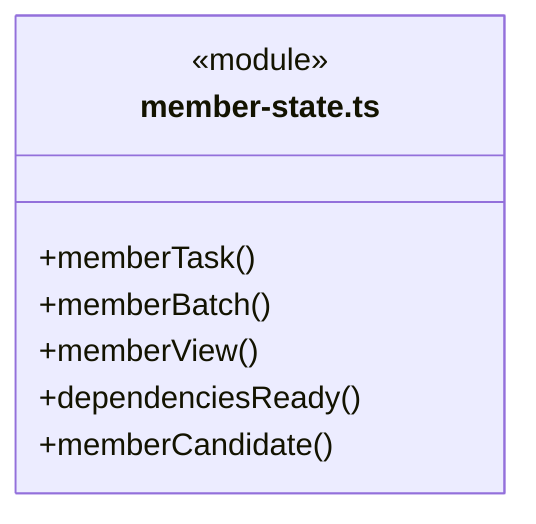

直接依赖：[../../tasks/rules/candidate-review.ts](../../tasks/rules/candidate-review.ts)、[../../../core/errors.ts](../../../core/errors.ts)、[../../execution/rules/types.ts](../../execution/rules/types.ts)、[../../dispatch/rules/dispatch-storage.ts](../../dispatch/rules/dispatch-storage.ts)、[../../tasks/rules/graph-types.ts](../../tasks/rules/graph-types.ts)、[../rules/agent-types.ts](../rules/agent-types.ts)、[../../tasks/rules/member-tool-output.ts](../../tasks/rules/member-tool-output.ts)、[member-help-state.ts](member-help-state.ts)。

### member-workflow.ts

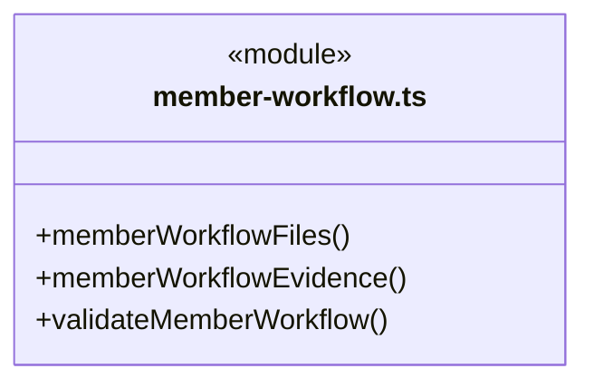

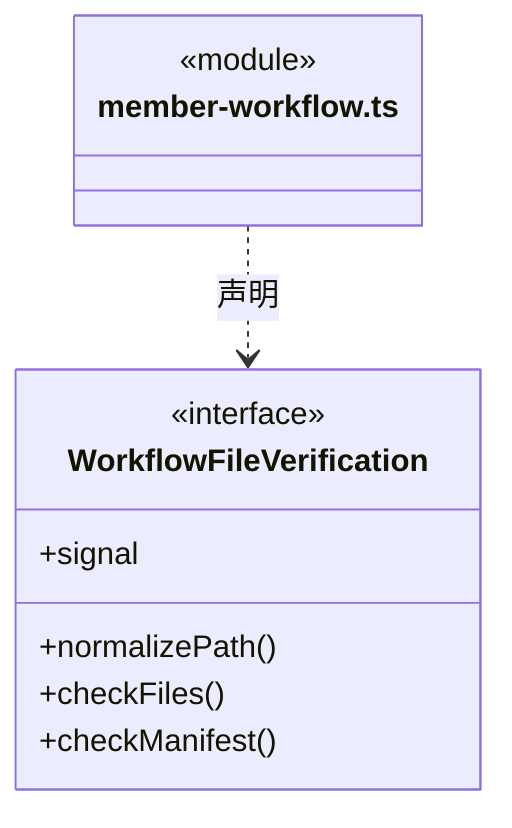

直接依赖：[../../../core/errors.ts](../../../core/errors.ts)、[../../tasks/rules/scope-goal.ts](../../tasks/rules/scope-goal.ts)、[../../tasks/rules/execution-context.ts](../../tasks/rules/execution-context.ts)、[../../evidence/rules/workflow-evidence.ts](../../evidence/rules/workflow-evidence.ts)、[../../evidence/rules/validation-evidence.ts](../../evidence/rules/validation-evidence.ts)、[../../evidence/rules/complete-output-evidence.ts](../../evidence/rules/complete-output-evidence.ts)、[../../evidence/rules/output-manifest-evidence.ts](../../evidence/rules/output-manifest-evidence.ts)、[../../workspace/rules/artifact-scope.ts](../../workspace/rules/artifact-scope.ts)、[../../evidence/rules/output-manifest.ts](../../evidence/rules/output-manifest.ts)、[../../evidence/rules/artifact-baseline.ts](../../evidence/rules/artifact-baseline.ts)、[../../execution/rules/types.ts](../../execution/rules/types.ts)、[../../tasks/rules/graph-types.ts](../../tasks/rules/graph-types.ts)、[../../tasks/rules/dispatch-execution.ts](../../tasks/rules/dispatch-execution.ts)、[../../runtime/monitoring/member-events.ts](../../runtime/monitoring/member-events.ts)。

### 本目录调用边界

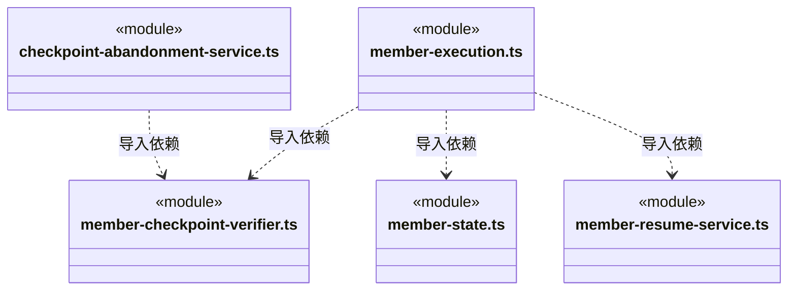

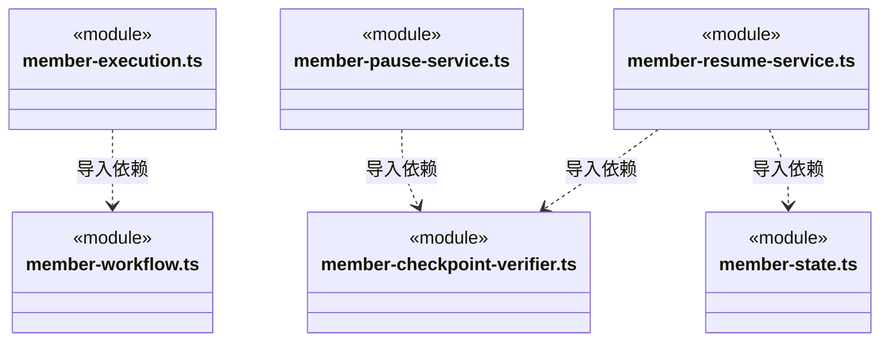

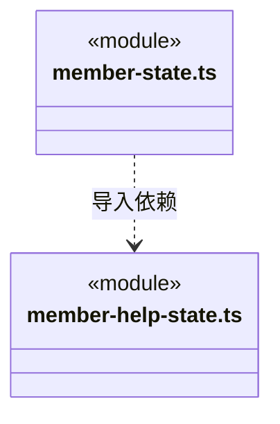

## 子目录导航

无子目录。

[返回上层](../ARCHITECTURE.md)。

每次修改本目录代码，同步维护文件头、关键契约说明及本图。未实现的治理、证据验收和自动编排能力不列入当前类图。

## 设计契约 v1 与落地范围

以下内容区分已接通能力与后续设计；以各节的实现状态为准，不将目标图当作现状图。维护源：[CONTRACT.md](CONTRACT.md)；生成类图时同步附加，勿直接修改本附录。

## 长期对话与执行登记

成员领取冻结当前话题的 `topicContext` 引用，排除其他话题任务和其他角色的隐式历史。前置候选必须来自同话题；旧原生通道不能跨任务/话题复用。同任务检查点保持原身份与证明核验，长期逻辑子 Session 不作为原生线程复用依据。

`prepareMember` 返回 `teamSession`，按当前工作区、主会话和角色查找已有长期身份，首次登记才生成新 ID。返回隔离副本、不直接保存；派发服务将它与主根/成员/任务一同提交。任务租约仍按原规则冻结和结算，关闭任务不删除长期逻辑对话。不同主会话不会复用同一角色的逻辑对话。

新成员领取在保存 starting 之前核 `teamSessionBusy`。同办公室同角色已有 starting/running 返回 `TEAM_SESSION_BUSY`，本次不创建运行、不调用引擎、不占执行租约；原任务仍待办。原运行真实结算并释放后可再领取。

## 失败原因与任务卡

成员结算为 `failed/interrupted` 时，从身份已核实的 `RunSummary` 最后一条匹配终态取得 `error`，通过 Logic 领域规则 `publicRunFailure` 重建公开原因，和运行状态一起保存到 `TaskNode.waitReason` 与 `DispatchRun.error`。任务图既有原因区域直接消费此字段，不需要前端另猜错误。工具自身失败或旧轮错误不冒充本轮终态；无错误时保持原缺省说明，恢复关闭等明确原因仍优先。未决工具、候选资格、占用排空及用户取消语义不变；历史已保存的任务节点不批量重写。

## 审阅后领取

dependenciesReady 同时供自动协调器和实际成员领取使用：有候选、计划和锁定结果匹配后，reviewRequired 边还须 candidateAccepted。检查先于执行占用；事务层再检查相同约束。旧未带标志依赖保持原行为，候选审阅不会修改运行事实或替代产物核实。

## 指定话题补充与排空

原话题存在尚未消费的用户补充时，成员领取返回 TOPIC_PAUSING，不创建新 run 或借逻辑子会话重启旧任务。已经运行的成员依旧按真实引擎结果结算；停止请求不自行清除占用。其他办公室及已封存话题的未消费补充不占用当前办公室新话题。

### 多角色执行准备

领取从被冻结版本的岗位 RuntimePolicy 或正式 fallbackBinding 恢复 modelRoles，连同 primary 在模型配置短锁中准备。完整 configurationHash 和成员版本仍由领取事务核对；公开预览不携带密钥，解密准备不能在回调结束后重新调用。
