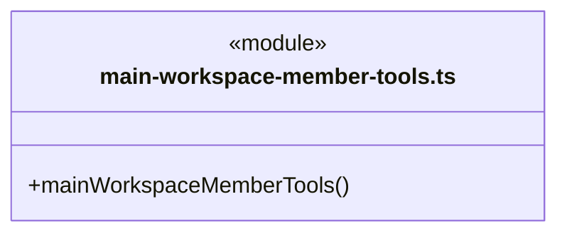
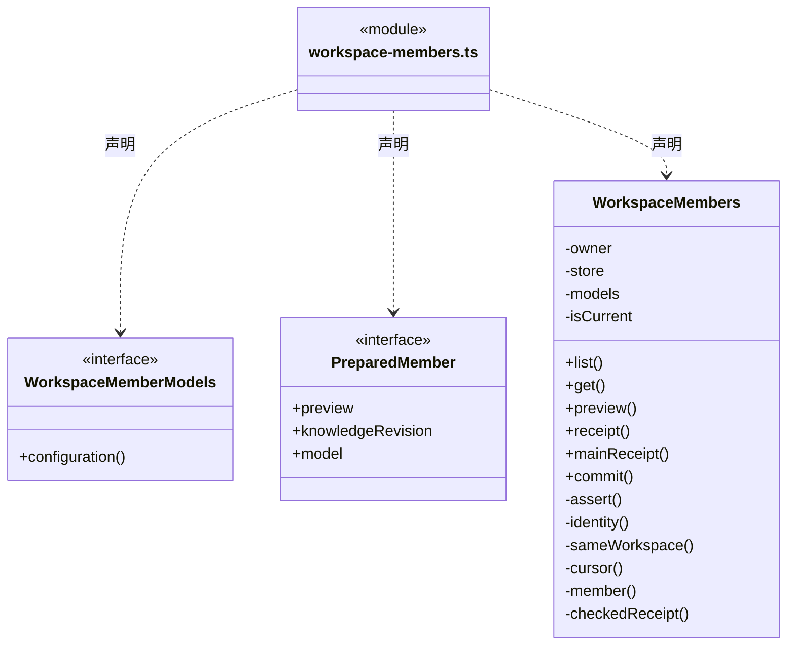
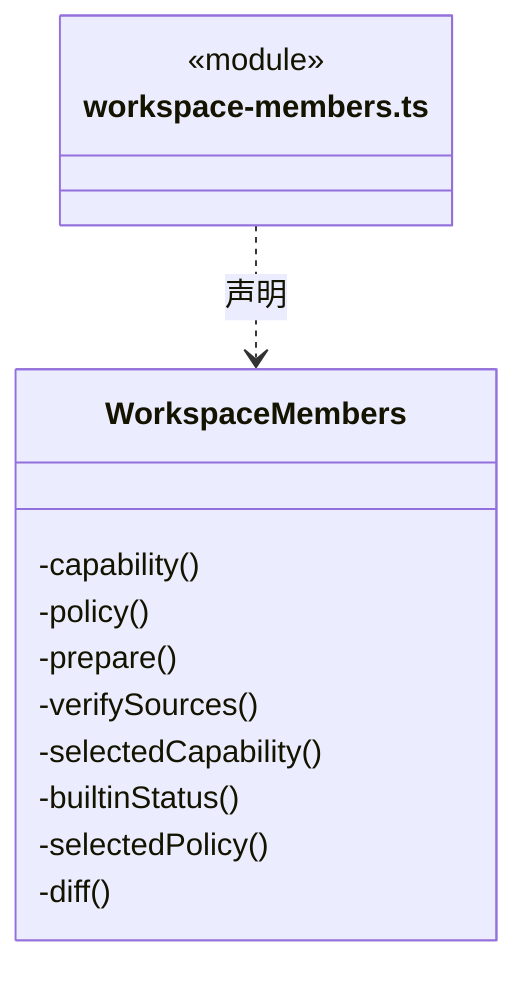
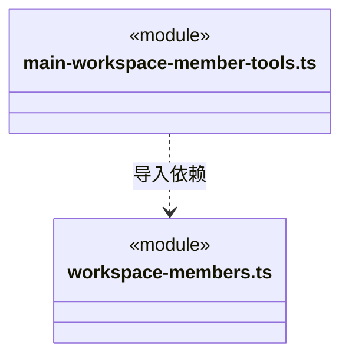

# src/logic/team/service 架构

## 目录定位

岗位、来源与责任登记的应用服务；协调知识、文件实现和 Logic 领域规则，不拥有正式运行准入。

本文描述当前实现。通过分析目录边界后维护的 [源码架构脚本](../../../../scripts/source-architecture.mjs) 同步清单和声明；代码变更时仍须核对职责、关键成员与关系。

## 代码清单

| 文件 | 当前职责 |
| --- | --- |
| [main-workspace-member-tools.ts](main-workspace-member-tools.ts) | 把岗位服务装配到真实主运行；工作区、actor 和命令身份由闭包持有。 |
| [workspace-members.ts](workspace-members.ts) | 将桌面岗位登记、采纳与当前差异查询接到工作区唯一 DispatchStore，公开模型配置由 Main 注入。 |

## 架构类图

### main-workspace-member-tools.ts

直接依赖：[../../../core/errors.ts](../../../core/errors.ts)、[../../execution/rules/conversation-binding.ts](../../execution/rules/conversation-binding.ts)、[../rules/agent-runtime.ts](../rules/agent-runtime.ts)、[../../knowledge/rules/read-models/index.ts](../../knowledge/rules/read-models/index.ts)、[../../knowledge/rules/ports.ts](../../knowledge/rules/ports.ts)、[../../tasks/rules/types.ts](../../tasks/rules/types.ts)、[../rules/workspace-member-rules.ts](../rules/workspace-member-rules.ts)、[../rules/workspace-member.ts](../rules/workspace-member.ts)、[../rules/workspace-member-tools.ts](../rules/workspace-member-tools.ts)、[../../dispatch/runtime/auto-collaboration.ts](../../dispatch/runtime/auto-collaboration.ts)、[workspace-members.ts](workspace-members.ts)。

### workspace-members.ts

成员 1/2（同名节点为同一声明，跨图合并阅读）。

成员 2/2（同名节点为同一声明，跨图合并阅读）。

直接依赖：[../../knowledge/rules/read-models/index.ts](../../knowledge/rules/read-models/index.ts)、[../rules/agent-runtime.ts](../rules/agent-runtime.ts)、[../../../core/errors.ts](../../../core/errors.ts)、[../../dispatch/rules/dispatch-storage.ts](../../dispatch/rules/dispatch-storage.ts)、[../rules/workspace-member.ts](../rules/workspace-member.ts)、[../rules/workspace-member-rules.ts](../rules/workspace-member-rules.ts)、[../../execution/context/dispatch-context.ts](../../execution/context/dispatch-context.ts)、[../../knowledge/rules/types.ts](../../knowledge/rules/types.ts)、[../../workspace/rules/knowledge-source-rules.ts](../../workspace/rules/knowledge-source-rules.ts)、[../../workspace/rules/knowledge-source.ts](../../workspace/rules/knowledge-source.ts)、[../../knowledge/service/knowledge-sources.ts](../../knowledge/service/knowledge-sources.ts)。

### 本目录调用边界

## 子目录导航

无子目录。

[返回上层](../ARCHITECTURE.md)。

每次修改本目录代码，同步维护文件头、关键契约说明及本图。未实现的治理、证据验收和自动编排能力不列入当前类图。
