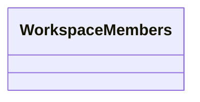

# src/logic/team/service 架构

## 设计意图

岗位、来源与责任登记的应用服务；协调知识、文件实现和 Logic 领域规则，不拥有正式运行准入。

## 主要组成

| 组成 | 定位 |
| --- | --- |
| [WorkspaceMembers](workspace-members.ts) | 将桌面岗位登记、采纳与当前差异查询接到工作区唯一 DispatchStore，公开模型配置由 Main 注入。 |

<!-- architecture:generated:start -->

## 架构关系

[上层设计](../ARCHITECTURE.md)

<!-- architecture:generated:end -->
